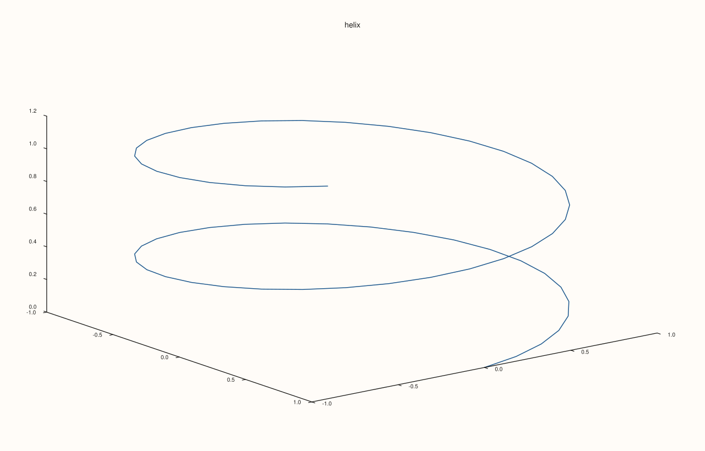
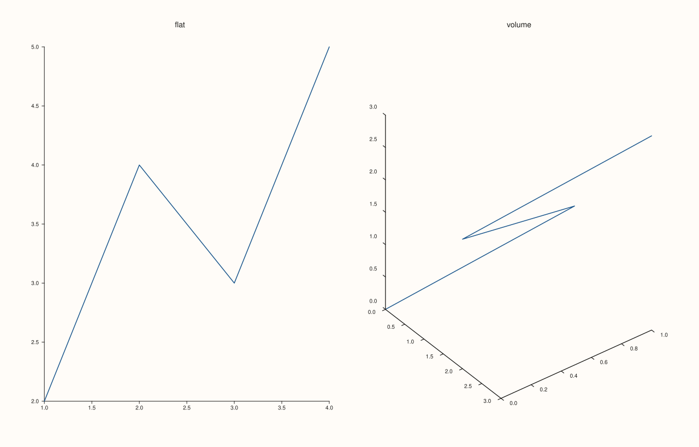
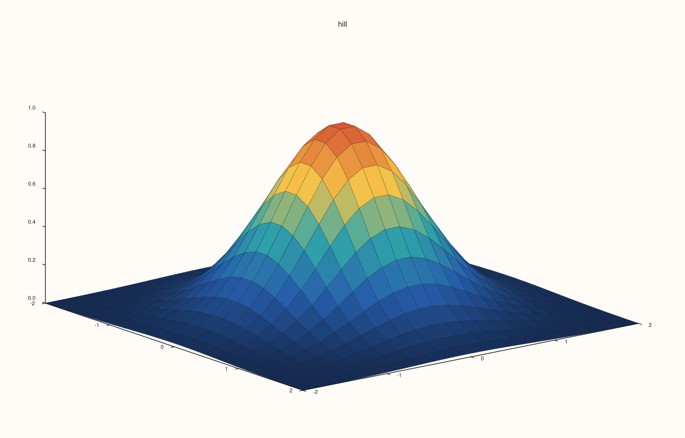
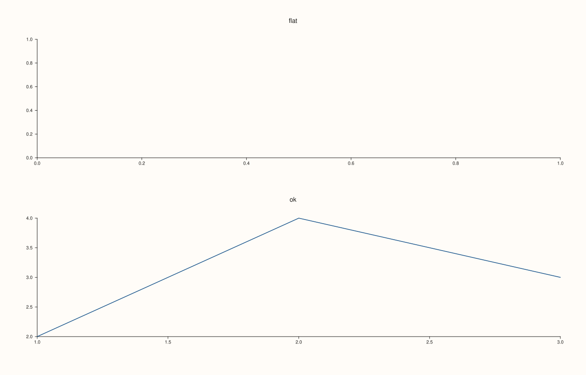

<!-- pluss-hand-authored -->

# Studio::pane3

[Back to Studio API Reference](../../studio_api_reference)

## Signature

```cpp
Pane& Studio::pane3(std::string title = {})
```

## What It Does

Adds a volumetric (3D) pane and returns it. It is [`pane2`](pane2.md) for the kinds that need a third axis: `path3`, `cloud3`, `sheet`, `lattice`, `spire3`, `ridge3` and `isoshell` are added to a pane made here, while a planar pane refuses them. Everything else is the same: the returned reference stays valid for the life of the figure, panes are placed in creation order or by a [`mosaic`](mosaic.md), the title is drawn above the pane, and the figure's theme, font scales and style defaults are copied in at creation.

A volumetric pane has x, y and z axes and a camera that is set through its [`Lens`](../types/Lens.md) (projection, viewing angles, perspective), and it takes a [`LightRig`](../types/LightRig.md) for lit surfaces. Planar and volumetric panes can share a figure.

## Parameters

**title** (`std::string`, default empty)
    The pane's title. Empty draws none.

## Returns

`Pane&`
    The new pane, valid for the life of the figure.

## Examples

Example 1. A 3D pane with a path. The pane reports itself as volumetric, and the path is drawn in the default view.

```cpp
auto fig = studio("pane3_path");
auto& pane = fig.pane3("helix");
std::vector<double> x, y, z;
for (int i = 0; i < 60; ++i) {
  const double t = i * 0.2;
  x.push_back(std::cos(t));
  y.push_back(std::sin(t));
  z.push_back(0.1 * t);
}
pane.path3(x, y, z);
std::cout << "volumetric: " << (pane.kind() == PaneKind::Volumetric) << ", traces: " << pane.traces().size() << "\n";
fig.save_svg("figure.svg");
```

### Output

```text
volumetric: 1, traces: 1
```



Example 2. Mixed with 2D. A figure can hold both kinds side by side; each pane reports its own kind.

```cpp
auto fig = studio("pane3_mixed");
fig.mosaic(1, 2);
fig.pane2("flat").trend(std::vector<double>{1, 2, 3, 4}, std::vector<double>{2, 4, 3, 5});
fig.pane3("volume").path3(std::vector<double>{0, 1, 2, 3}, std::vector<double>{0, 1, 0, 1}, std::vector<double>{0, 1, 2, 3});
for (const Pane& pane : fig.panes()) std::cout << pane.title_text() << ": " << (pane.kind() == PaneKind::Volumetric ? "volumetric" : "planar") << "\n";
fig.save_svg("figure.svg");
```

### Output

```text
flat: planar
volume: volumetric
```



Example 3. A surface. A sheet over a grid, in a volumetric pane with a title.

```cpp
constexpr std::int64_t n = 24;
auto axis = pluss::series::linspace(-2.0, 2.0, n, pluss::ScalarType::Float64);
std::vector<double> heights(static_cast<std::size_t>(n * n));
for (std::int64_t i = 0; i < n; ++i) {
  for (std::int64_t j = 0; j < n; ++j) {
    const double x = -2.0 + 4.0 * i / (n - 1), y = -2.0 + 4.0 * j / (n - 1);
    heights[static_cast<std::size_t>(i * n + j)] = std::exp(-(x * x + y * y));
  }
}
auto z = pluss::make_series(heights, {n, n});
auto fig = studio("pane3_surface");
fig.pane3("hill").sheet(axis, axis, z);
fig.save_svg("figure.svg");
```



Example 4. A 3D trace needs a 3D pane. Adding `path3` to a planar pane throws `pluss::Error`, and the pane is left without it.

```cpp
auto fig = studio("pane3_refused");
auto& flat = fig.pane2("flat");
try {
  flat.path3(std::vector<double>{0, 1}, std::vector<double>{0, 1}, std::vector<double>{0, 1});
} catch (const pluss::Error& e) {
  std::cout << e.message() << "\n";
}
std::cout << "traces on the flat pane: " << flat.traces().size() << "\n";
fig.pane2("ok").trend(std::vector<double>{1, 2, 3}, std::vector<double>{2, 4, 3});
fig.save_svg("figure.svg");
```

### Output

```text
path3 requires a volumetric pane
traces on the flat pane: 0
```



## Notes

- Not `noexcept`. A planar pane cannot be turned into a volumetric one; make the pane with the kind the traces need.
- The camera and lights are settings of the pane, reached through the returned reference.

## See Also

- [`Studio::pane2`](pane2.md): the 2D counterpart, with the shared rules.
- [`Studio::subpane3`](subpane3.md): a 3D pane inside another pane's grid.
- [`Lens`](../types/Lens.md), [`LightRig`](../types/LightRig.md): camera and lights.

<div class="pluss-inline-prev-next">
  <a class="prev-link" href="pane2.html">
    <span class="label">Previous</span>
    <span class="title">pane2</span>
  </a>
  <a class="next-link" href="pane_count.html">
    <span class="label">Next</span>
    <span class="title">pane_count</span>
  </a>
</div>
