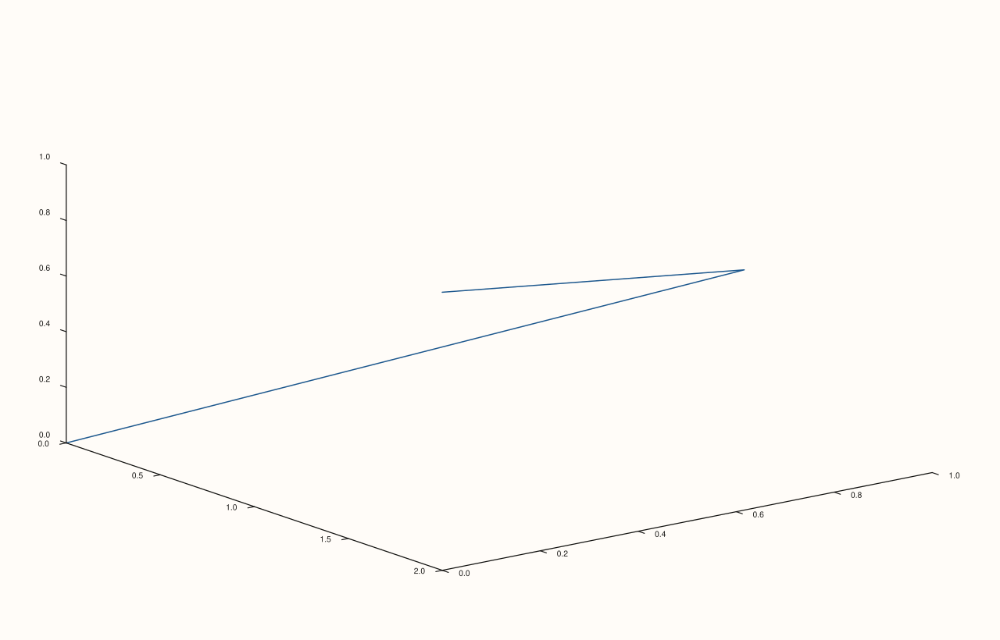
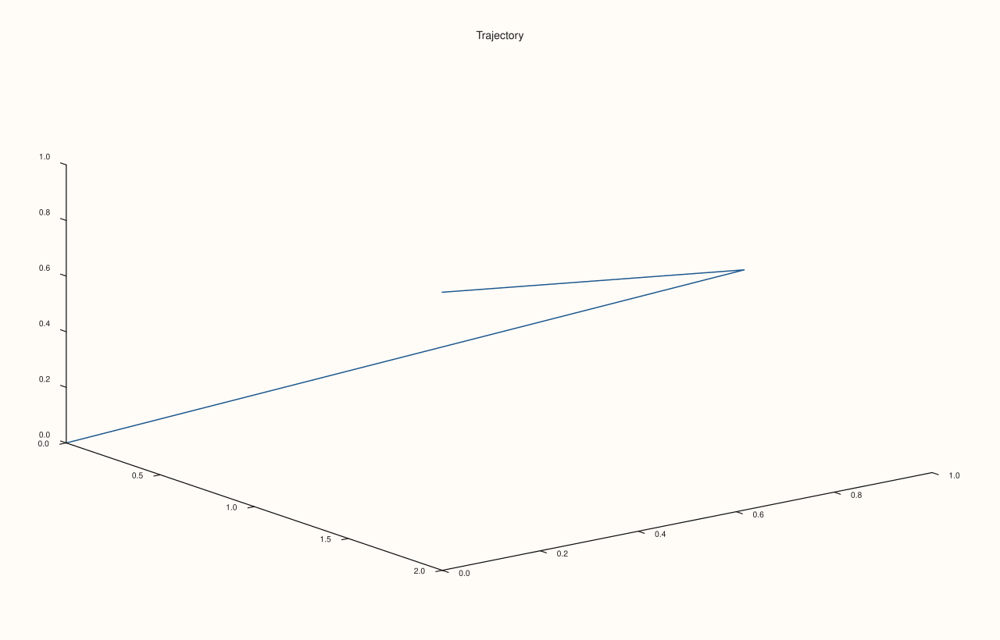
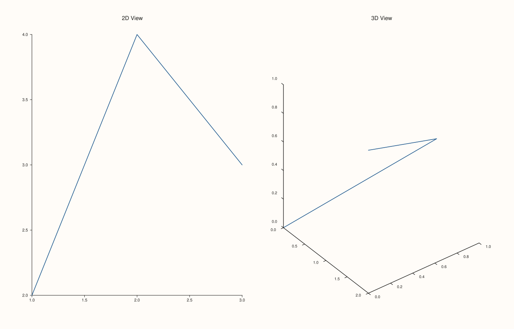

<!-- pluss-hand-authored -->

# Studio::pane3

[Back to Studio API Reference](../../studio_api_reference)

## Signature

```cpp
Pane& Studio::pane3(std::string title = {})
```

## What It Does

The 3D counterpart of [`pane2()`](pane2.md): creates a new `PaneKind::Volumetric` pane,
appends it to the figure, and returns a reference to it. Everything about `pane2()`'s
behavior carries over unchanged — the same `context_scales()`/`pane_style_defaults()`
creation-time snapshots, the same reference-invalidation hazard on later pane-creation
calls, the same default top-to-bottom stacking absent an explicit
[`mosaic()`](mosaic.md) — the only difference is the pane's `kind()`, which controls
which `flash::` functions accept it: 3D-only functions like `flash::path3`,
`flash::scatter3D`, `flash::plot_surface`, etc. take a `Pane&` created via `pane3()`, not
`pane2()`.

```{important} Same reference-invalidation hazard as pane2()
See [`pane2()`](pane2.md)'s important callout: the `Pane&` returned here is invalidated
by any subsequent `pane2()`/`pane3()`/`subpane2()`/`subpane3()` call. Configure and plot
into a 3D pane immediately after creating it.
```

## Parameters

**title** (`std::string`, default `{}`)
    The pane's title. An empty title (the default) draws no title text.

## Returns

`Pane&`
    A reference to the newly created 3D pane, valid until the next pane-creation call.

## Examples

Example 1. The default: no title, a `path3` trace through a simple 3-point trajectory.

```cpp
using namespace pluss::pl;

auto fig = studio("pane3_default_title");
auto& pane = fig.pane3();
flash::path3(pane, std::vector<double>{0.0, 1.0, 2.0}, std::vector<double>{0.0, 1.0, 0.0}, std::vector<double>{0.0, 0.5, 1.0});
fig.show();

std::cout << pane.title_text().empty() << "\n";
std::cout << (pane.kind() == PaneKind::Volumetric) << "\n";
```

### Output

```text
1
1
```



Example 2. An explicit title.

```cpp
using namespace pluss::pl;

auto fig = studio("pane3_with_title");
auto& pane = fig.pane3("Trajectory");
flash::path3(pane, std::vector<double>{0.0, 1.0, 2.0}, std::vector<double>{0.0, 1.0, 0.0}, std::vector<double>{0.0, 0.5, 1.0});
fig.show();

std::cout << pane.title_text() << "\n";
```

### Output

```text
Trajectory
```



Example 3. Mixing `pane2()` and `pane3()` in the same figure — a 2D pane alongside a 3D
one, arranged side by side.

```cpp
using namespace pluss::pl;

auto fig = studio("pane2_and_pane3_mixed");
auto& planar = fig.pane2("2D View");
flash::lineplot(planar, std::vector<double>{1.0, 2.0, 3.0}, std::vector<double>{2.0, 4.0, 3.0});
auto& volumetric = fig.pane3("3D View");
flash::path3(volumetric, std::vector<double>{0.0, 1.0, 2.0}, std::vector<double>{0.0, 1.0, 0.0}, std::vector<double>{0.0, 0.5, 1.0});
fig.mosaic(1, 2);
fig.show();
```



## Notes

- Not `noexcept`.
- Creates `PaneKind::Volumetric`; use [`pane2()`](pane2.md) for a 2D (`Planar`) pane.
- Same creation-time snapshot rules and reference-invalidation hazard as `pane2()` — see
  that page's Notes and important callout for the full explanation.
- A figure can freely mix `pane2()` and `pane3()` panes — see Example 3.

## See Also

- [`Studio::pane2`](pane2.md): the 2D counterpart, and where the shared behavioral details
  (creation-time snapshots, reference invalidation) are documented in full.
- [`Studio::subpane3`](subpane3.md): creates a 3D pane occupying a sub-cell within another
  pane's own local grid.
- [`Studio::pane_index`](pane_index.md): a durable identifier for a pane after creating
  others.

<div class="pluss-inline-prev-next">
  <a class="prev-link" href="pane2.html">
    <span class="label">Previous</span>
    <span class="title">pane2</span>
  </a>
  <a class="next-link" href="pane_index.html">
    <span class="label">Next</span>
    <span class="title">pane_index</span>
  </a>
</div>
