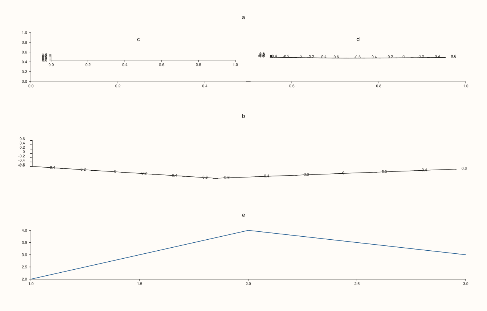
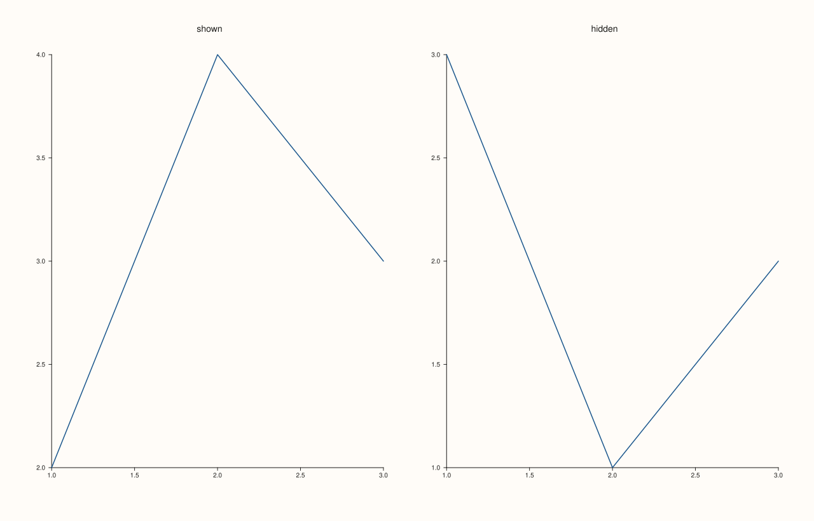
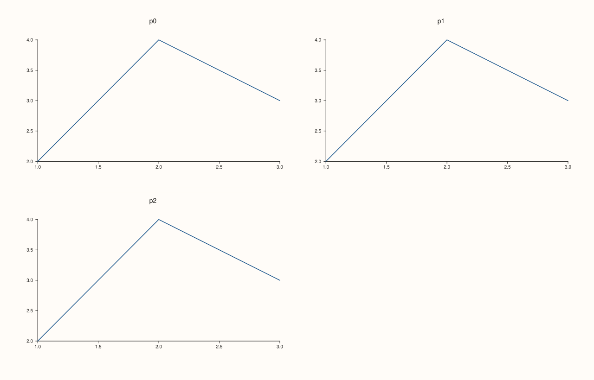

<!-- pluss-hand-authored -->

# Studio::pane_count

[Back to Studio API Reference](../../studio_api_reference)

## Signature

```cpp
std::size_t Studio::pane_count() const noexcept
```

## What It Does

Returns how many panes the figure holds: the number of calls to [`pane2`](pane2.md), [`pane3`](pane3.md), [`subpane2`](subpane2.md) and [`subpane3`](subpane3.md) so far. Hidden panes ([`Pane::hide`](../pane/visible.md)) are still counted, because hiding changes what is drawn and not what the figure holds; panes are never removed, so the count never goes down. It equals `panes().size()` and is the exclusive upper bound of the indices [`pane_index`](pane_index.md) returns.

A new figure has no panes and renders as an empty canvas. A figure with a [`mosaic`](mosaic.md) can hold fewer panes than the grid has cells, and a figure with more panes than cells is refused when it is rendered, because the grid may still be given after the panes.

## Parameters

*(none)*

## Returns

`std::size_t`
    The number of panes.

## Examples

Example 1. Counting as panes are added. A new figure has none, each creation call adds one, and 2D, 3D and sub-panes are all counted.

```cpp
auto fig = studio("pane_count_counting");
std::cout << "new figure: " << fig.pane_count() << "\n";
fig.pane2("a");
std::cout << "after pane2: " << fig.pane_count() << "\n";
fig.pane3("b");
std::cout << "after pane3: " << fig.pane_count() << "\n";
fig.subpane2(0, 1, 2, 0, 0, 1, 1, "c");
fig.subpane3(0, 1, 2, 0, 1, 1, 1, "d");
std::cout << "after two sub-panes: " << fig.pane_count() << "\n";
fig.pane2("e").trend(std::vector<double>{1, 2, 3}, std::vector<double>{2, 4, 3});
fig.save_svg("figure.svg");
```

### Output

```text
new figure: 0
after pane2: 1
after pane3: 2
after two sub-panes: 4
```



Example 2. Hidden panes still count. Hiding changes what is drawn, not what the figure holds, so the count is unchanged and the pane can be shown again.

```cpp
auto fig = studio("pane_count_hidden");
fig.mosaic(1, 2);
fig.pane2("shown").trend(std::vector<double>{1, 2, 3}, std::vector<double>{2, 4, 3});
auto& second = fig.pane2("hidden");
second.trend(std::vector<double>{1, 2, 3}, std::vector<double>{3, 1, 2});
second.hide();
std::cout << "panes: " << fig.pane_count() << ", visible: " << (fig.panes()[0].visible() ? 1 : 0) + (fig.panes()[1].visible() ? 1 : 0) << "\n";
second.visible(true);
std::cout << "after showing it again: " << (fig.panes()[1].visible() ? 1 : 0) + 1 << " visible of " << fig.pane_count() << "\n";
fig.save_svg("figure.svg");
```

### Output

```text
panes: 2, visible: 1
after showing it again: 2 visible of 2
```



Example 3. Equal to the pane list. `pane_count()` is `panes().size()`, and the valid indices are `0` to `pane_count() - 1`.

```cpp
auto fig = studio("pane_count_panes");
fig.mosaic(2, 2);
for (int i = 0; i < 3; ++i) fig.pane2("p" + std::to_string(i)).trend(std::vector<double>{1, 2, 3}, std::vector<double>{2, 4, 3});
std::cout << "count == size: " << (fig.pane_count() == fig.panes().size()) << "\n";
for (std::size_t i = 0; i < fig.pane_count(); ++i) std::cout << i << ": " << fig.panes()[i].title_text() << "\n";
fig.save_svg("figure.svg");
```

### Output

```text
count == size: 1
0: p0
1: p1
2: p2
```



Example 4. More panes than cells is refused at render time. A 1 by 2 mosaic holds two panes; a third pane is created without complaint (the grid could still change), and rendering the figure throws a message that names the problem.

```cpp
auto fig = studio("pane_count_full");
fig.mosaic(1, 2);
fig.pane2("a").trend(std::vector<double>{1, 2, 3}, std::vector<double>{2, 4, 3});
fig.pane2("b").trend(std::vector<double>{1, 2, 3}, std::vector<double>{3, 1, 2});
fig.pane2("c").trend(std::vector<double>{1, 2, 3}, std::vector<double>{1, 1, 2});
std::cout << "panes created: " << fig.pane_count() << "\n";
try {
  fig.to_svg();
} catch (const pluss::Error& e) {
  std::cout << e.message() << "\n";
}
auto fits = studio("pane_count_fits");
fits.mosaic(2, 2);
for (int i = 0; i < 3; ++i) fits.pane2("p" + std::to_string(i)).trend(std::vector<double>{1, 2, 3}, std::vector<double>{2, 4, 3});
fits.save_svg("figure.svg");
```

### Output

```text
panes created: 3
mosaic has no free cells left for pane placement
```


## Notes

- `noexcept`, and has no effect on the figure.
- A figure with no panes is valid: [`to_svg`](to_svg.md), [`save_pdf`](save_pdf.md) and [`show`](show.md) draw an empty canvas.

## See Also

- [`Studio::panes`](panes.md): the panes themselves.
- [`Studio::pane2`](pane2.md), [`pane3`](pane3.md): add panes.
- [`Studio::pane_index`](pane_index.md): the position of a pane.

<div class="pluss-inline-prev-next">
  <a class="prev-link" href="pane3.html">
    <span class="label">Previous</span>
    <span class="title">pane3</span>
  </a>
  <a class="next-link" href="pane_index.html">
    <span class="label">Next</span>
    <span class="title">pane_index</span>
  </a>
</div>
