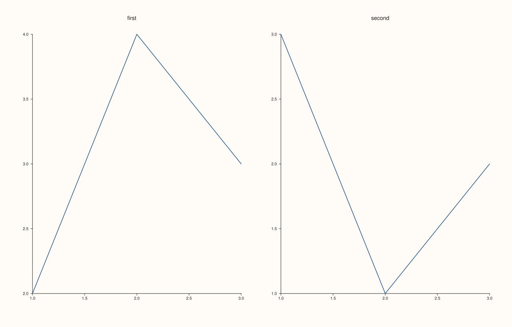
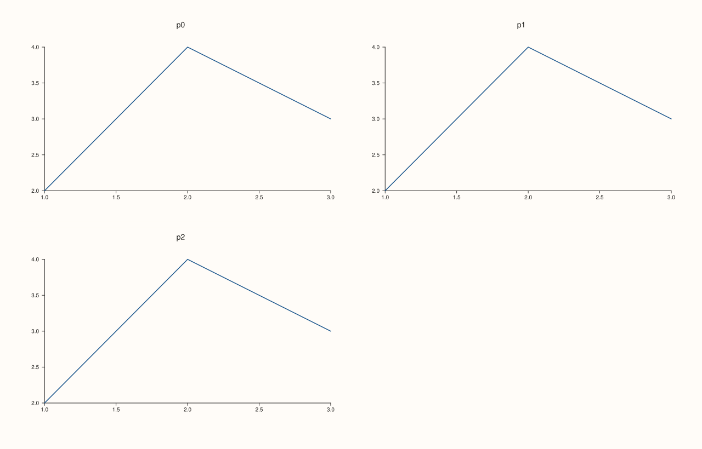
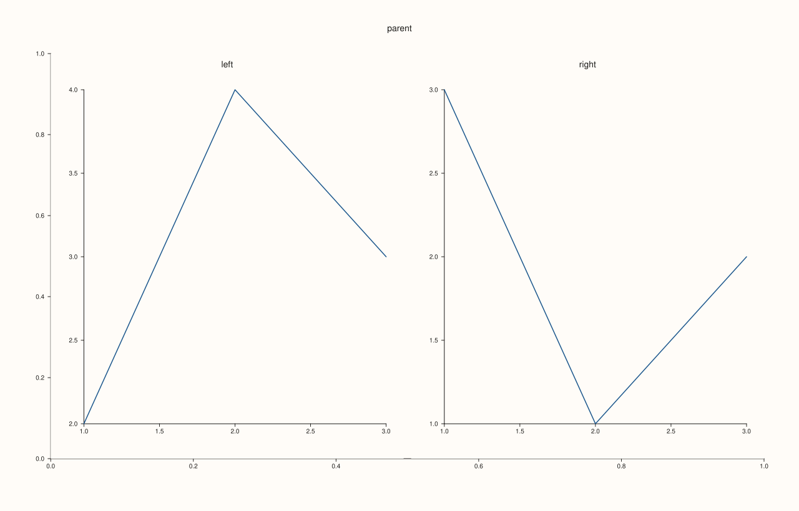
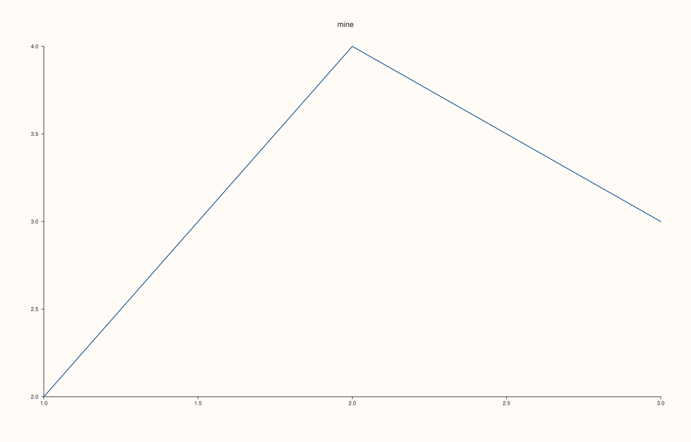

<!-- pluss-hand-authored -->

# Studio::pane_index

[Back to Studio API Reference](../../studio_api_reference)

## Signature

```cpp
std::size_t Studio::pane_index(const Pane& pane) const
```

## What It Does

Returns the position of a pane in the figure: 0 for the first pane created, 1 for the next, and so on, the same index [`panes`](panes.md) uses. It is how a pane's index is obtained to pass to [`subpane2`](subpane2.md) or [`subpane3`](subpane3.md) as the parent. The lookup is by identity, comparing the address of `pane` with the figure's panes; panes never move, so a reference taken at any time can be passed later, after any number of other panes have been created.

A pane that does not belong to this figure (a standalone `Pane`, or a pane of another figure) is refused with `pluss::Error`; so is a copy of a pane, since a copy is a different object. The call has no effect on the figure.

## Parameters

**pane** (`const Pane&`)
    A pane of this figure, as returned by a creation call or taken from [`panes`](panes.md).

## Returns

`std::size_t`
    The position of the pane, from 0.

## Examples

Example 1. Looking up positions. Two panes are created and then looked up together; the references taken at creation are still the panes.

```cpp
auto fig = studio("pane_index_indices");
fig.mosaic(1, 2);
auto& first = fig.pane2("first");
first.trend(std::vector<double>{1, 2, 3}, std::vector<double>{2, 4, 3});
auto& second = fig.pane2("second");
second.trend(std::vector<double>{1, 2, 3}, std::vector<double>{3, 1, 2});
std::cout << "first: " << fig.pane_index(first) << ", second: " << fig.pane_index(second) << "\n";
fig.save_svg("figure.svg");
```

### Output

```text
first: 0, second: 1
```



Example 2. From the pane list. A pane taken from `panes()` gives its own position back, so the index and the sequence agree for every pane.

```cpp
auto fig = studio("pane_index_list");
fig.mosaic(2, 2);
for (int i = 0; i < 3; ++i) fig.pane2("p" + std::to_string(i)).trend(std::vector<double>{1, 2, 3}, std::vector<double>{2, 4, 3});
bool consistent = true;
for (std::size_t i = 0; i < fig.panes().size(); ++i) consistent = consistent && fig.pane_index(fig.panes()[i]) == i;
std::cout << "pane_index(panes()[i]) == i for all: " << consistent << "\n";
fig.save_svg("figure.svg");
```

### Output

```text
pane_index(panes()[i]) == i for all: 1
```



Example 3. The parent of a sub-pane. The index of the parent is what `subpane2` takes; the sub-panes follow it in the list.

```cpp
auto fig = studio("pane_index_parent");
auto& parent = fig.pane2("parent");
const std::size_t parent_index = fig.pane_index(parent);
auto& left = fig.subpane2(parent_index, 1, 2, 0, 0, 1, 1, "left");
left.trend(std::vector<double>{1, 2, 3}, std::vector<double>{2, 4, 3});
auto& right = fig.subpane2(parent_index, 1, 2, 0, 1, 1, 1, "right");
right.trend(std::vector<double>{1, 2, 3}, std::vector<double>{3, 1, 2});
std::cout << "parent " << parent_index << ", left " << fig.pane_index(left) << ", right " << fig.pane_index(right) << "\n";
fig.save_svg("figure.svg");
```

### Output

```text
parent 0, left 1, right 2
```



Example 4. Panes that are not in this figure. A standalone pane, a pane of another figure and a copy of a pane are each refused with `pluss::Error`.

```cpp
auto fig = studio("pane_index_not_ours");
auto& mine = fig.pane2("mine");
mine.trend(std::vector<double>{1, 2, 3}, std::vector<double>{2, 4, 3});
Pane standalone(PaneKind::Planar, Theme::paper(), "standalone");
auto other = studio("other");
auto& theirs = other.pane2("theirs");
const Pane copy = mine;
auto attempt = [&](const char* label, const Pane& pane) {
  try {
    const std::size_t index = fig.pane_index(pane);
    std::cout << label << ": " << index << "\n";
  } catch (const pluss::Error& e) {
    std::cout << label << ": " << e.message() << "\n";
  }
};
attempt("own pane", mine);
attempt("standalone pane", standalone);
attempt("pane of another figure", theirs);
attempt("copy of a pane", copy);
fig.save_svg("figure.svg");
```

### Output

```text
own pane: 0
standalone pane: pane_index: pane does not belong to this studio
pane of another figure: pane_index: pane does not belong to this studio
copy of a pane: pane_index: pane does not belong to this studio
```



## Notes

- Not `noexcept`. It scans the panes, so it takes time proportional to the number of panes; keep the index when it is needed often.
- Indices are never reused: panes cannot be removed, so an index stays valid for the life of the figure.

## See Also

- [`Studio::panes`](panes.md): the panes by index.
- [`Studio::subpane2`](subpane2.md), [`subpane3`](subpane3.md): take a parent index.
- [`Studio::pane_count`](pane_count.md): how many panes there are.

<div class="pluss-inline-prev-next">
  <a class="prev-link" href="pane_count.html">
    <span class="label">Previous</span>
    <span class="title">pane_count</span>
  </a>
  <a class="next-link" href="pane_style_defaults.html">
    <span class="label">Next</span>
    <span class="title">pane_style_defaults</span>
  </a>
</div>
