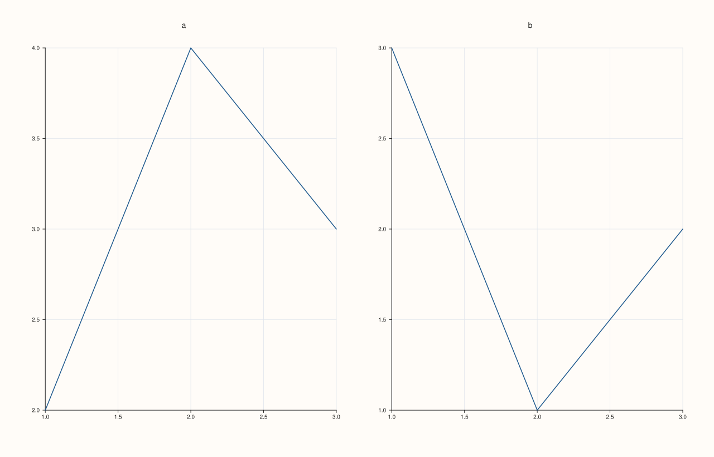
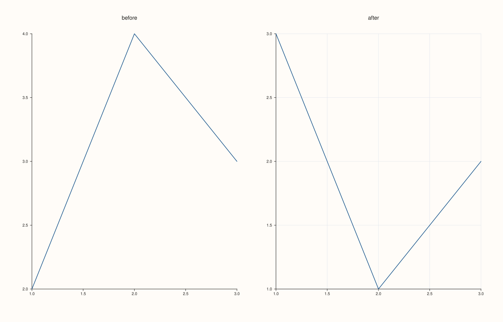
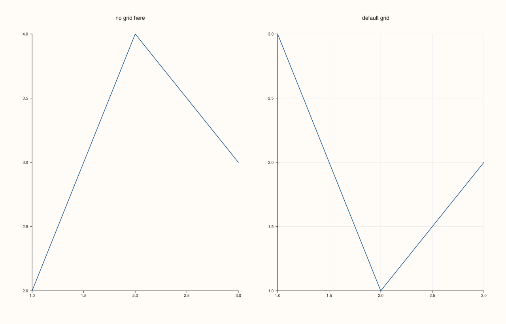
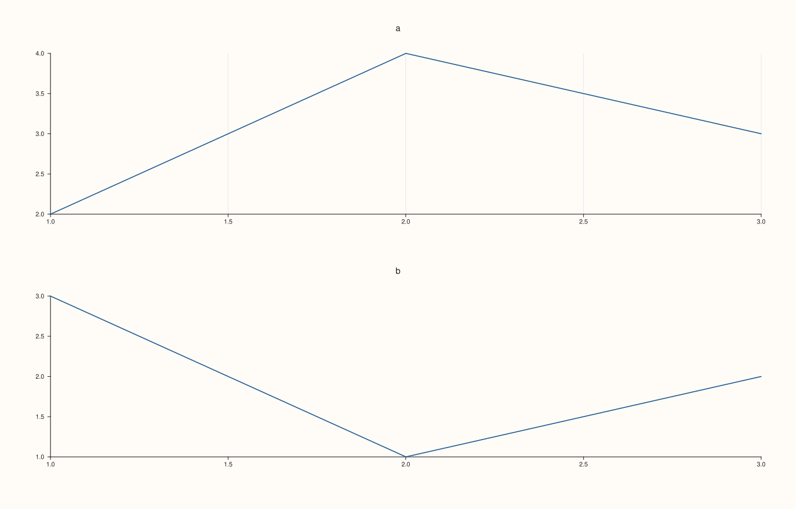
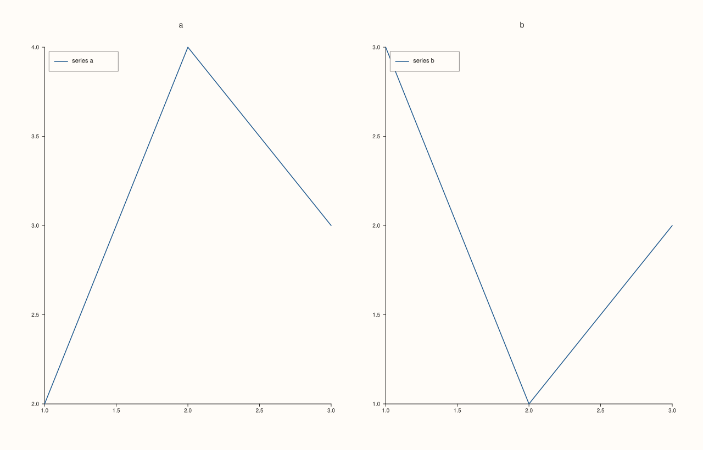

<!-- pluss-hand-authored -->

# Studio::pane_style_defaults

[Back to Studio API Reference](../../studio_api_reference)

## Signature

```cpp
Studio& Studio::pane_style_defaults(const Pane& pane)
```

## What It Does

Makes the style of an example pane the starting style of every pane created from now on. The figure reads these settings from `pane` and stores them: the pane's theme, whether its axes are visible, its grid style and the major and minor grid switches of each axis, and its legend place, frame and shape. Panes created afterwards with [`pane2`](pane2.md), [`pane3`](pane3.md), [`subpane2`](subpane2.md) or [`subpane3`](subpane3.md) start with those settings, and the settings can still be changed pane by pane. It is the way to give a whole figure one consistent look without repeating the same calls on every pane.

Only panes created after the call are affected; panes that already exist keep what they have. The stored settings are a snapshot of `pane` at the time of the call, so changing the example pane afterwards does nothing, and the example pane does not have to belong to the figure (a standalone `Pane` is fine). A second call replaces the stored settings, [`clear_pane_style_defaults`](clear_pane_style_defaults.md) switches the defaults off, and the figure's [`context_scales`](context_scales.md) is separate and keeps working.

## Parameters

**pane** (`const Pane&`)
    The pane whose style becomes the default for new panes. Not stored; only its style is copied.

## Returns

`Studio&`
    The same figure, for chaining.

## Examples

Example 1. One look for every pane. The example pane has major grid lines on both axes; the two panes created afterwards both have them, and neither was configured.

```cpp
Pane look(PaneKind::Planar, Theme::paper(), "look");
look.x_major_grid(true).y_major_grid(true);
auto fig = studio("defaults_grid");
fig.pane_style_defaults(look);
fig.mosaic(1, 2);
fig.pane2("a").trend(std::vector<double>{1, 2, 3}, std::vector<double>{2, 4, 3});
fig.pane2("b").trend(std::vector<double>{1, 2, 3}, std::vector<double>{3, 1, 2});
std::cout << "x grid on both: " << (fig.panes()[0].x_axis().major_grid && fig.panes()[1].x_axis().major_grid) << "\n";
fig.save_svg("figure.svg");
```

### Output

```text
x grid on both: 1
```



Example 2. Only panes created afterwards. A pane that exists when the defaults are set keeps its own style, and the next one takes the defaults.

```cpp
Pane look(PaneKind::Planar, Theme::paper(), "look");
look.x_major_grid(true).y_major_grid(true);
auto fig = studio("defaults_after");
fig.mosaic(1, 2);
fig.pane2("before").trend(std::vector<double>{1, 2, 3}, std::vector<double>{2, 4, 3});
fig.pane_style_defaults(look);
fig.pane2("after").trend(std::vector<double>{1, 2, 3}, std::vector<double>{3, 1, 2});
std::cout << "before has the grid: " << fig.panes()[0].x_axis().major_grid << ", after has it: " << fig.panes()[1].x_axis().major_grid << "\n";
fig.save_svg("figure.svg");
```

### Output

```text
before has the grid: 0, after has it: 1
```



Example 3. Still adjustable. A pane created with the defaults can change any of them, and the other panes are unaffected.

```cpp
Pane look(PaneKind::Planar, Theme::paper(), "look");
look.x_major_grid(true).y_major_grid(true);
auto fig = studio("defaults_override");
fig.pane_style_defaults(look);
fig.mosaic(1, 2);
auto& plain = fig.pane2("no grid here");
plain.trend(std::vector<double>{1, 2, 3}, std::vector<double>{2, 4, 3});
plain.x_major_grid(false).y_major_grid(false);
fig.pane2("default grid").trend(std::vector<double>{1, 2, 3}, std::vector<double>{3, 1, 2});
std::cout << "first: " << plain.x_axis().major_grid << ", second: " << fig.panes()[1].x_axis().major_grid << "\n";
fig.save_svg("figure.svg");
```

### Output

```text
first: 0, second: 1
```



Example 4. A snapshot of the example pane. Changing the example afterwards does not change the defaults, and a second call replaces them.

```cpp
Pane look(PaneKind::Planar, Theme::paper(), "look");
look.x_major_grid(true);
auto fig = studio("defaults_snapshot");
fig.pane_style_defaults(look);
look.x_major_grid(false);
fig.pane2("a").trend(std::vector<double>{1, 2, 3}, std::vector<double>{2, 4, 3});
std::cout << "example changed afterwards, new pane still has the grid: " << fig.panes()[0].x_axis().major_grid << "\n";
Pane other(PaneKind::Planar, Theme::paper(), "other");
fig.pane_style_defaults(other);
fig.pane2("b").trend(std::vector<double>{1, 2, 3}, std::vector<double>{3, 1, 2});
std::cout << "after a second call, new pane has no grid: " << !fig.panes()[1].x_axis().major_grid << "\n";
fig.save_svg("figure.svg");
```

### Output

```text
example changed afterwards, new pane still has the grid: 1
after a second call, new pane has no grid: 1
```



Example 5. Legend settings come along. The example pane's legend place and frame are the defaults, so every new pane shows its legend in that corner.

```cpp
Pane look(PaneKind::Planar, Theme::paper(), "look");
look.legend(KeyPlace::NorthWest).legend_frame(KeyFrame::Framed);
auto fig = studio("defaults_legend");
fig.pane_style_defaults(look);
fig.mosaic(1, 2);
fig.pane2("a").trend(std::vector<double>{1, 2, 3}, std::vector<double>{2, 4, 3}).label("series a");
fig.pane2("b").trend(std::vector<double>{1, 2, 3}, std::vector<double>{3, 1, 2}).label("series b");
std::cout << "legend at NorthWest on both: " << (fig.panes()[0].legend_place() == KeyPlace::NorthWest && fig.panes()[1].legend_place() == KeyPlace::NorthWest) << "\n";
fig.save_svg("figure.svg");
```

### Output

```text
legend at NorthWest on both: 1
```



## Notes

- Not `noexcept`. The defaults copy the style fields listed above; the traces, title, limits and labels of the example pane are not copied.
- The figure's headline, legend dock and captions are figure settings and are not part of a pane's defaults.

## See Also

- [`Studio::clear_pane_style_defaults`](clear_pane_style_defaults.md): switches the defaults off.
- [`Studio::context_scales`](context_scales.md): default font scales for new panes.
- [`Studio::theme`](theme.md): the theme new panes copy when no defaults are set.

<div class="pluss-inline-prev-next">
  <a class="prev-link" href="pane_index.html">
    <span class="label">Previous</span>
    <span class="title">pane_index</span>
  </a>
  <a class="next-link" href="panes.html">
    <span class="label">Next</span>
    <span class="title">panes</span>
  </a>
</div>
