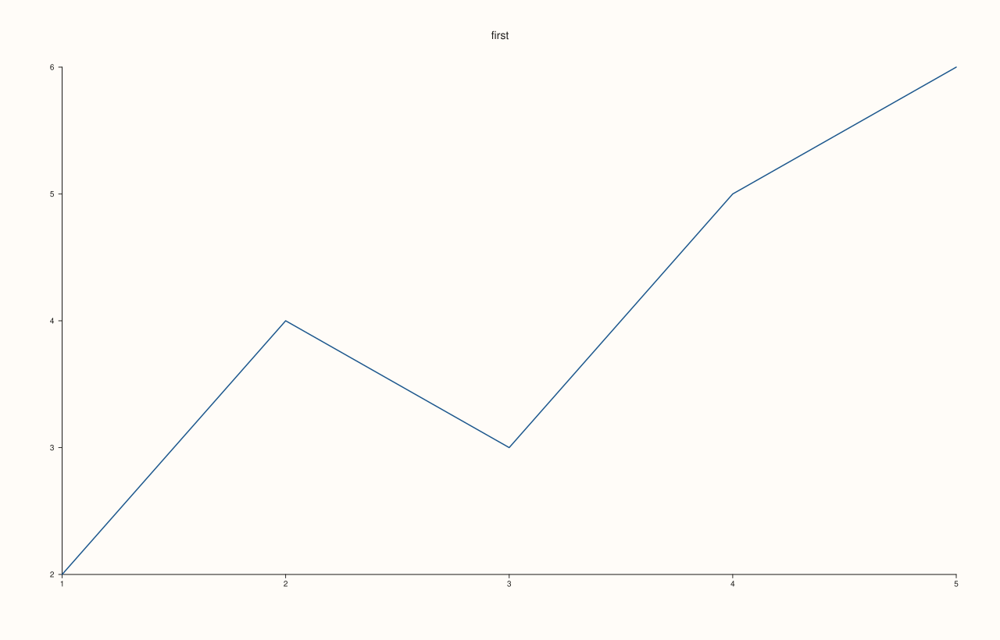
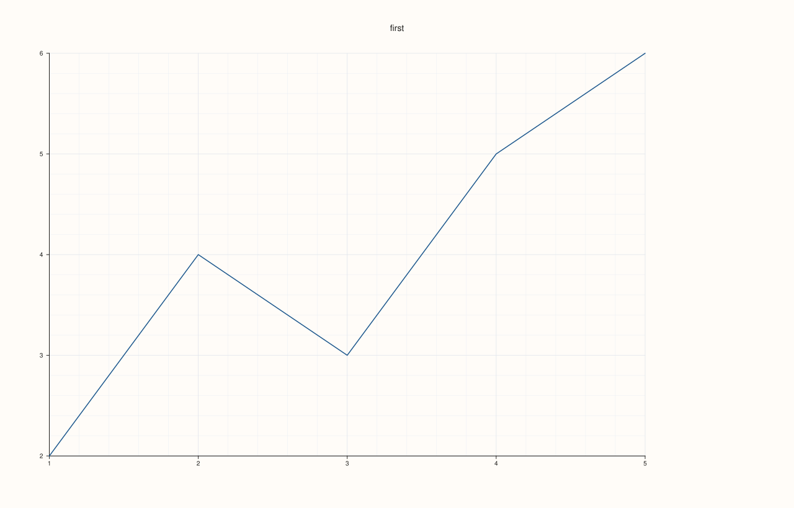
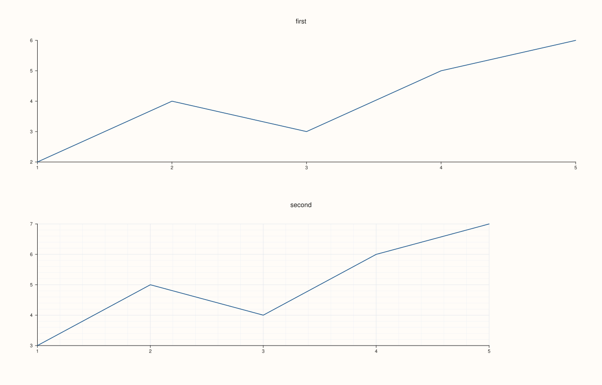

<!-- pluss-hand-authored -->

# Studio::pane_style_defaults

[Back to Studio API Reference](../../studio_api_reference)

## Signature

```cpp
Studio& Studio::pane_style_defaults(const Pane& pane)
```

## What It Does

Captures a snapshot of several style fields from an arbitrary `Pane` — its theme, grid
style, legend placement/frame/shape, per-axis major/minor grid flags, and axes-visible
flag — and stores them as the defaults every subsequently-created pane starts with. The
source `Pane` doesn't need to belong to this (or any) `Studio`: build a throwaway "template"
`Pane` purely to carry the desired settings, and pass it here.

```{important} Snapshot semantics: copies values now, doesn't keep a live link
`pane_style_defaults()` reads the passed-in `pane`'s current field values immediately and
copies them into the `Studio`'s own defaults — it does not retain a reference to `pane`
itself. Mutating the template `Pane` afterward has no further effect; call
`pane_style_defaults()` again with the updated template if the defaults need to change.
```

```{important} Only affects panes created afterward — the same rule as theme()
Exactly like [`theme()`](theme.md) and [`context_scales()`](context_scales.md), the
captured defaults are only applied to panes created via
[`pane2()`](pane2.md)/[`pane3()`](pane3.md) **after** this call. Panes that already exist
keep whatever style they already had. See Example 3.
```

The fields copied are:

- `theme_tokens()` — the pane's `Theme`
- `axes_visible()`
- `grid_style()` — `GridStyle::None` / `Major` / `MajorMinor`
- `legend_place()`, `legend_frame()`, `legend_shape()`
- `x_axis().major_grid`, `y_axis().major_grid`, `z_axis().major_grid`
- `x_axis().minor_grid`, `y_axis().minor_grid`, `z_axis().minor_grid`

Everything else about a `Pane` (traces, camera/lighting, axis limits, ticks, cues,
placement, ...) is untouched by this mechanism.

## Parameters

**pane** (`const Pane&`)
    The template pane to copy defaults from. Constructing one purely for this purpose is
    the common pattern: `Pane(PaneKind::Planar, Theme::paper())` (or any theme/kind),
    configured with the desired grid/legend/axes-visible settings, and never added to any
    figure's own pane list.

## Returns

`Studio&`
    A reference to the same figure, for chaining.

## Examples

Example 1. A plain figure, with no style defaults set — the default `GridStyle::None`.

```cpp
using namespace pluss::pl;

auto fig = studio("style_defaults_before");
auto& pane = fig.pane2("first");
pane.trend(std::vector<double>{1.0, 2.0, 3.0, 4.0, 5.0}, std::vector<double>{2.0, 4.0, 3.0, 5.0, 6.0});
fig.show();
```



Example 2. A template `Pane` configured with `GridStyle::MajorMinor` and an
outside-east legend, applied via `pane_style_defaults()` before adding the real pane.

```cpp
using namespace pluss::pl;

Pane style_template(PaneKind::Planar, Theme::paper());
style_template.grid(GridStyle::MajorMinor).legend(KeyPlace::OutsideEast);

auto fig = studio("style_defaults_after");
fig.pane_style_defaults(style_template);

auto& pane = fig.pane2("first");
pane.trend(std::vector<double>{1.0, 2.0, 3.0, 4.0, 5.0}, std::vector<double>{2.0, 4.0, 3.0, 5.0, 6.0});
fig.show();

std::cout << static_cast<int>(pane.grid_style()) << "\n";  // GridStyle::MajorMinor == 2
```

### Output

```text
2
```



Example 3. A pane created **before** `pane_style_defaults()` keeps its old style; only
panes created **after** the call pick up the new defaults.

```cpp
using namespace pluss::pl;

Pane style_template(PaneKind::Planar, Theme::paper());
style_template.grid(GridStyle::MajorMinor).legend(KeyPlace::OutsideEast);

auto fig = studio("style_defaults_too_late");
auto& first = fig.pane2("first");
first.trend(std::vector<double>{1.0, 2.0, 3.0, 4.0, 5.0}, std::vector<double>{2.0, 4.0, 3.0, 5.0, 6.0});

fig.pane_style_defaults(style_template);

auto& second = fig.pane2("second");
second.trend(std::vector<double>{1.0, 2.0, 3.0, 4.0, 5.0}, std::vector<double>{3.0, 5.0, 4.0, 6.0, 7.0});
fig.show();

std::cout << static_cast<int>(first.grid_style()) << " " << static_cast<int>(second.grid_style()) << "\n";
```

`first`'s grid style is still `None` (`0`); only `second`, created after
`pane_style_defaults()`, inherits `MajorMinor` (`2`).

### Output

```text
0 2
```



## Notes

- Copies field *values* immediately, not a live reference to the source `Pane` — see the
  important callout above.
- Only affects panes created after the call — see Example 3.
- The source `Pane` need not belong to any `Studio`; a throwaway template built solely to
  carry settings is the idiomatic usage.
- Only the specific field list above is copied — see "What It Does" for the exact set.

## See Also

- [`Studio::clear_pane_style_defaults`](clear_pane_style_defaults.md): turns this back off.
- [`Studio::theme`](theme.md) / [`context_scales`](context_scales.md): the other two
  figure-wide, creation-time-only pane defaults.
- [`Studio::pane2`](pane2.md) / [`pane3`](pane3.md): where these defaults get applied.

<div class="pluss-inline-prev-next">
  <a class="prev-link" href="tight_layout_padding.html">
    <span class="label">Previous</span>
    <span class="title">tight_layout_padding</span>
  </a>
  <a class="next-link" href="clear_pane_style_defaults.html">
    <span class="label">Next</span>
    <span class="title">clear_pane_style_defaults</span>
  </a>
</div>
