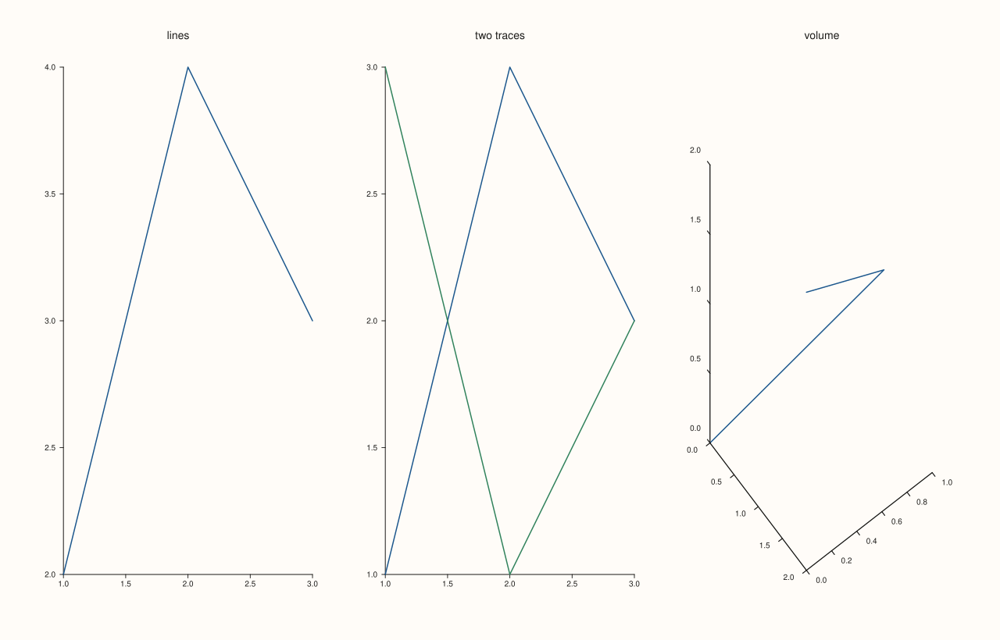
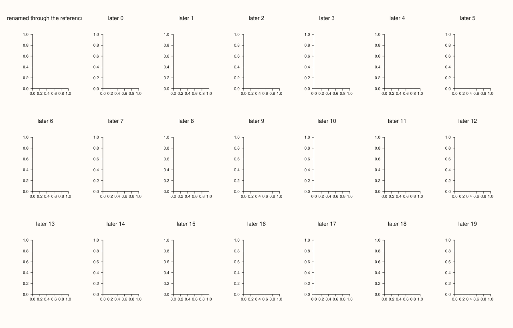
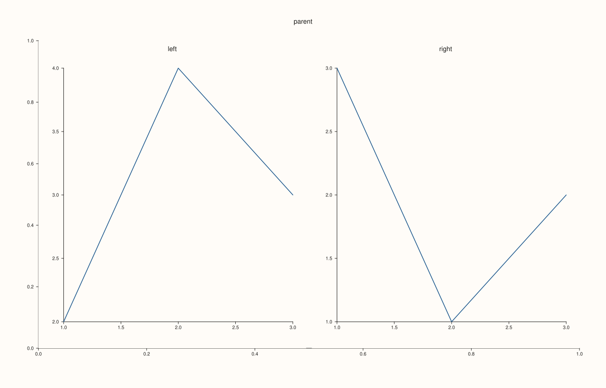
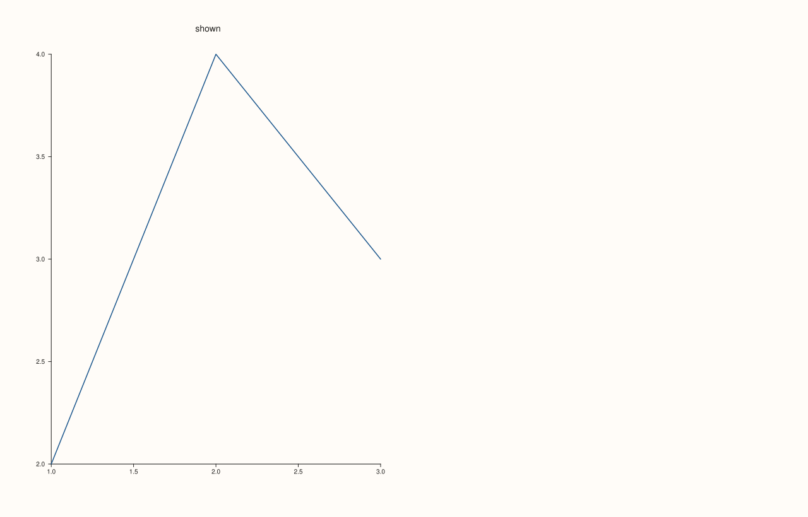

<!-- pluss-hand-authored -->

# Studio::panes

[Back to Studio API Reference](../../studio_api_reference)

## Signature

```cpp
const std::deque<Pane>& Studio::panes() const noexcept
```

## What It Does

Returns the figure's panes in creation order, as a read-only sequence. It supports indexing, `size()` and range-for, and every element is the `Pane` that [`pane2`](pane2.md), [`pane3`](pane3.md), [`subpane2`](subpane2.md) or [`subpane3`](subpane3.md) returned, so reading a setting back (`title_text()`, `legend_place()`, `traces()`) is how a figure is inspected after it is built. Panes are stored so that adding more never moves the ones already there: a reference to a pane, and the references into it, stay valid for the life of the figure, and an element of `panes()` is at the same address as the `Pane&` the creation call returned.

The sequence is const: panes are added through the creation calls and configured through the `Pane&` they return, and there is no way to remove one. Hidden panes are in the sequence too (their [`visible`](../pane/visible.md) is false). Index `i` is the value [`pane_index`](pane_index.md) returns for that pane, and `panes().size()` equals [`pane_count`](pane_count.md).

## Parameters

*(none)*

## Returns

`const std::deque<Pane>&`
    The panes, oldest first.

## Examples

Example 1. Inspecting a built figure. Range-for visits the panes in creation order, and each shows its title, kind and number of traces.

```cpp
auto fig = studio("panes_inspect");
fig.mosaic(1, 3);
fig.pane2("lines").trend(std::vector<double>{1, 2, 3}, std::vector<double>{2, 4, 3});
auto& second = fig.pane2("two traces");
second.trend(std::vector<double>{1, 2, 3}, std::vector<double>{1, 3, 2});
second.trend(std::vector<double>{1, 2, 3}, std::vector<double>{3, 1, 2});
fig.pane3("volume").path3(std::vector<double>{0, 1, 2}, std::vector<double>{0, 1, 0}, std::vector<double>{0, 1, 2});
for (const Pane& pane : fig.panes()) {
  std::cout << pane.title_text() << ": " << (pane.kind() == PaneKind::Planar ? "planar" : "volumetric") << ", traces " << pane.traces().size() << "\n";
}
fig.save_svg("figure.svg");
```

### Output

```text
lines: planar, traces 1
two traces: planar, traces 2
volume: volumetric, traces 1
```



Example 2. The same objects. An element of `panes()` is the pane the creation call returned, at the same address, and it stays so after many more panes are added.

```cpp
auto fig = studio("panes_same");
Pane& first = fig.pane2("first");
for (int i = 0; i < 20; ++i) fig.pane2("later " + std::to_string(i));
std::cout << "same address: " << (&fig.panes()[0] == &first) << "\n";
first.title("renamed through the reference");
std::cout << "seen through panes(): " << fig.panes()[0].title_text() << "\n";
fig.mosaic(3, 7);
fig.save_svg("figure.svg");
```

### Output

```text
same address: 1
seen through panes(): renamed through the reference
```



Example 3. Creation order, and sub-panes included. `pane_index` of each pane is its position, and a sub-pane follows the panes created before it.

```cpp
auto fig = studio("panes_order");
auto& parent = fig.pane2("parent");
const std::size_t parent_index = fig.pane_index(parent);
fig.subpane2(parent_index, 1, 2, 0, 0, 1, 1, "left").trend(std::vector<double>{1, 2, 3}, std::vector<double>{2, 4, 3});
fig.subpane2(parent_index, 1, 2, 0, 1, 1, 1, "right").trend(std::vector<double>{1, 2, 3}, std::vector<double>{3, 1, 2});
for (std::size_t i = 0; i < fig.panes().size(); ++i) std::cout << i << ": " << fig.panes()[i].title_text() << "\n";
fig.save_svg("figure.svg");
```

### Output

```text
0: parent
1: left
2: right
```



Example 4. Read-only and including hidden panes. A hidden pane is still listed, with `visible()` false, and the sequence offers no way to change or remove a pane.

```cpp
auto fig = studio("panes_hidden");
fig.mosaic(1, 2);
fig.pane2("shown").trend(std::vector<double>{1, 2, 3}, std::vector<double>{2, 4, 3});
auto& other = fig.pane2("hidden");
other.trend(std::vector<double>{1, 2, 3}, std::vector<double>{3, 1, 2});
other.hide();
for (const Pane& pane : fig.panes()) std::cout << pane.title_text() << ": visible " << pane.visible() << "\n";
fig.save_svg("figure.svg");
```

### Output

```text
shown: visible 1
hidden: visible 0
```



## Notes

- `noexcept`. The type is a standard container, so the usual algorithms and iterators work; pane objects are not copied by reading them through a reference.
- Add panes with [`pane2`](pane2.md) and [`pane3`](pane3.md) and configure them through the reference those return.

## See Also

- [`Studio::pane_count`](pane_count.md): the number of panes.
- [`Studio::pane_index`](pane_index.md): the position of a pane.
- [`Studio::pane2`](pane2.md), [`pane3`](pane3.md): add panes.

<div class="pluss-inline-prev-next">
  <a class="prev-link" href="pane_style_defaults.html">
    <span class="label">Previous</span>
    <span class="title">pane_style_defaults</span>
  </a>
  <a class="next-link" href="rename.html">
    <span class="label">Next</span>
    <span class="title">rename</span>
  </a>
</div>
