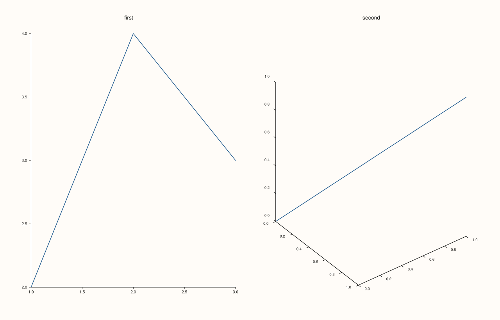

<!-- pluss-hand-authored -->

# Studio::panes

[Back to Studio API Reference](../../studio_api_reference)

## Signature

```cpp
[[nodiscard]] const std::vector<Pane>& Studio::panes() const noexcept
```

## What It Does

Returns the figure's full list of panes, in creation order — every pane created via
[`pane2()`](pane2.md), [`pane3()`](pane3.md), [`subpane2()`](subpane2.md), or
[`subpane3()`](subpane3.md), including subpanes (they're appended to the same list as
top-level panes; only their [`PanePlacement`](studio.md) distinguishes them). This is a
**read-only** view — there is no mutable overload, and no public API to remove a pane from
this list once created.

Combined with [`pane_index()`](pane_index.md), this is how index-based code (like
`subpane2()`'s `parent_index`) can be cross-checked, or how a figure's structure can be
inspected after the fact without holding onto individual `Pane&` references (which, per
[`pane2()`](pane2.md)'s important callout, become invalid after later pane-creation calls
— `panes()[i]` is always safe to re-fetch, since it looks up fresh from current storage
each time it's called).

## Parameters

*(none)*

## Returns

`const std::vector<Pane>&`
    A reference to the figure's own pane storage, in creation order. Read-only.

## Examples

Example 1. Empty on a fresh figure; growing as panes are added, including a mix of 2D and
3D panes.

```cpp
using namespace pluss::pl;

auto fig = studio("panes_check");
std::cout << fig.panes().empty() << "\n";

auto& first = fig.pane2("first");
first.trend(std::vector<double>{1.0, 2.0, 3.0}, std::vector<double>{2.0, 4.0, 3.0});
auto& second = fig.pane3("second");
second.path3(std::vector<double>{0.0, 1.0}, std::vector<double>{0.0, 1.0}, std::vector<double>{0.0, 1.0});

std::cout << fig.panes().size() << "\n";
std::cout << fig.panes()[0].title_text() << "\n";
std::cout << (fig.panes()[1].kind() == PaneKind::Volumetric) << "\n";

fig.mosaic(1, 2);
fig.show();
```

### Output

```text
1
2
first
1
```



Example 2. Iterating with a range-`for` loop — the common way to inspect every pane
without tracking indices by hand.

```cpp
using namespace pluss::pl;

auto fig = studio("panes_iterate");
fig.pane2("alpha");
fig.pane2("beta");
fig.pane2("gamma");

int count = 0;
for (const auto& pane : fig.panes()) {
  ++count;
  std::cout << pane.title_text() << "\n";
}
std::cout << "count: " << count << "\n";
```

### Output

```text
alpha
beta
gamma
count: 3
```

## Notes

- `noexcept`, `const` — read-only, no allocation.
- Returns a reference into the `Studio`'s own storage; valid as long as the `Studio` is
  alive. Unlike a `Pane&` returned from `pane2()`/`pane3()`, re-calling `panes()` always
  reflects the current, live pane list — but iterating and then triggering a
  `pane2()`/`pane3()`/`subpane2()`/`subpane3()` call *during* that iteration is still
  unsafe, for the same underlying `std::vector` reallocation reason.
- Subpanes (created via `subpane2()`/`subpane3()`) appear in this same flat list alongside
  top-level panes, in creation order — nothing distinguishes them here except their
  `PanePlacement`.
- There is no way to remove an entry from this list once created.

## See Also

- [`Studio::pane_count`](pane_count.md): just the `size()` of this list, without the
  elements themselves.
- [`Studio::pane_index`](pane_index.md): finds a specific pane's position in this list by
  address.
- [`Studio::pane2`](pane2.md) / [`pane3`](pane3.md): what populates this list.

<div class="pluss-inline-prev-next">
  <a class="prev-link" href="show.html">
    <span class="label">Previous</span>
    <span class="title">show</span>
  </a>
  <a class="next-link" href="pane_count.html">
    <span class="label">Next</span>
    <span class="title">pane_count</span>
  </a>
</div>
