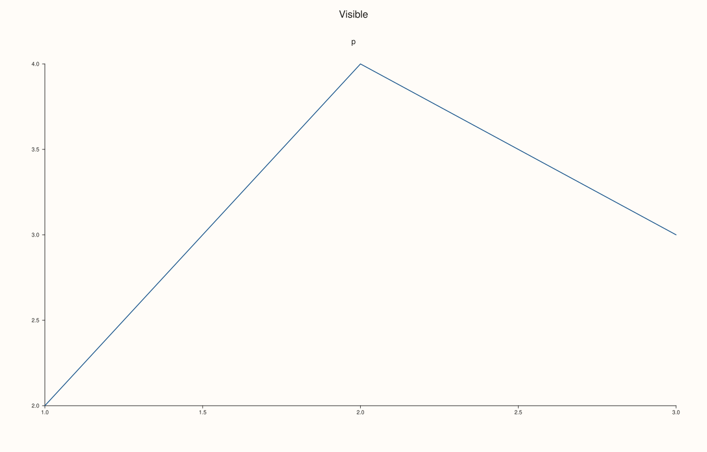
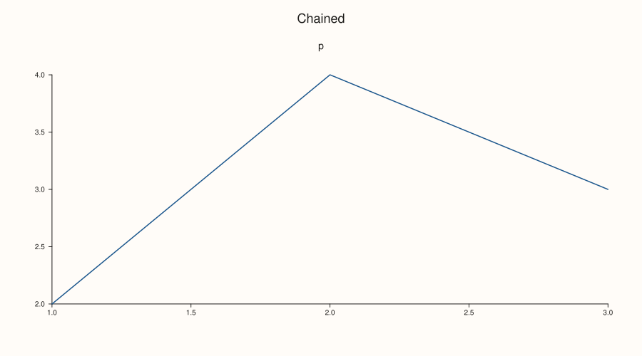

<!-- pluss-hand-authored -->

# Studio::rename

[Back to Studio API Reference](../../studio_api_reference)

## Signature

```cpp
Studio& Studio::rename(std::string name)
```

## What It Does

Changes the figure's name, the string [`name`](name.md) returns. The name is bookkeeping and is never drawn, so renaming a figure does not change its SVG, PDF or PNG, and it does not touch the [`headline`](headline.md), the panes or any other setting. The new name replaces the old one completely; an empty string makes the figure unnamed. It is used as the title of the viewer window ([`show`](show.md)) when none is passed, and in the temporary names the exporters create.

Any text is accepted, including empty text and text with spaces or line breaks; nothing validates it and nothing requires it to be unique among figures.

## Parameters

**name** (`std::string`)
    The new name. Empty makes the figure unnamed.

## Returns

`Studio&`
    The same figure, for chaining.

## Examples

Example 1. Renaming. The name is replaced, an empty name is allowed, and each call is read back by `name`.

```cpp
auto fig = studio("draft");
std::cout << "before: " << fig.name() << "\n";
fig.rename("final");
std::cout << "after: " << fig.name() << "\n";
fig.rename("");
std::cout << "empty allowed: '" << fig.name() << "'\n";
fig.pane2("p").trend(std::vector<double>{1, 2, 3}, std::vector<double>{2, 4, 3});
fig.save_svg("figure.svg");
```

### Output

```text
before: draft
after: final
empty allowed: ''
```


Example 2. No effect on the picture. The SVG is identical before and after renaming, and the figure's size, panes and headline are untouched.

```cpp
auto fig = studio("before");
fig.headline("Visible");
fig.pane2("p").trend(std::vector<double>{1, 2, 3}, std::vector<double>{2, 4, 3});
const std::string svg = fig.to_svg();
fig.rename("after");
std::cout << "same SVG: " << (fig.to_svg() == svg) << "\n";
std::cout << "headline kept: " << fig.headline_text() << ", panes: " << fig.pane_count() << "\n";
fig.save_svg("figure.svg");
```

### Output

```text
same SVG: 1
headline kept: Visible, panes: 1
```



Example 3. Chaining. `rename` returns the figure, so it chains with the other setters in one statement, in any order.

```cpp
auto fig = studio("a");
fig.rename("b").headline("Chained").size(900.0, 500.0).rename("c");
std::cout << fig.name() << " / " << fig.headline_text() << " / " << fig.extent().width << " x " << fig.extent().height << "\n";
fig.pane2("p").trend(std::vector<double>{1, 2, 3}, std::vector<double>{2, 4, 3});
fig.save_svg("figure.svg");
```

### Output

```text
c / Chained / 900 x 500
```



Example 4. Any text. Spaces, non-ASCII characters and line breaks are stored as given; the name is not interpreted.

```cpp
auto fig = studio();
for (const char* text : {"two words", "naïve — figure", "line one\nline two", " "}) {
  fig.rename(text);
  std::cout << "length " << fig.name().size() << ": " << (fig.name() == text) << "\n";
}
fig.pane2("p").trend(std::vector<double>{1, 2, 3}, std::vector<double>{2, 4, 3});
fig.save_svg("figure.svg");
```

### Output

```text
length 9: 1
length 17: 1
length 17: 1
length 1: 1
```


## Notes

- Not `noexcept`: it moves a string into the figure.
- To change the text that is drawn, use [`headline`](headline.md); `rename` never changes the picture.

## See Also

- [`Studio::name`](name.md): reads the name back.
- [`Studio::headline`](headline.md): the visible title.
- [`studio`](studio.md): the factory that takes the first name.

<div class="pluss-inline-prev-next">
  <a class="prev-link" href="panes.html">
    <span class="label">Previous</span>
    <span class="title">panes</span>
  </a>
  <a class="next-link" href="row_title.html">
    <span class="label">Next</span>
    <span class="title">row_title</span>
  </a>
</div>
