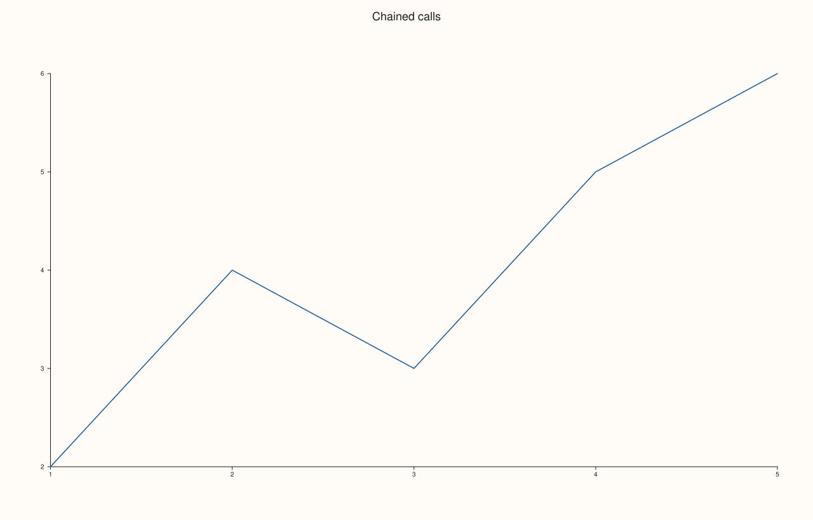

<!-- pluss-hand-authored -->

# Studio::rename

[Back to Studio API Reference](../../studio_api_reference)

## Signature

```cpp
Studio& Studio::rename(std::string name)
```

## What It Does

Replaces the figure's own name (the same value [`studio(name)`](studio.md)/the constructor
set) after the fact. Like every mutator on `Studio`, it returns `*this` by reference, so
calls chain.

## Parameters

**name** (`std::string`)
    The new name. Passing an empty string is valid and clears the name back to its default
    state.

## Returns

`Studio&`
    A reference to the same figure, for chaining.

## Examples

Example 1. Renaming after construction.

```cpp
using namespace pluss::pl;

auto fig = studio("initial");
std::cout << fig.name() << "\n";  // "initial"

fig.rename("renamed");
std::cout << fig.name() << "\n";  // "renamed"
```

### Output

```text
initial
renamed
```

Example 2. Chaining `rename()` with `headline()` in one expression.

```cpp
using namespace pluss::pl;

auto fig = studio("chain");
fig.rename("chained").headline("Chained calls");

auto& pane = fig.pane2();
pane.trend(std::vector<double>{1.0, 2.0, 3.0, 4.0, 5.0}, std::vector<double>{2.0, 4.0, 3.0, 5.0, 6.0});
fig.show();

std::cout << fig.name() << " / " << fig.headline_text() << "\n";
```

### Output

```text
chained / Chained calls
```



## Notes

- Returns `*this` by reference — chains with any other mutator (`headline()`, `theme()`,
  `size()`, ...).
- `name` is bookkeeping only, same as the constructor's `name` parameter — see
  [`studio()`](studio.md)'s Parameters for what it's actually used for (window titles,
  fallback export filenames) and what it isn't (nothing renders inside the SVG itself).

## See Also

- [`studio()`](studio.md): sets the initial name at construction.
- [`Studio::name`](name.md): reads the current name back.
- [`Studio::headline`](headline.md): the sibling text field that **does** render inside
  the figure.

<div class="pluss-inline-prev-next">
  <a class="prev-link" href="studio.html">
    <span class="label">Previous</span>
    <span class="title">studio</span>
  </a>
  <a class="next-link" href="theme.html">
    <span class="label">Next</span>
    <span class="title">theme</span>
  </a>
</div>
