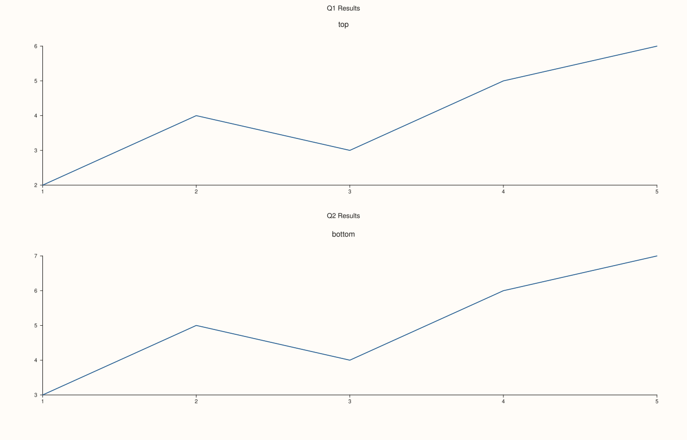
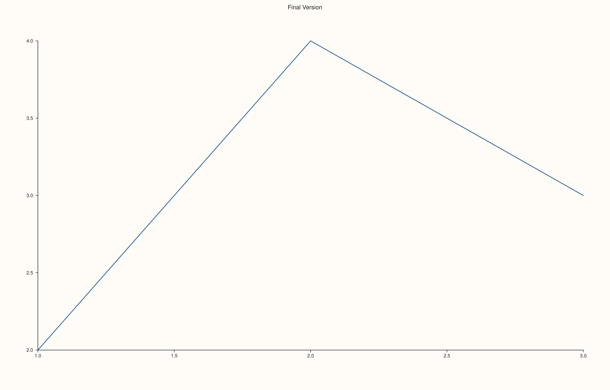

<!-- pluss-hand-authored -->

# Studio::row_title

[Back to Studio API Reference](../../studio_api_reference)

## Signature

```cpp
Studio& Studio::row_title(std::int64_t row, std::string text)
```

## What It Does

Sets a title drawn once, to the left of an entire **mosaic row**, spanning every pane
in that row. Unlike [`x_caption`](x_caption.md)/[`y_caption`](y_caption.md)/
[`z_caption`](z_caption.md), row titles need **no per-pane opt-in** — the row index is
inferred purely from the figure's mosaic layout (panes sorted by their y-position), so any
multi-row figure built with [`mosaic(rows, cols)`](mosaic.md) can use `row_title()`
immediately without touching the individual panes at all.

`row` is **0-indexed from the top**: row `0` is the topmost mosaic row, row `1` the next one
down, and so on.

Calling `row_title()` again with the same `row` overwrites the previous text for that row
(`std::map` upsert semantics, same as the caption methods).

```{important} row must be non-negative
Passing a negative `row` throws `std::invalid_argument("row_title: row must be non-negative")`
immediately — there's no such thing as a "row -1". See Example 4.
```

## Parameters

**row** (`std::int64_t`)
    The 0-indexed mosaic row to title. Must be `>= 0`. There's no upper-bound check at
    call time — a `row` index beyond the figure's actual row count is simply never matched
    at render time, drawing nothing (mirroring the caption methods' unmatched-group
    behavior, except no layout space is reserved for a row that doesn't exist).

**text** (`std::string`)
    The title text for that row.

## Returns

`Studio&`
    A reference to the same figure, for chaining.

## Examples

Example 1. A two-row mosaic with no row titles set.

```cpp
using namespace pluss::pl;

auto fig = studio("row_titles_none");
fig.mosaic(2, 1);
auto& top = fig.pane2("top");
top.trend(std::vector<double>{1.0, 2.0, 3.0, 4.0, 5.0}, std::vector<double>{2.0, 4.0, 3.0, 5.0, 6.0}).label("series a");
auto& bottom = fig.pane2("bottom");
bottom.trend(std::vector<double>{1.0, 2.0, 3.0, 4.0, 5.0}, std::vector<double>{3.0, 5.0, 4.0, 6.0, 7.0}).label("series b");
fig.show();

std::cout << fig.row_titles().empty() << "\n";
```

### Output

```text
1
```


Example 2. The same layout, with row `0` and row `1` each given a title — no per-pane
`align_*` opt-in required.

```cpp
using namespace pluss::pl;

auto fig = studio("row_titles_set");
fig.mosaic(2, 1);
fig.row_title(0, "Q1 Results").row_title(1, "Q2 Results");
auto& top = fig.pane2("top");
top.trend(std::vector<double>{1.0, 2.0, 3.0, 4.0, 5.0}, std::vector<double>{2.0, 4.0, 3.0, 5.0, 6.0}).label("series a");
auto& bottom = fig.pane2("bottom");
bottom.trend(std::vector<double>{1.0, 2.0, 3.0, 4.0, 5.0}, std::vector<double>{3.0, 5.0, 4.0, 6.0, 7.0}).label("series b");
fig.show();

std::cout << fig.row_titles().size() << "\n";
std::cout << fig.row_titles().at(0) << "\n";
```

### Output

```text
2
Q1 Results
```



Example 3. `row_title()` chains, so both rows can be set in one statement:
`fig.row_title(0, "Q1 Results").row_title(1, "Q2 Results")` — already used above.
Calling it again with the same row overwrites the text.

```cpp
using namespace pluss::pl;

auto fig = studio("row_titles_overwrite");
fig.row_title(0, "First Draft").row_title(0, "Final Version");
auto& pane = fig.pane2();
pane.trend(std::vector<double>{1.0, 2.0, 3.0}, std::vector<double>{2.0, 4.0, 3.0}).label("series");
fig.show();

std::cout << fig.row_titles().at(0) << "\n";
```

### Output

```text
Final Version
```



Example 4. A negative row index throws immediately.

```cpp
using namespace pluss::pl;

auto fig = studio("row_titles_negative");
try {
  fig.row_title(-1, "Invalid");
} catch (const std::invalid_argument& e) {
  std::cout << e.what() << "\n";
}
```

### Output

```text
row_title: row must be non-negative
```

## Notes

- Not `noexcept` (throws on a negative `row`; also constructs/moves a `std::string` and
  inserts into a `std::map`).
- No per-pane opt-in needed, unlike the caption family — row index alone determines the
  match, inferred from mosaic layout at render time.
- `row` is 0-indexed from the top.
- Re-calling with the same `row` overwrites (map upsert), not appends.
- A `row` beyond the figure's actual row count draws nothing and reserves no space —
  different from an unmatched caption group, which still reserves layout space (see
  [`x_caption`](x_caption.md)'s important callout).

## See Also

- [`Studio::row_titles`](row_titles.md): reads back the full map of registered row titles.
- [`Studio::clear_row_title`](clear_row_title.md) / [`clear_row_titles`](clear_row_titles.md):
  remove entries set by this method.
- [`Studio::mosaic`](mosaic.md): defines the row/column grid that `row` indexes into.

<div class="pluss-inline-prev-next">
  <a class="prev-link" href="z_captions.html">
    <span class="label">Previous</span>
    <span class="title">z_captions</span>
  </a>
  <a class="next-link" href="row_titles.html">
    <span class="label">Next</span>
    <span class="title">row_titles</span>
  </a>
</div>
