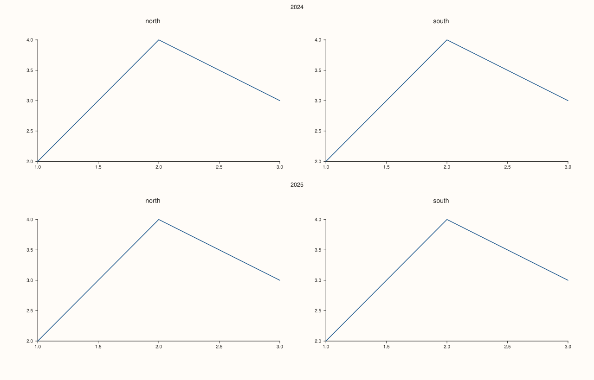
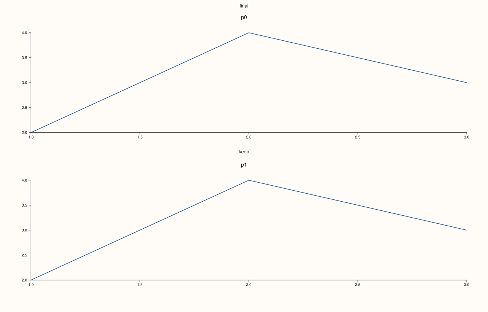
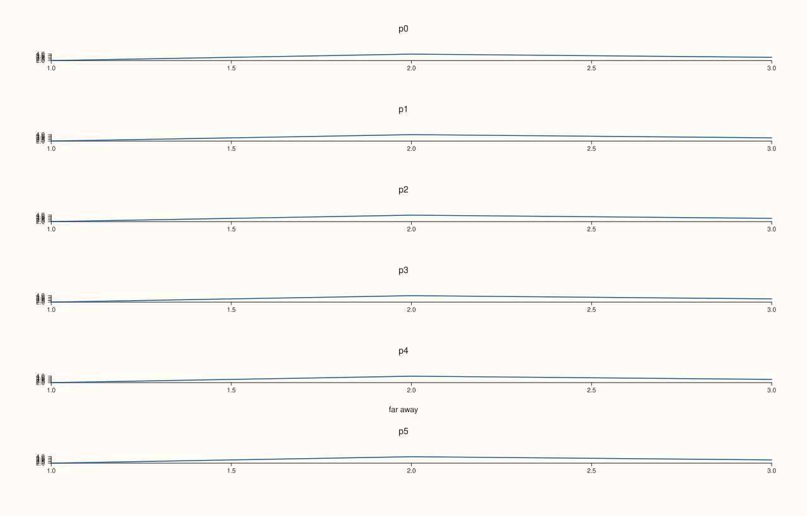
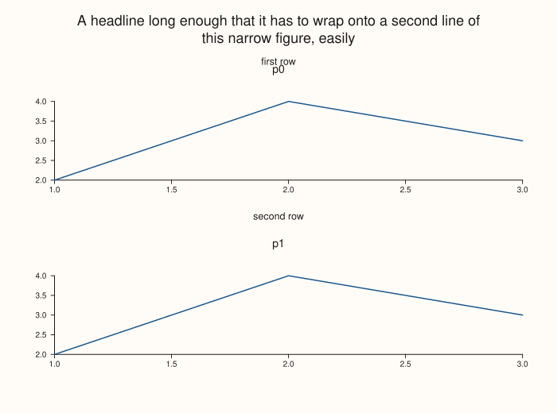
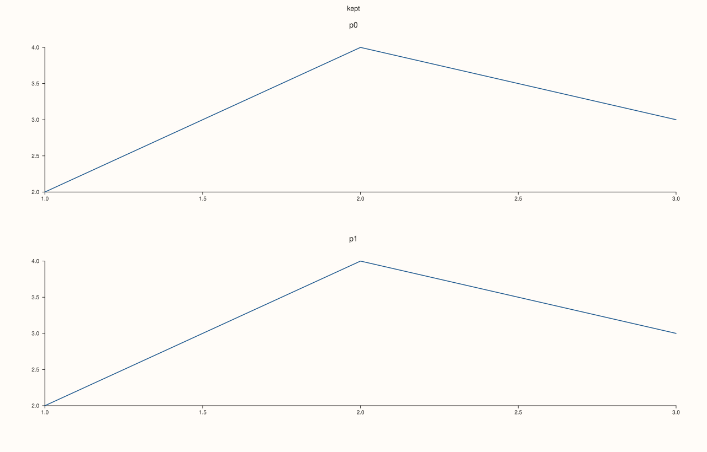

<!-- pluss-hand-authored -->

# Studio::row_title

[Back to Studio API Reference](../../studio_api_reference)

## Signature

```cpp
Studio& Studio::row_title(std::int64_t row, std::string text)
```

## What It Does

Gives one row of the [`mosaic`](mosaic.md) a title, drawn centred above the row, just above the titles of the row's panes, and shared by every pane in the row. It is for labelling a whole row of a grid (a year, a region, a model) without repeating the label in each pane's own title. Rows are numbered from 0 at the top.

A title is stored by row number, one per row: calling again for the same row replaces the text, and different rows are independent. A title for a row the grid does not have (a row beyond the last, or any row when there is no mosaic) is stored but draws nothing and takes no room, so it can be set before the mosaic is; it appears as soon as the grid has that row. An empty string draws nothing. A negative row is refused with `pluss::Error` and the stored titles are left as they were.

With a [`headline`](headline.md) the first row's title sits below the headline, whatever the headline's height.

## Parameters

**row** (`std::int64_t`)
    The row, counted from 0 at the top. Must not be negative.

**text** (`std::string`)
    The title. Empty draws nothing.

## Returns

`Studio&`
    The same figure, for chaining.

## Examples

Example 1. A title for each row of a 2 by 2 grid. Each title is centred above its row, shared by the two panes of that row.

```cpp
auto fig = studio("row_title_basic");
fig.mosaic(2, 2);
fig.row_title(0, "2024").row_title(1, "2025");
const char* names[] = {"north", "south", "north", "south"};
for (const char* name : names) fig.pane2(name).trend(std::vector<double>{1, 2, 3}, std::vector<double>{2, 4, 3});
std::cout << "titles stored: " << fig.row_titles().size() << "\n";
fig.save_svg("figure.svg");
```

### Output

```text
titles stored: 2
```



Example 2. One title per row. Setting the same row again replaces the text; the other rows are untouched.

```cpp
auto fig = studio("row_title_replace");
fig.mosaic(2, 1);
fig.row_title(0, "draft").row_title(1, "keep");
fig.row_title(0, "final");
std::cout << "row 0: " << fig.row_titles().at(0) << ", row 1: " << fig.row_titles().at(1) << ", entries: " << fig.row_titles().size() << "\n";
for (int i = 0; i < 2; ++i) fig.pane2("p" + std::to_string(i)).trend(std::vector<double>{1, 2, 3}, std::vector<double>{2, 4, 3});
fig.save_svg("figure.svg");
```

### Output

```text
row 0: final, row 1: keep, entries: 2
```



Example 3. A row the grid does not have draws nothing and takes no room. With no mosaic, and with a row beyond the last, the figure is the figure without the call; the title is kept and appears when the grid grows.

```cpp
auto build = [](bool title, int rows) {
  auto fig = studio("row_title_norow");
  fig.mosaic(rows, 1);
  if (title) fig.row_title(5, "far away");
  for (int i = 0; i < rows; ++i) fig.pane2("p" + std::to_string(i)).trend(std::vector<double>{1, 2, 3}, std::vector<double>{2, 4, 3});
  return fig.to_svg();
};
std::cout << "row 5 of a 2-row grid draws nothing: " << (build(true, 2) == build(false, 2)) << "\n";
std::cout << "row 5 of a 6-row grid is drawn: " << (build(true, 6) != build(false, 6)) << "\n";
auto fig = studio("row_title_norow_out");
fig.mosaic(6, 1);
fig.row_title(5, "far away");
for (int i = 0; i < 6; ++i) fig.pane2("p" + std::to_string(i)).trend(std::vector<double>{1, 2, 3}, std::vector<double>{2, 4, 3});
fig.save_svg("figure.svg");
```

### Output

```text
row 5 of a 2-row grid draws nothing: 1
row 5 of a 6-row grid is drawn: 1
```



Example 4. An empty title draws nothing. The figure equals the one that never set a title for the row, although the empty entry is stored.

```cpp
auto build = [](bool empty_title) {
  auto fig = studio("row_title_empty");
  fig.mosaic(1, 1);
  if (empty_title) fig.row_title(0, "");
  fig.pane2("p").trend(std::vector<double>{1, 2, 3}, std::vector<double>{2, 4, 3});
  return fig;
};
auto with = build(true), without = build(false);
std::cout << "same figure: " << (with.to_svg() == without.to_svg()) << ", entries stored: " << with.row_titles().size() << "\n";
without.save_svg("figure.svg");
```

### Output

```text
same figure: 1, entries stored: 1
```


Example 5. Below a headline. A figure with a headline and row titles keeps the titles clear of the headline, including a headline that wraps onto several lines.

```cpp
auto fig = studio("row_title_headline");
fig.size(700.0, 520.0);
fig.headline("A headline long enough that it has to wrap onto a second line of this narrow figure, easily");
fig.mosaic(2, 1);
fig.row_title(0, "first row").row_title(1, "second row");
for (int i = 0; i < 2; ++i) fig.pane2("p" + std::to_string(i)).trend(std::vector<double>{1, 2, 3}, std::vector<double>{2, 4, 3});
fig.save_svg("figure.svg");
```



Example 6. A negative row is refused. The call throws `pluss::Error`, and the titles already stored are left as they were.

```cpp
auto fig = studio("row_title_invalid");
fig.mosaic(2, 1);
fig.row_title(0, "kept");
try {
  fig.row_title(-1, "never stored");
} catch (const pluss::Error& e) {
  std::cout << e.message() << "\n";
}
std::cout << "entries: " << fig.row_titles().size() << ", row 0: " << fig.row_titles().at(0) << "\n";
for (int i = 0; i < 2; ++i) fig.pane2("p" + std::to_string(i)).trend(std::vector<double>{1, 2, 3}, std::vector<double>{2, 4, 3});
fig.save_svg("figure.svg");
```

### Output

```text
row_title: row must be non-negative
entries: 1, row 0: kept
```



## Notes

- Not `noexcept`: it can throw for a negative row.
- Titles belong to the figure, not to panes; moving panes between rows moves them under different titles.
- Remove titles with [`clear_row_title`](clear_row_title.md) and [`clear_row_titles`](clear_row_titles.md); read them with [`row_titles`](row_titles.md).

## See Also

- [`Studio::row_titles`](row_titles.md): reads the titles back.
- [`Studio::clear_row_title`](clear_row_title.md), [`clear_row_titles`](clear_row_titles.md): remove titles.
- [`Studio::mosaic`](mosaic.md): the grid the rows belong to.
- [`Studio::headline`](headline.md): the title of the whole figure.

<div class="pluss-inline-prev-next">
  <a class="prev-link" href="rename.html">
    <span class="label">Previous</span>
    <span class="title">rename</span>
  </a>
  <a class="next-link" href="row_titles.html">
    <span class="label">Next</span>
    <span class="title">row_titles</span>
  </a>
</div>
