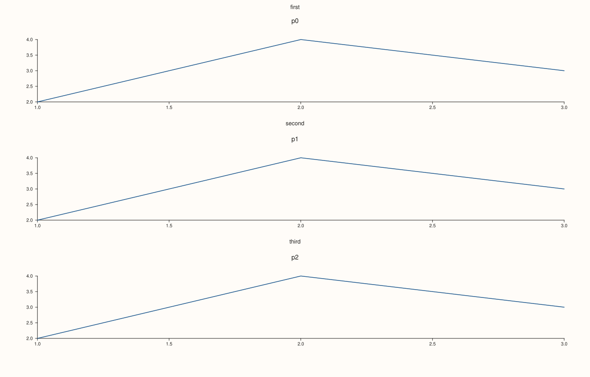
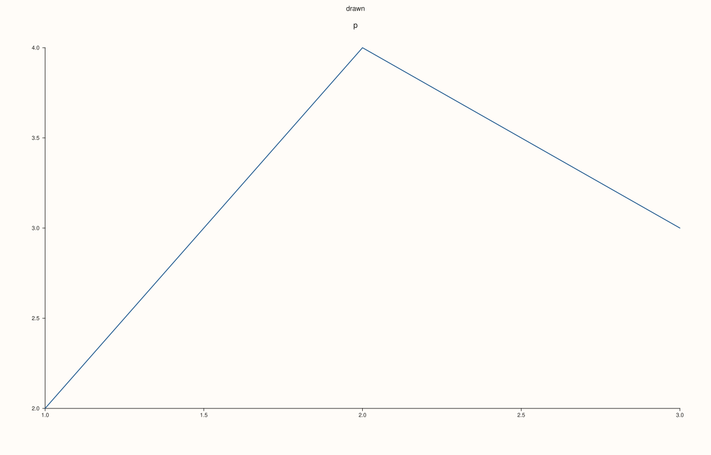

<!-- pluss-hand-authored -->

# Studio::row_titles

[Back to Studio API Reference](../../studio_api_reference)

## Signature

```cpp
const std::map<std::int64_t, std::string>& Studio::row_titles() const noexcept
```

## What It Does

Returns every row title that [`row_title`](row_title.md) has stored, as a map from row number to text, in ascending row order. It is what is stored, not what is drawn: a title for a row the grid does not have, and an empty title, are in the map although they draw nothing. The map is empty for a figure with no titles, and [`clear_row_title`](clear_row_title.md) and [`clear_row_titles`](clear_row_titles.md) remove entries from it.

The reference is to the figure's own map, so it shows later changes and should be copied when a snapshot is needed.

## Parameters

*(none)*

## Returns

`const std::map<std::int64_t, std::string>&`
    The stored titles, keyed by row, ascending.

## Examples

Example 1. Reading the titles. A map keyed by row and sorted by row, whatever order the calls were made in.

```cpp
auto fig = studio("row_titles_iterate");
std::cout << "none yet: " << fig.row_titles().empty() << "\n";
fig.row_title(2, "third").row_title(0, "first").row_title(1, "second");
for (const auto& [row, text] : fig.row_titles()) std::cout << row << " => " << text << "\n";
fig.mosaic(3, 1);
for (int i = 0; i < 3; ++i) fig.pane2("p" + std::to_string(i)).trend(std::vector<double>{1, 2, 3}, std::vector<double>{2, 4, 3});
fig.save_svg("figure.svg");
```

### Output

```text
none yet: 1
0 => first
1 => second
2 => third
```



Example 2. Stored, not drawn. Titles for rows the grid does not have, and an empty title, are in the map but draw nothing.

```cpp
auto fig = studio("row_titles_stored");
fig.mosaic(1, 1);
fig.row_title(0, "drawn").row_title(3, "no such row").row_title(4, "");
std::cout << "entries: " << fig.row_titles().size() << "\n";
fig.pane2("p").trend(std::vector<double>{1, 2, 3}, std::vector<double>{2, 4, 3});
const std::string svg = fig.to_svg();
std::cout << "row 0 drawn: " << (svg.find(">drawn<") != std::string::npos) << ", row 3 drawn: " << (svg.find("no such row") != std::string::npos) << "\n";
fig.save_svg("figure.svg");
```

### Output

```text
entries: 3
row 0 drawn: 1, row 3 drawn: 0
```



Example 3. Removals are reflected. Clearing one row removes only its entry, clearing a row with no title does nothing, and clearing all empties the map.

```cpp
auto fig = studio("row_titles_removals");
fig.row_title(0, "a").row_title(1, "b").row_title(2, "c");
fig.clear_row_title(1);
std::cout << "after clearing row 1: " << fig.row_titles().size() << " (row 1 present: " << fig.row_titles().count(1) << ")\n";
fig.clear_row_title(9);
std::cout << "clearing a row with no title: " << fig.row_titles().size() << "\n";
fig.clear_row_titles();
std::cout << "after clear_row_titles: " << fig.row_titles().size() << "\n";
fig.pane2("p").trend(std::vector<double>{1, 2, 3}, std::vector<double>{2, 4, 3});
fig.save_svg("figure.svg");
```

### Output

```text
after clearing row 1: 2 (row 1 present: 0)
clearing a row with no title: 2
after clear_row_titles: 0
```


Example 4. A snapshot needs a copy. The reference follows the figure, so a copy taken earlier keeps the old titles.

```cpp
auto fig = studio("row_titles_snapshot");
fig.row_title(0, "before");
const auto snapshot = fig.row_titles();
const auto& live = fig.row_titles();
fig.row_title(0, "after");
std::cout << "snapshot: " << snapshot.at(0) << ", live: " << live.at(0) << "\n";
fig.pane2("p").trend(std::vector<double>{1, 2, 3}, std::vector<double>{2, 4, 3});
fig.save_svg("figure.svg");
```

### Output

```text
snapshot: before, live: after
```


## Notes

- `noexcept`, and has no effect on the figure.
- Rows are numbers, not positions in the map: a title for row 5 is under key 5 whether or not rows 0 to 4 have titles.

## See Also

- [`Studio::row_title`](row_title.md): stores a title.
- [`Studio::clear_row_title`](clear_row_title.md), [`clear_row_titles`](clear_row_titles.md): remove titles.

<div class="pluss-inline-prev-next">
  <a class="prev-link" href="row_title.html">
    <span class="label">Previous</span>
    <span class="title">row_title</span>
  </a>
  <a class="next-link" href="save_pdf.html">
    <span class="label">Next</span>
    <span class="title">save_pdf</span>
  </a>
</div>
