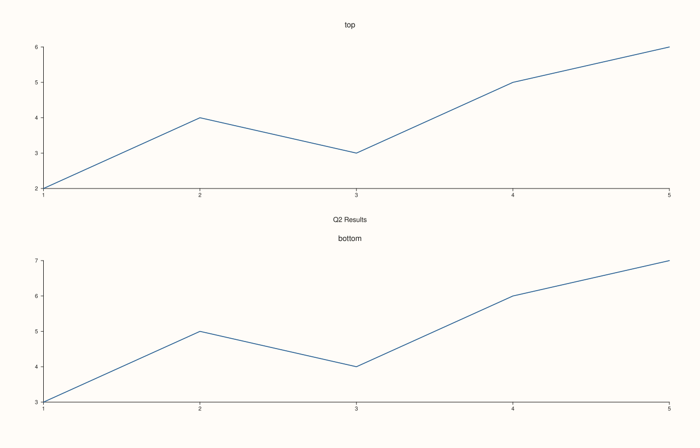

<!-- pluss-hand-authored -->

# Studio::row_titles

[Back to Studio API Reference](../../studio_api_reference)

## Signature

```cpp
const std::map<std::int64_t, std::string>& Studio::row_titles() const noexcept
```

## What It Does

Returns the full map of registered row titles — every `row → text` pair set via
[`row_title(row, text)`](row_title.md), keyed by 0-indexed row number. Empty if
`row_title()` has never been called, or after [`clear_row_titles()`](clear_row_titles.md).

## Parameters

*(none)*

## Returns

`const std::map<std::int64_t, std::string>&`
    A reference to the figure's internal row-title map. `std::map` keeps entries sorted
    numerically by row index.

## Examples

Example 1. Empty by default, populated after two `row_title` calls, then reduced by
[`clear_row_title`](clear_row_title.md).

```cpp
using namespace pluss::pl;

auto fig = studio("row_titles_full_check");
std::cout << fig.row_titles().empty() << "\n";

fig.mosaic(2, 1);
fig.row_title(0, "Q1 Results").row_title(1, "Q2 Results");
std::cout << fig.row_titles().size() << "\n";

fig.clear_row_title(0);
std::cout << fig.row_titles().size() << "\n";
std::cout << fig.row_titles().count(0) << "\n";

auto& top = fig.pane2("top");
top.trend(std::vector<double>{1.0, 2.0, 3.0}, std::vector<double>{2.0, 4.0, 3.0}).label("series a");
auto& bottom = fig.pane2("bottom");
bottom.trend(std::vector<double>{1.0, 2.0, 3.0}, std::vector<double>{3.0, 5.0, 4.0}).label("series b");
fig.show();
```

### Output

```text
1
2
1
0
```



## Notes

- `noexcept`.
- Returns a reference into the `Studio`'s own storage.
- Sorted numerically by row index (`std::map<std::int64_t, ...>`'s ordering).
- Doesn't validate that each key corresponds to a row that actually exists in the current
  mosaic layout — a stale entry for a row beyond the figure's current grid simply never
  matches at render time.

## See Also

- [`Studio::row_title`](row_title.md): the only way to add or overwrite entries.
- [`Studio::clear_row_title`](clear_row_title.md) / [`clear_row_titles`](clear_row_titles.md):
  remove entries.

<div class="pluss-inline-prev-next">
  <a class="prev-link" href="row_title.html">
    <span class="label">Previous</span>
    <span class="title">row_title</span>
  </a>
  <a class="next-link" href="clear_row_title.html">
    <span class="label">Next</span>
    <span class="title">clear_row_title</span>
  </a>
</div>
