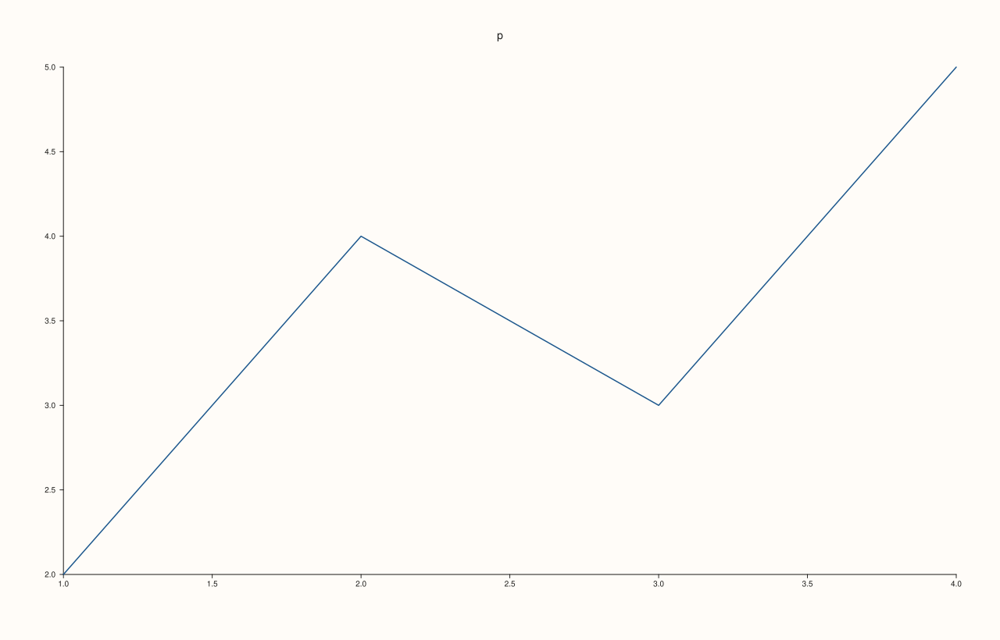
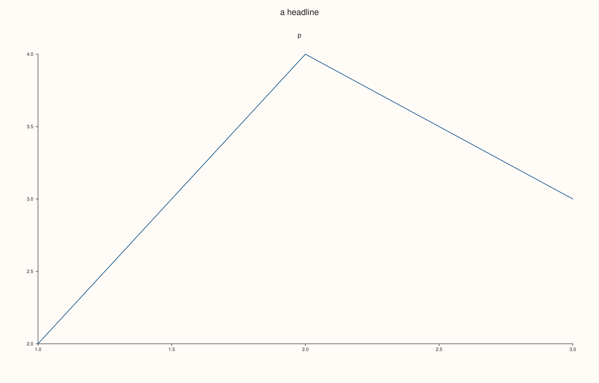

<!-- pluss-hand-authored -->

# Studio::save_pdf

[Back to Studio API Reference](../../studio_api_reference)

## Signature

```cpp
void Studio::save_pdf(std::string_view path, PdfEngine engine = PdfEngine::Auto) const
```

## What It Does

Writes the figure to a one-page PDF file. The page is the size of the figure ([`size`](size.md)) and the plot is vector graphics, so it scales without loss. Missing folders in the path are created and an existing file is overwritten.

`engine` chooses how the file is made ([`PdfEngine`](../types/PdfEngine.md)). `Auto` and `Internal` use the built-in writer, the same bytes [`to_pdf`](to_pdf.md) returns, and need nothing installed. `SvgConvert` writes the SVG and hands it to a converter found on the machine (`rsvg-convert`, `inkscape` or ImageMagick, in that order), which lays out text and curves in its own way; when none is found the call throws `pluss::Error`, and no file is left half-written.

`path` must end in `.pdf` (any case) and must not be empty, or the call throws `pluss::Error` before anything is rendered. A path that cannot be written throws `pluss::Error` naming the path.

## Parameters

**path** (`std::string_view`)
    The file to write. Must end in `.pdf` (any case).

**engine** (`PdfEngine`, default `PdfEngine::Auto`)
    `Auto` and `Internal` use the built-in writer; `SvgConvert` uses an installed converter.

## Returns

`void`

## Examples

Example 1. The default engine. The file is written and holds the bytes `to_pdf` returns.

```cpp
namespace fs = std::filesystem;
fs::remove_all("pdf_out_default");
auto fig = studio("save_pdf_default");
fig.pane2("p").trend(std::vector<double>{1, 2, 3, 4}, std::vector<double>{2, 4, 3, 5});
fig.save_pdf("pdf_out_default/default.pdf");
std::ifstream in("pdf_out_default/default.pdf", std::ios::binary);
const std::string file((std::istreambuf_iterator<char>(in)), std::istreambuf_iterator<char>());
std::cout << "written: " << fs::exists("pdf_out_default/default.pdf") << "\n";
std::cout << "equals to_pdf(): " << (file == fig.to_pdf()) << "\n";
fig.save_svg("figure.svg");
```

### Output

```text
written: 1
equals to_pdf(): 1
```


Example 2. The engines. `Auto` and `Internal` write identical files; `SvgConvert` writes a PDF made by the installed converter, so its bytes differ.

```cpp
auto read = [](const std::string& path) {
  std::ifstream in(path, std::ios::binary);
  return std::string((std::istreambuf_iterator<char>(in)), std::istreambuf_iterator<char>());
};
auto fig = studio("save_pdf_engines");
fig.pane2("p").trend(std::vector<double>{1, 2, 3, 4}, std::vector<double>{2, 4, 3, 5});
fig.save_pdf("auto.pdf", PdfEngine::Auto);
fig.save_pdf("internal.pdf", PdfEngine::Internal);
std::cout << "Auto == Internal: " << (read("auto.pdf") == read("internal.pdf")) << "\n";
try {
  fig.save_pdf("convert.pdf", PdfEngine::SvgConvert);
  const std::string converted = read("convert.pdf");
  std::cout << "SvgConvert wrote a PDF: " << (converted.rfind("%PDF", 0) == 0) << "\n";
  std::cout << "SvgConvert == Internal: " << (converted == read("internal.pdf")) << "\n";
} catch (const pluss::Error& e) {
  std::cout << "no converter available: " << e.message() << "\n";
}
fig.save_svg("figure.svg");
```

### Output

```text
Auto == Internal: 1
SvgConvert wrote a PDF: 1
SvgConvert == Internal: 0
```



Example 3. Folders, overwriting and the extension. Missing folders are created, a second save replaces the file, and `.PDF` is accepted.

```cpp
namespace fs = std::filesystem;
fs::remove_all("pdf_out_folders");
auto fig = studio("save_pdf_folders");
fig.pane2("p").trend(std::vector<double>{1, 2, 3}, std::vector<double>{2, 4, 3});
fig.save_pdf("pdf_out_folders/x/y/figure.pdf");
const auto first = fs::file_size("pdf_out_folders/x/y/figure.pdf");
fig.headline("a headline");
fig.save_pdf("pdf_out_folders/x/y/figure.pdf");
std::cout << "created: " << fs::exists("pdf_out_folders/x/y/figure.pdf") << ", overwritten: " << (fs::file_size("pdf_out_folders/x/y/figure.pdf") != first) << "\n";
fig.save_pdf("pdf_out_folders/UPPER.PDF");
std::cout << "UPPER.PDF: " << fs::exists("pdf_out_folders/UPPER.PDF") << "\n";
fig.save_svg("figure.svg");
```

### Output

```text
created: 1, overwritten: 1
UPPER.PDF: 1
```



Example 4. Representative failures. A wrong or missing extension and an empty path are refused before anything is rendered or written, and a path that cannot be written names the path.

```cpp
namespace fs = std::filesystem;
fs::remove_all("pdf_out_errors");
fs::create_directories("pdf_out_errors");
std::ofstream("pdf_out_errors/plain_file") << "x";
auto fig = studio("save_pdf_errors");
fig.pane2("p").trend(std::vector<double>{1, 2, 3}, std::vector<double>{2, 4, 3});
for (const char* bad : {"pdf_out_errors/figure.svg", "pdf_out_errors/figure", "", "pdf_out_errors/plain_file/figure.pdf"}) {
  try {
    fig.save_pdf(bad);
  } catch (const pluss::Error& e) {
    std::cout << "'" << bad << "': " << e.message() << "\n";
  }
}
std::cout << "files written for the bad paths: " << (fs::exists("pdf_out_errors/figure.svg") || fs::exists("pdf_out_errors/figure")) << "\n";
fig.save_svg("figure.svg");
```

### Output

```text
'pdf_out_errors/figure.svg': save_pdf(): filename extension '.svg' does not match expected '.pdf'
'pdf_out_errors/figure': save_pdf(): filename extension '' does not match expected '.pdf'
'': save_pdf(): output path cannot be empty
'pdf_out_errors/plain_file/figure.pdf': unable to create the folder for 'pdf_out_errors/plain_file/figure.pdf': File exists
files written for the bad paths: 0
```


## Notes

- Use `SvgConvert` only when the converter's page layout is wanted; it needs a program on the machine, the built-in engines do not.
- The page is the figure size in points; set it with [`size`](size.md) before saving.

## See Also

- [`Studio::to_pdf`](to_pdf.md): the built-in PDF as a string.
- [`PdfEngine`](../types/PdfEngine.md): the engines.
- [`Studio::save_svg`](save_svg.md), [`save_png`](save_png.md): the other file formats.

<div class="pluss-inline-prev-next">
  <a class="prev-link" href="row_titles.html">
    <span class="label">Previous</span>
    <span class="title">row_titles</span>
  </a>
  <a class="next-link" href="save_png.html">
    <span class="label">Next</span>
    <span class="title">save_png</span>
  </a>
</div>
