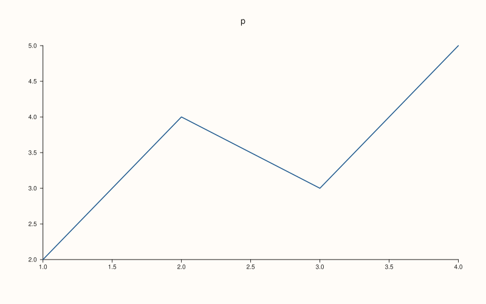
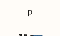
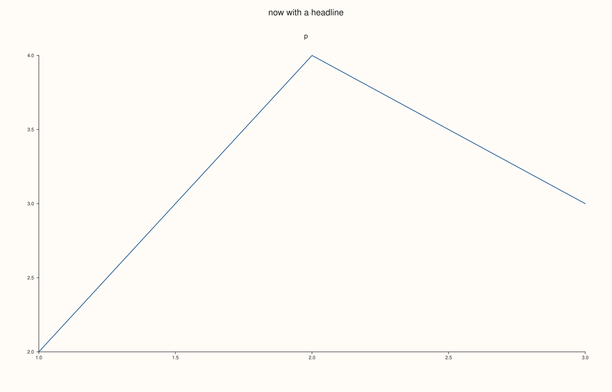

<!-- pluss-hand-authored -->

# Studio::save_png

[Back to Studio API Reference](../../studio_api_reference)

## Signature

```cpp
void Studio::save_png(std::string_view path, std::int64_t dpi = 144) const
```

## What It Does

Writes the figure to a PNG file. The figure is rendered to SVG and rasterised by whichever of `rsvg-convert`, `inkscape` or ImageMagick (`magick`, then `convert`) is installed; there is no built-in rasteriser, so when none of them is found the call throws `std::runtime_error` and `save_svg` or `save_pdf` are the formats that always work.

The raster is the figure size scaled by `dpi / 96`: a 1280 by 820 figure is 1920 by 1230 pixels at the default 144 dpi, 1280 by 820 at 96 and 3200 by 2050 at 240. A side is never smaller than 64 pixels. `dpi` must be positive, and a `dpi` that would give a side longer than 32768 pixels is refused, so a typing mistake cannot start a conversion that never finishes. Both checks, and the extension check, happen before anything is rendered or written.

`path` must end in `.png` (any case). Missing parent directories are created, an existing file is overwritten, and nothing but the PNG is left behind: the temporary SVG that the rasteriser reads is removed whether or not the conversion succeeds.

## Parameters

**path** (`std::string_view`)
    The file to write. The extension must be `.png`, in any case; any other extension throws `pluss::Error`.

**dpi** (`std::int64_t`, default `144`)
    The raster density. The width and height in pixels are the figure size times `dpi / 96`. Must be positive, and the result must not exceed 32768 pixels on a side.

## Returns

`void`

## Examples

Example 1. The default density. The figure is 1280 by 820 drawing units, so at 144 dpi the PNG is 1920 by 1230 pixels. The helper reads the size back from the PNG header.

```cpp
auto png_size = [](const std::string& path) {
  std::ifstream in(path, std::ios::binary);
  unsigned char h[24];
  in.read(reinterpret_cast<char*>(h), 24);
  auto be = [&](int at) { return (h[at] << 24) | (h[at + 1] << 16) | (h[at + 2] << 8) | h[at + 3]; };
  return std::to_string(be(16)) + " x " + std::to_string(be(20));
};
auto fig = studio("save_png_default");
fig.pane2("p").trend(std::vector<double>{1, 2, 3, 4}, std::vector<double>{2, 4, 3, 5});
fig.save_png("default.png");
std::cout << "figure: " << fig.extent().width << " x " << fig.extent().height << "\n";
std::cout << "default.png: " << png_size("default.png") << "\n";
fig.save_svg("figure.svg");
```

### Output

```text
figure: 1280 x 820
default.png: 1920 x 1230
```


Example 2. Several densities of the same figure: 36, 96, 144 and 300 dpi. The pixel size is the figure size times `dpi / 96`, rounded.

```cpp
auto png_size = [](const std::string& path) {
  std::ifstream in(path, std::ios::binary);
  unsigned char h[24];
  in.read(reinterpret_cast<char*>(h), 24);
  auto be = [&](int at) { return (h[at] << 24) | (h[at + 1] << 16) | (h[at + 2] << 8) | h[at + 3]; };
  return std::to_string(be(16)) + " x " + std::to_string(be(20));
};
auto fig = studio("save_png_dpi");
fig.size(800.0, 500.0);
fig.pane2("p").trend(std::vector<double>{1, 2, 3, 4}, std::vector<double>{2, 4, 3, 5});
for (std::int64_t dpi : {36, 96, 144, 300}) {
  const std::string path = "dpi_" + std::to_string(dpi) + ".png";
  fig.save_png(path, dpi);
  std::cout << dpi << " dpi: " << png_size(path) << "\n";
}
fig.save_svg("figure.svg");
```

### Output

```text
36 dpi: 300 x 188
96 dpi: 800 x 500
144 dpi: 1200 x 750
300 dpi: 2500 x 1563
```



Example 3. The 64-pixel floor. A 100 by 60 figure at 36 dpi would be 38 by 22 pixels, and each side is raised to 64.

```cpp
auto png_size = [](const std::string& path) {
  std::ifstream in(path, std::ios::binary);
  unsigned char h[24];
  in.read(reinterpret_cast<char*>(h), 24);
  auto be = [&](int at) { return (h[at] << 24) | (h[at + 1] << 16) | (h[at + 2] << 8) | h[at + 3]; };
  return std::to_string(be(16)) + " x " + std::to_string(be(20));
};
auto fig = studio("save_png_small");
fig.size(100.0, 60.0);
fig.pane2("p").trend(std::vector<double>{1, 2, 3}, std::vector<double>{2, 4, 3});
fig.save_png("small.png", 36);
std::cout << "small.png: " << png_size("small.png") << "\n";
fig.save_svg("figure.svg");
```

### Output

```text
small.png: 64 x 64
```



Example 4. Folders, overwriting and the extension. A path with folders that do not exist creates them; writing the same path again replaces the file; `.PNG` is accepted.

```cpp
namespace fs = std::filesystem;
fs::remove_all("png_out");
auto fig = studio("save_png_folders");
fig.pane2("p").trend(std::vector<double>{1, 2, 3}, std::vector<double>{2, 4, 3});
fig.save_png("png_out/a/b/figure.png");
std::cout << "created: " << fs::exists("png_out/a/b/figure.png") << "\n";
const auto first = fs::file_size("png_out/a/b/figure.png");
fig.headline("now with a headline");
fig.save_png("png_out/a/b/figure.png");
std::cout << "overwritten (the file changed): " << (fs::file_size("png_out/a/b/figure.png") != first) << "\n";
fig.save_png("png_out/UPPER.PNG");
std::cout << "upper-case extension: " << fs::exists("png_out/UPPER.PNG") << "\n";
int others = 0;
for (const auto& e : fs::recursive_directory_iterator("png_out")) {
  if (e.is_regular_file() && e.path().extension() != ".png" && e.path().extension() != ".PNG") ++others;
}
std::cout << "files other than PNGs left behind: " << others << "\n";
fig.save_svg("figure.svg");
```

### Output

```text
created: 1
overwritten (the file changed): 1
upper-case extension: 1
files other than PNGs left behind: 0
```



Example 5. Representative failures. The extension, the density and an enormous density are each refused with `pluss::Error` before anything is rendered or written.

```cpp
auto fig = studio("save_png_errors");
fig.pane2("p").trend(std::vector<double>{1, 2, 3}, std::vector<double>{2, 4, 3});
auto attempt = [&](const char* label, auto call) {
  try {
    call();
    std::cout << label << ": ok\n";
  } catch (const pluss::Error& e) {
    std::cout << label << ": " << e.message() << "\n";
  }
};
attempt("wrong extension", [&] { fig.save_png("figure.svg"); });
attempt("no extension", [&] { fig.save_png("figure"); });
attempt("dpi 0", [&] { fig.save_png("never.png", 0); });
attempt("dpi -50", [&] { fig.save_png("never.png", -50); });
attempt("dpi 100000000", [&] { fig.save_png("never.png", 100000000); });
std::cout << "never.png written: " << std::filesystem::exists("never.png") << "\n";
fig.save_svg("figure.svg");
```

### Output

```text
wrong extension: save_png(): filename extension '.svg' does not match expected '.png'
no extension: save_png(): filename extension '' does not match expected '.png'
dpi 0: save_png(): dpi must be positive
dpi -50: save_png(): dpi must be positive
dpi 100000000: save_png(): dpi gives a raster larger than 32768 pixels on a side
never.png written: 0
```


## Notes

- The raster is made from the same SVG that [`save_svg`](save_svg.md) writes, so a PNG and an SVG of one figure always agree.
- The figure size is set with [`size`](size.md); raise `dpi`, not the size, to get a sharper picture of the same layout, because the size also changes how the panes are laid out.
- Rasterising starts an external program, so it is slower than `save_svg` and `save_pdf`; write the SVG when the picture is only going to be looked at in a browser.

## See Also

- [`Studio::save_svg`](save_svg.md): the vector original the PNG is made from.
- [`Studio::save_pdf`](save_pdf.md): vector output that needs no external program.
- [`Studio::size`](size.md): the figure size the pixel size is derived from.
- [`Studio::extent`](extent.md): reads the figure size back.

<div class="pluss-inline-prev-next">
  <a class="prev-link" href="save_pdf.html">
    <span class="label">Previous</span>
    <span class="title">save_pdf</span>
  </a>
  <a class="next-link" href="save_svg.html">
    <span class="label">Next</span>
    <span class="title">save_svg</span>
  </a>
</div>
