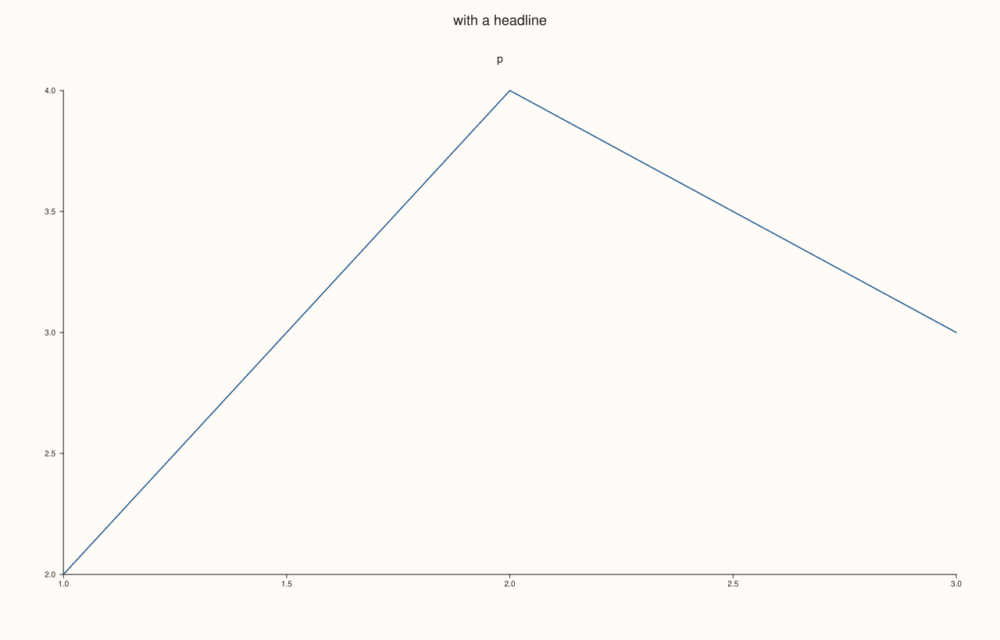

<!-- pluss-hand-authored -->

# Studio::save_svg

[Back to Studio API Reference](../../studio_api_reference)

## Signature

```cpp
void Studio::save_svg(std::string_view path) const
```

## What It Does

Writes the figure to an SVG file: the text [`to_svg`](to_svg.md) returns, saved at `path`. Missing folders in the path are created, an existing file is overwritten, and the file is written completely or the call throws.

`path` must end in `.svg`, in any case, and must not be empty; anything else is refused with `pluss::Error` before the figure is rendered or any folder is created. A path that cannot be written (a folder that cannot be created, a file that cannot be opened, a full disk) throws `pluss::Error` naming the path. Nothing is returned and the figure is unchanged.

## Parameters

**path** (`std::string_view`)
    The file to write. Must end in `.svg` (any case). Relative paths are relative to the working directory.

## Returns

`void`

## Examples

Example 1. Writing a file. The file exists afterwards and holds exactly what `to_svg` returns.

```cpp
namespace fs = std::filesystem;
fs::remove_all("svg_out_basic");
auto fig = studio("save_svg_basic");
fig.pane2("p").trend(std::vector<double>{1, 2, 3, 4}, std::vector<double>{2, 4, 3, 5});
fig.save_svg("svg_out_basic/basic.svg");
std::ifstream in("svg_out_basic/basic.svg", std::ios::binary);
const std::string file((std::istreambuf_iterator<char>(in)), std::istreambuf_iterator<char>());
std::cout << "written: " << fs::exists("svg_out_basic/basic.svg") << "\n";
std::cout << "equals to_svg(): " << (file == fig.to_svg()) << "\n";
fig.save_svg("figure.svg");
```

### Output

```text
written: 1
equals to_svg(): 1
```


Example 2. Folders and overwriting. A path through folders that do not exist creates them, and saving to the same path again replaces the file.

```cpp
namespace fs = std::filesystem;
fs::remove_all("svg_out_folders");
auto fig = studio("save_svg_folders");
fig.pane2("p").trend(std::vector<double>{1, 2, 3}, std::vector<double>{2, 4, 3});
fig.save_svg("svg_out_folders/a/b/c/figure.svg");
std::cout << "created folders and file: " << fs::exists("svg_out_folders/a/b/c/figure.svg") << "\n";
const auto first = fs::file_size("svg_out_folders/a/b/c/figure.svg");
fig.headline("with a headline");
fig.save_svg("svg_out_folders/a/b/c/figure.svg");
std::cout << "overwritten (the size changed): " << (fs::file_size("svg_out_folders/a/b/c/figure.svg") != first) << "\n";
fig.save_svg("figure.svg");
```

### Output

```text
created folders and file: 1
overwritten (the size changed): 1
```



Example 3. The extension. `.SVG` in capitals is accepted; any other extension, or none, is refused before anything is rendered or written.

```cpp
namespace fs = std::filesystem;
fs::remove_all("svg_out_extension");
auto fig = studio("save_svg_extension");
fig.pane2("p").trend(std::vector<double>{1, 2, 3}, std::vector<double>{2, 4, 3});
fig.save_svg("svg_out_extension/UPPER.SVG");
std::cout << "UPPER.SVG: " << fs::exists("svg_out_extension/UPPER.SVG") << "\n";
for (const char* bad : {"svg_out_extension/figure.png", "svg_out_extension/figure", "svg_out_extension/figure.svg.txt", ""}) {
  try {
    fig.save_svg(bad);
  } catch (const pluss::Error& e) {
    std::cout << "'" << bad << "': " << e.message() << "\n";
  }
}
std::cout << "files written for the bad paths: " << (fs::exists("svg_out_extension/figure.png") || fs::exists("svg_out_extension/figure")) << "\n";
fig.save_svg("figure.svg");
```

### Output

```text
UPPER.SVG: 1
'svg_out_extension/figure.png': save_svg(): filename extension '.png' does not match expected '.svg'
'svg_out_extension/figure': save_svg(): filename extension '' does not match expected '.svg'
'svg_out_extension/figure.svg.txt': save_svg(): filename extension '.txt' does not match expected '.svg'
'': save_svg(): output path cannot be empty
files written for the bad paths: 0
```


Example 4. A path that cannot be written. A file where a folder is needed, and a folder where a file is wanted, each throw `pluss::Error` that names the path.

```cpp
namespace fs = std::filesystem;
fs::remove_all("svg_out_unwritable");
fs::create_directories("svg_out_unwritable");
std::ofstream("svg_out_unwritable/plain_file") << "x";
fs::create_directories("svg_out_unwritable/is_a_folder.svg");
auto fig = studio("save_svg_unwritable");
fig.pane2("p").trend(std::vector<double>{1, 2, 3}, std::vector<double>{2, 4, 3});
for (const char* bad : {"svg_out_unwritable/plain_file/figure.svg", "svg_out_unwritable/is_a_folder.svg"}) {
  try {
    fig.save_svg(bad);
  } catch (const pluss::Error& e) {
    std::cout << e.message() << "\n";
  }
}
fig.save_svg("figure.svg");
```

### Output

```text
unable to create the folder for 'svg_out_unwritable/plain_file/figure.svg': File exists
unable to open 'svg_out_unwritable/is_a_folder.svg' for writing
```


## Notes

- When the error is not caught, the message printed by the runtime is a traceback ending at the failing `save_svg` line of your program.
- To keep a copy that survives figure changes, save before editing; `save_svg` writes the figure as it is at the time of the call.

## See Also

- [`Studio::to_svg`](to_svg.md): the same document as a string.
- [`Studio::save_pdf`](save_pdf.md), [`save_png`](save_png.md): the other file formats.
- [`Studio::show`](show.md): view the figure without writing a file.

<div class="pluss-inline-prev-next">
  <a class="prev-link" href="save_png.html">
    <span class="label">Previous</span>
    <span class="title">save_png</span>
  </a>
  <a class="next-link" href="show.html">
    <span class="label">Next</span>
    <span class="title">show</span>
  </a>
</div>
