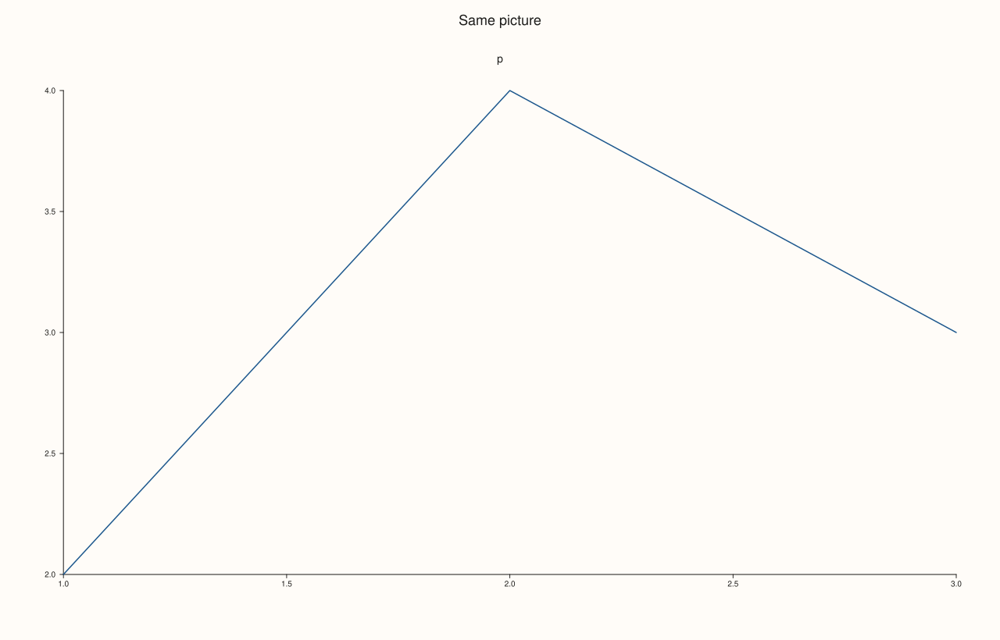

<!-- pluss-hand-authored -->

# Studio::show

[Back to Studio API Reference](../../studio_api_reference)

## Signature

```cpp
bool Studio::show(std::string_view title = {}, std::int64_t width = 1280, std::int64_t height = 820, bool launch = true) const
bool Studio::show(const pluss::view::HtmlWindowOptions& options, bool launch = true) const
```

## What It Does

Opens the figure in an interactive viewer: it renders the figure to SVG ([`to_svg`](to_svg.md)), wraps it in a small self-contained page with zoom controls and a button that saves the SVG, and shows that page in a window of the platform's viewer. It is the call for looking at a figure while working; use [`save_svg`](save_svg.md), [`save_pdf`](save_pdf.md) or [`save_png`](save_png.md) for files. Nothing in the figure changes.

The first overload takes a window `title` (empty uses the figure's [`name`](name.md), then `PlussPl Plot`) and a window size in pixels; the size is a request, raised to at least 320 by 240, and is separate from the figure's own [`size`](size.md). The second takes a full `pluss::view::HtmlWindowOptions`, which also names the snapshot files and the window backend; its window is at least 640 by 420. Both return `bool`.

`launch = false` renders and writes the viewer page to a temporary file without opening anything and returns `true` when the page was written; it is how to exercise `show` where no window can open, and the page is the same one `launch = true` would open. With `launch = true` the return value is `true` when a window (or, failing that, the default browser) was opened, and `false` when nothing could be shown. When a window cannot be created the page is still written and handed to the default viewer. Old temporary pages are cleaned up.

## Parameters

**title** (`std::string_view`, default empty)
    The window title. Empty uses the figure's name, then `PlussPl Plot`.

**width**, **height** (`std::int64_t`, default 1280 and 820)
    The requested window size in pixels, raised to at least 320 by 240.

**options** (`const pluss::view::HtmlWindowOptions&`)
    Title, size (at least 640 by 420), snapshot file names and backend preference.

**launch** (`bool`, default `true`)
    `false` writes the page but opens nothing.

## Returns

`bool`
    `true` when a window or viewer was opened, or, with `launch = false`, when the page was written; `false` when nothing could be shown.

## Examples

Example 1. Writing the page without opening a window. With `launch = false` the call renders the figure, writes the page and returns `true`, and the figure is unchanged.

```cpp
auto fig = studio("show_no_launch");
fig.pane2("p").trend(std::vector<double>{1, 2, 3, 4}, std::vector<double>{2, 4, 3, 5});
const std::string before = fig.to_svg();
const bool ok = fig.show({}, 1280, 820, false);
std::cout << "page written: " << ok << "\n";
std::cout << "figure unchanged: " << (fig.to_svg() == before) << "\n";
fig.save_svg("figure.svg");
```

### Output

```text
page written: 1
figure unchanged: 1
```


Example 2. Title and size. A title can be given, an empty one falls back to the figure's name, and sizes below the minimum are accepted (they are raised); each call returns `true`.

```cpp
auto fig = studio("show_titles");
fig.pane2("p").trend(std::vector<double>{1, 2, 3}, std::vector<double>{2, 4, 3});
std::cout << "explicit title: " << fig.show("My window", 900, 600, false) << "\n";
std::cout << "title from the name: " << fig.show({}, 1280, 820, false) << "\n";
std::cout << "tiny window request: " << fig.show("tiny", 10, 10, false) << "\n";
std::cout << "zero and negative sizes: " << fig.show("odd", 0, -5, false) << "\n";
fig.save_svg("figure.svg");
```

### Output

```text
explicit title: 1
title from the name: 1
tiny window request: 1
zero and negative sizes: 1
```


Example 3. The options overload. A `HtmlWindowOptions` carries the title, size and snapshot names; the window is at least 640 by 420, and `launch = false` writes the page and returns `true`.

```cpp
auto fig = studio("show_options");
fig.pane2("p").trend(std::vector<double>{1, 2, 3}, std::vector<double>{2, 4, 3});
pluss::view::HtmlWindowOptions options;
options.title = "From the options";
options.width = 800;
options.height = 500;
options.snapshot_name = "show_options.png";
std::cout << "written: " << fig.show(options, false) << "\n";
fig.save_svg("figure.svg");
```

### Output

```text
written: 1
```


Example 4. Any figure can be shown. A figure with no panes renders as an empty canvas and the page is written; there is no error for an empty figure.

```cpp
auto fig = studio("show_empty");
std::cout << "panes: " << fig.pane_count() << ", written: " << fig.show({}, 1280, 820, false) << "\n";
auto shown = studio("show_empty_out");
shown.pane2("p").trend(std::vector<double>{1, 2, 3}, std::vector<double>{2, 4, 3});
shown.save_svg("figure.svg");
```

### Output

```text
panes: 0, written: 1
```


Example 5. It shows what `to_svg` renders. The page is made from the same SVG, so the figure seen in the window is the figure the file functions write.

```cpp
auto fig = studio("show_same");
fig.headline("Same picture");
fig.pane2("p").trend(std::vector<double>{1, 2, 3}, std::vector<double>{2, 4, 3});
fig.show({}, 1280, 820, false);
fig.save_svg("viewed.svg");
std::ifstream in("viewed.svg", std::ios::binary);
const std::string file((std::istreambuf_iterator<char>(in)), std::istreambuf_iterator<char>());
std::cout << "file equals to_svg(): " << (file == fig.to_svg()) << "\n";
fig.save_svg("figure.svg");
```

### Output

```text
file equals to_svg(): 1
```



## Notes

- Not `noexcept`: rendering and writing the page can fail with `pluss::Error`, for example when the temporary folder cannot be written.
- A program in a session with no display still gets a page written to the temporary folder and handed to the default viewer; use `launch = false` in tests and servers.

## See Also

- [`Studio::to_svg`](to_svg.md): the SVG the page contains.
- [`Studio::save_svg`](save_svg.md), [`save_png`](save_png.md), [`save_pdf`](save_pdf.md): files.
- [`Studio::name`](name.md): the default title.

<div class="pluss-inline-prev-next">
  <a class="prev-link" href="save_svg.html">
    <span class="label">Previous</span>
    <span class="title">save_svg</span>
  </a>
  <a class="next-link" href="size.html">
    <span class="label">Next</span>
    <span class="title">size</span>
  </a>
</div>
