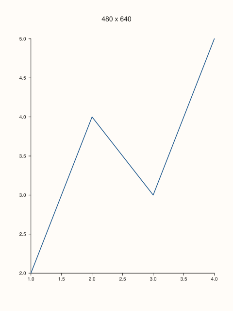
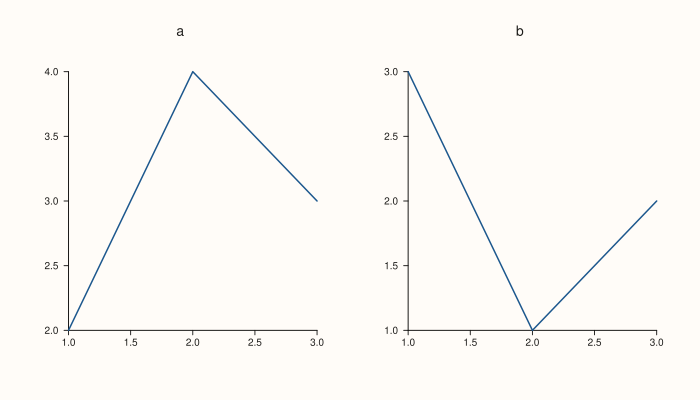
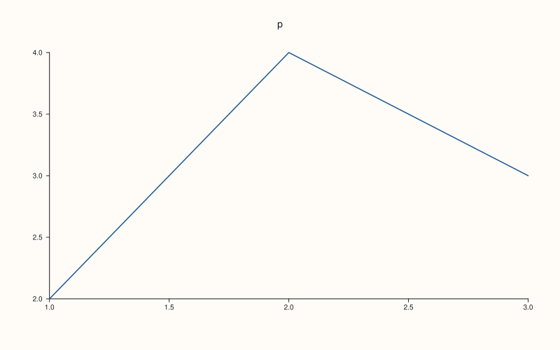
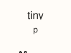

<!-- pluss-hand-authored -->

# Studio::size

[Back to Studio API Reference](../../studio_api_reference)

## Signature

```cpp
Studio& Studio::size(double width, double height)
```

## What It Does

Sets the size of the whole figure in drawing units (one unit is one pixel at 96 dpi). Every pane, margin, headline, caption and legend is laid out inside this rectangle, and it becomes the `width`, `height` and `viewBox` of the SVG. It is the figure-wide size; the size of one cell of a [`mosaic`](mosaic.md) is whatever is left of this rectangle after the margins and gutters, and the window size given to [`show`](show.md) is only the size of the viewer.

A new `Studio` is 1280 by 820. Both numbers must be finite and greater than zero: anything else (zero, a negative number, infinity or NaN) is refused with `pluss::Error`, and the figure keeps the size it had. The size is read when the figure is rendered, so calling `size` before or after the panes are added gives the same figure, and calling it again simply replaces the previous size. [`extent`](extent.md) reads it back.

The margins around the panes are shares of the size, as in matplotlib and MATLAB (a share of the width at the left and right, of the height at the top and bottom), so a small figure keeps small margins and a large one large margins; what a headline, a caption or a docked legend adds is measured from its own font or its own key. The size is not scaled to the content: the same panes in a smaller figure get smaller plot areas, and a figure that is too small for its margins and legends leaves the plot area empty rather than overlapping them.

## Parameters

**width** (`double`)
    The figure width. Must be finite and greater than zero.

**height** (`double`)
    The figure height. Must be finite and greater than zero.

## Returns

`Studio&`
    The same figure, for chaining.

## Examples

Example 1. The default size and a new one. A fresh figure is 1280 by 820; `size` replaces both numbers, and the SVG header carries the new size.

```cpp
auto fig = studio("size_default");
fig.pane2("p").trend(std::vector<double>{1, 2, 3, 4}, std::vector<double>{2, 4, 3, 5});
std::cout << "default: " << fig.extent().width << " x " << fig.extent().height << "\n";
fig.size(900.0, 420.0);
std::cout << "after size(900, 420): " << fig.extent().width << " x " << fig.extent().height << "\n";
const std::string svg = fig.to_svg();
std::cout << svg.substr(svg.find("<svg"), svg.find('>', svg.find("<svg")) - svg.find("<svg") + 1) << "\n";
fig.save_svg("figure.svg");
```

### Output

```text
default: 1280 x 820
after size(900, 420): 900 x 420
<svg xmlns="http://www.w3.org/2000/svg" width="900.0000" height="420.0000" viewBox="0 0 900.0000 420.0000">
```


Example 2. Three sizes. The header of each SVG carries the size that was set, and the last figure, 480 by 640, shows how a tall narrow canvas lays out the same pane.

```cpp
const double sizes[][2] = {{1280, 820}, {900, 420}, {480, 640}};
for (const auto& s : sizes) {
  auto one = studio("size_one");
  one.size(s[0], s[1]);
  one.pane2("p").trend(std::vector<double>{1, 2, 3, 4}, std::vector<double>{2, 4, 3, 5});
  const std::string svg = one.to_svg();
  const auto at = svg.find("<svg");
  std::cout << s[0] << " x " << s[1] << " -> " << svg.substr(svg.find("width=", at), 36) << "\n";
}
auto fig = studio("size_tall");
fig.size(480.0, 640.0);
fig.pane2("480 x 640").trend(std::vector<double>{1, 2, 3, 4}, std::vector<double>{2, 4, 3, 5});
fig.save_svg("figure.svg");
```

### Output

```text
1280 x 820 -> width="1280.0000" height="820.0000" 
900 x 420 -> width="900.0000" height="420.0000" v
480 x 640 -> width="480.0000" height="640.0000" v
```



Example 3. The order of the calls does not matter. The size is read at render time, so `size` before the panes and `size` after them produce byte-identical SVG.

```cpp
auto build = [](bool size_first) {
  auto fig = studio("size_order");
  if (size_first) fig.size(700.0, 400.0);
  fig.mosaic(1, 2);
  fig.pane2("a").trend(std::vector<double>{1, 2, 3}, std::vector<double>{2, 4, 3});
  fig.pane2("b").trend(std::vector<double>{1, 2, 3}, std::vector<double>{3, 1, 2});
  if (!size_first) fig.size(700.0, 400.0);
  return fig.to_svg();
};
std::cout << "size first == size last: " << (build(true) == build(false)) << "\n";
auto fig = studio("size_order_out");
fig.size(700.0, 400.0);
fig.mosaic(1, 2);
fig.pane2("a").trend(std::vector<double>{1, 2, 3}, std::vector<double>{2, 4, 3});
fig.pane2("b").trend(std::vector<double>{1, 2, 3}, std::vector<double>{3, 1, 2});
fig.save_svg("figure.svg");
```

### Output

```text
size first == size last: 1
```



Example 4. Invalid sizes are refused and the figure keeps its size. Zero, a negative number, infinity and NaN each throw `pluss::Error`; either dimension can be the bad one.

```cpp
auto fig = studio("size_invalid");
fig.size(800.0, 500.0);
const double inf = std::numeric_limits<double>::infinity();
const double nan = std::numeric_limits<double>::quiet_NaN();
const double bad[][2] = {{0.0, 500.0}, {800.0, -1.0}, {inf, 500.0}, {800.0, nan}};
for (const auto& b : bad) {
  try {
    fig.size(b[0], b[1]);
  } catch (const pluss::Error& e) {
    std::cout << "size(" << b[0] << ", " << b[1] << "): " << e.message() << "\n";
  }
}
std::cout << "still " << fig.extent().width << " x " << fig.extent().height << "\n";
fig.pane2("p").trend(std::vector<double>{1, 2, 3}, std::vector<double>{2, 4, 3});
fig.save_svg("figure.svg");
```

### Output

```text
size(0, 500): size: width and height must be finite and positive
size(800, -1): size: width and height must be finite and positive
size(inf, 500): size: width and height must be finite and positive
size(800, nan): size: width and height must be finite and positive
still 800 x 500
```



Example 5. A figure that is smaller than its own margins. At 120 by 90 the margins and the headline already fill the figure, so the plot area is empty and the SVG is still well formed; nothing overlaps.

```cpp
auto fig = studio("size_small");
fig.size(120.0, 90.0);
fig.headline("tiny");
fig.pane2("p").trend(std::vector<double>{1, 2, 3}, std::vector<double>{2, 4, 3});
const std::string svg = fig.to_svg();
std::cout << "svg bytes: " << svg.size() << ", closed: " << (svg.rfind("</svg>") != std::string::npos) << "\n";
fig.save_svg("figure.svg");
```

### Output

```text
svg bytes: 5090, closed: 1
```



## Notes

- `size` throws, so it is not `noexcept`; code that builds the size from user input should catch `pluss::Error` or check the numbers first.
- The size is in drawing units. [`save_png`](save_png.md) turns it into pixels with its `dpi`, and [`save_pdf`](save_pdf.md) writes the same size as the page.
- The figure size is not a per-pane setting: [`tight_layout`](tight_layout.md), [`mosaic`](mosaic.md) and the pane's own settings decide how the rectangle is divided.

## See Also

- [`Studio::extent`](extent.md): reads the size back.
- [`Studio::mosaic`](mosaic.md): divides the figure into a grid of panes.
- [`Studio::save_png`](save_png.md): turns the size into pixels.
- [`Studio::show`](show.md): the viewer window size is separate from the figure size.

<div class="pluss-inline-prev-next">
  <a class="prev-link" href="show.html">
    <span class="label">Previous</span>
    <span class="title">show</span>
  </a>
  <a class="next-link" href="studio.html">
    <span class="label">Next</span>
    <span class="title">studio</span>
  </a>
</div>
