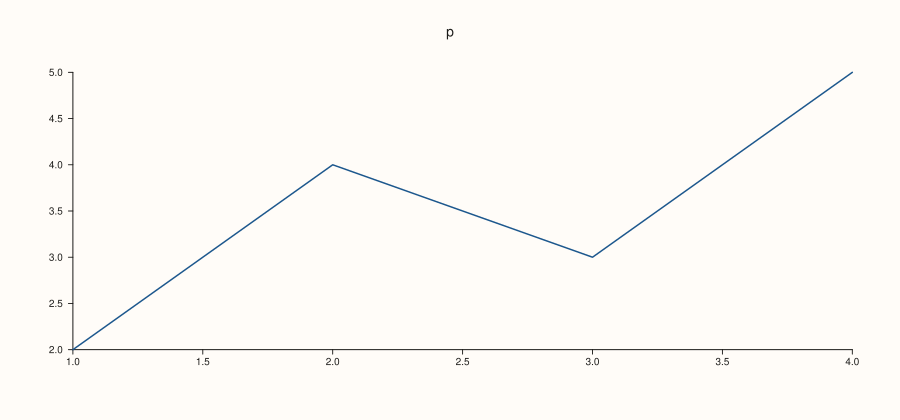
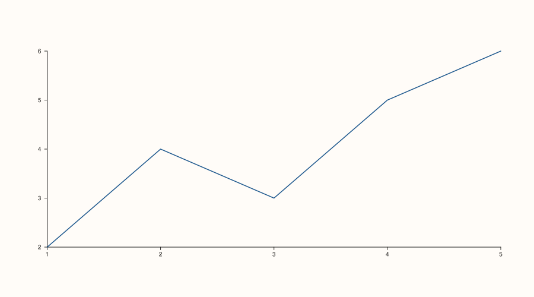

<!-- pluss-hand-authored -->

# Studio::size

[Back to Studio API Reference](../../studio_api_reference)

## Signature

```cpp
Studio& Studio::size(double width, double height) noexcept
```

## What It Does

Sets the overall canvas size of the figure — the outer width/height every pane, margin,
headline, caption, and legend is laid out inside of. This is the figure-level "how big is
the whole picture" control, distinct from a mosaic cell's size (derived automatically from
the figure size divided across [`mosaic()`](mosaic.md)'s grid) or a single pane's own
internal layout (governed by [`tight_layout()`](tight_layout.md) and the pane's own
axis/legend/caption settings).

```{important} Read fresh at render time, not snapshotted per pane
Unlike [`theme()`](theme.md), [`context_scales()`](context_scales.md), and
[`pane_style_defaults()`](pane_style_defaults.md) — all of which only affect panes created
*after* the call, because their values are copied onto each pane the moment
[`pane2()`](pane2.md)/[`pane3()`](pane3.md) creates it — `size()` sets a single figure-wide
`extent_` field that the renderer reads directly, fresh, every time
[`to_svg()`](to_svg.md)/[`show()`](show.md)/etc. actually builds the output. There is
nothing to "snapshot": calling `size()` before or after adding panes produces byte-identical
output, as long as it's called before the figure is actually rendered. See Example 3.
```

`size()` takes no validation path at all — it is `noexcept`, and accepts any `double` for
`width`/`height`, including zero, negative, or non-finite values, without complaint at call
time. A degenerate size still renders (the resulting SVG's `viewBox`/`width`/`height`
attributes simply reflect whatever was passed), so a caller who passes a nonsensical size
gets a nonsensical — but not crashing — figure.

## Parameters

**width** (`double`)
    The figure's total width, in the same abstract units every other size/position value in
    `PlussPl` uses (rendered 1:1 into the output SVG's coordinate space). Default `1280.0`
    if `size()` is never called.

**height** (`double`)
    The figure's total height. Default `820.0` if `size()` is never called.

## Returns

`Studio&`
    A reference to the same figure, for chaining.

## Examples

Example 1. The default size, never explicitly set.

```cpp
using namespace pluss::pl;

auto fig = studio("size_default");
auto& pane = fig.pane2();
pane.trend(std::vector<double>{1.0, 2.0, 3.0, 4.0, 5.0}, std::vector<double>{2.0, 4.0, 3.0, 5.0, 6.0});
fig.show();

std::cout << fig.extent().width << "x" << fig.extent().height << "\n";
```

### Output

```text
1280x820
```



Example 2. An explicit, smaller size.

```cpp
using namespace pluss::pl;

auto fig = studio("size_explicit");
fig.size(900.0, 500.0);

auto& pane = fig.pane2();
pane.trend(std::vector<double>{1.0, 2.0, 3.0, 4.0, 5.0}, std::vector<double>{2.0, 4.0, 3.0, 5.0, 6.0});
fig.show();

std::cout << fig.extent().width << "x" << fig.extent().height << "\n";
```

### Output

```text
900x500
```


Example 3. `size()` called **after** the pane already exists — the important callout above
in action: this still produces byte-identical output to Example 2, since `extent()` is read
fresh at render time rather than copied onto the pane at creation.

```cpp
using namespace pluss::pl;

auto fig = studio("size_after_pane");
auto& pane = fig.pane2();
pane.trend(std::vector<double>{1.0, 2.0, 3.0, 4.0, 5.0}, std::vector<double>{2.0, 4.0, 3.0, 5.0, 6.0});
fig.size(900.0, 500.0);
fig.show();
```



## Notes

- `noexcept` — no width/height combination throws, including zero, negative, or non-finite
  values; a degenerate size simply produces a degenerate (but still well-formed) SVG.
- Unlike `theme()`/`context_scales()`/`pane_style_defaults()`, call order relative to
  `pane2()`/`pane3()` does not matter — see the important callout above.
- Returns `*this` by reference — chains with any other mutator.

## See Also

- [`Studio::extent`](extent.md): reads the current size back.
- [`Studio::mosaic`](mosaic.md): divides this same canvas into a grid of equal cells for
  multiple panes.
- [`Studio::tight_layout`](tight_layout.md): controls how much of this canvas each pane's
  own margins consume, rather than the canvas size itself.

<div class="pluss-inline-prev-next">
  <a class="prev-link" href="theme_tokens.html">
    <span class="label">Previous</span>
    <span class="title">theme_tokens</span>
  </a>
  <a class="next-link" href="extent.html">
    <span class="label">Next</span>
    <span class="title">extent</span>
  </a>
</div>
