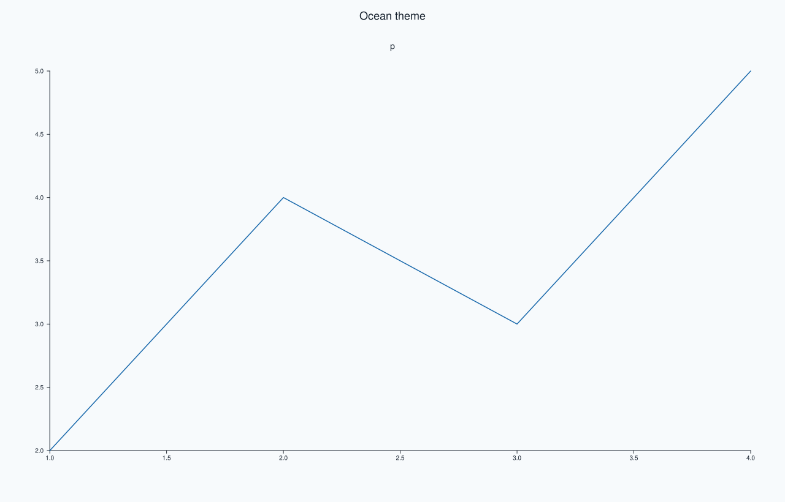
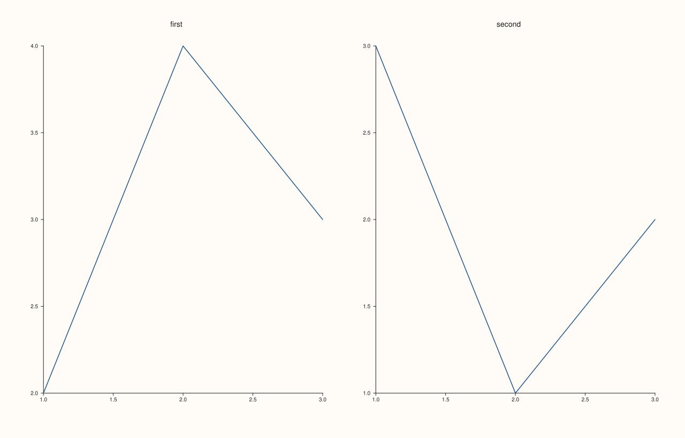

<!-- pluss-hand-authored -->

# studio

[Back to Studio API Reference](../../studio_api_reference)

## Signature

```cpp
Studio studio(std::string name = {})
Studio::Studio(std::string name = {}, Theme theme = Theme::paper())
```

## What It Does

Creates a figure. `studio(name)` is the everyday spelling and is exactly `Studio(name)`: an empty figure with no panes, 1280 by 820 drawing units, the paper theme, no headline, no mosaic, no docked legend and the relaxed layout. The constructor is the form that also takes a `Theme`, used for the figure's own parts (background, headline, captions, docked legend) and copied into every pane created afterwards. There is nothing to set before use: panes are added with [`pane2`](pane2.md) and [`pane3`](pane3.md), and the figure is looked at with [`show`](show.md) or saved with [`save_svg`](save_svg.md), [`save_pdf`](save_pdf.md) or [`save_png`](save_png.md).

The name is bookkeeping: it is never drawn (see [`name`](name.md)); an empty name is the default. A `Studio` is a value: copying one copies its panes and settings, and the copy is independent of the original. Moving is cheap, and a figure cannot be shared between two names. Panes created from a figure stay valid for as long as that figure lives.

## Parameters

**name** (`std::string`, default empty)
    The figure's name, used for window titles and temporary file names. Not drawn.

**theme** (`Theme`, constructor only, default `Theme::paper()`)
    The figure's theme; `Theme::ocean()` is the other built-in one.

## Returns

`Studio`
    A new, empty figure.

## Examples

Example 1. What a new figure holds. Nothing is drawn yet; the size, theme and settings are the defaults, and the first pane makes the figure worth drawing.

```cpp
auto fig = studio("studio_defaults");
std::cout << "name: " << fig.name() << ", panes: " << fig.pane_count() << "\n";
std::cout << "size: " << fig.extent().width << " x " << fig.extent().height << ", theme: " << fig.theme_tokens().name() << "\n";
std::cout << "headline empty: " << fig.headline_text().empty() << ", mosaic active: " << fig.mosaic_layout().active << ", dock: " << static_cast<int>(fig.legend_dock()) << ", tight layout: " << fig.tight_layout_enabled() << "\n";
fig.pane2("p").trend(std::vector<double>{1, 2, 3, 4}, std::vector<double>{2, 4, 3, 5});
fig.save_svg("figure.svg");
```

### Output

```text
name: studio_defaults, panes: 0
size: 1280 x 820, theme: paper
headline empty: 1, mosaic active: 0, dock: 0, tight layout: 0
```


Example 2. The two spellings. `studio(name)` and `Studio(name)` make the same figure, and an unnamed figure is allowed.

```cpp
auto a = studio("same");
Studio b("same");
Studio unnamed;
for (Studio* fig : {&a, &b}) fig->pane2("p").trend(std::vector<double>{1, 2, 3}, std::vector<double>{2, 4, 3});
std::cout << "same SVG: " << (a.to_svg() == b.to_svg()) << ", unnamed name empty: " << unnamed.name().empty() << "\n";
a.save_svg("figure.svg");
```

### Output

```text
same SVG: 1, unnamed name empty: 1
```


Example 3. A theme at construction. The constructor takes the figure's theme, here `ocean`; panes created afterwards copy it, and the figure's own parts use it.

```cpp
Studio fig("studio_ocean", Theme::ocean());
fig.headline("Ocean theme");
fig.pane2("p").trend(std::vector<double>{1, 2, 3, 4}, std::vector<double>{2, 4, 3, 5});
std::cout << "figure theme: " << fig.theme_tokens().name() << ", pane theme: " << fig.panes()[0].theme_tokens().name() << "\n";
fig.save_svg("figure.svg");
```

### Output

```text
figure theme: ocean, pane theme: ocean
```



Example 4. A figure is a value. A copy carries the panes and settings of the moment, and adding a pane to the copy leaves the original alone.

```cpp
auto original = studio("original");
original.pane2("first").trend(std::vector<double>{1, 2, 3}, std::vector<double>{2, 4, 3});
Studio copy = original;
copy.pane2("second").trend(std::vector<double>{1, 2, 3}, std::vector<double>{3, 1, 2});
copy.mosaic(1, 2);
std::cout << "original panes: " << original.pane_count() << ", copy panes: " << copy.pane_count() << "\n";
std::cout << "original mosaic: " << original.mosaic_layout().active << ", copy mosaic: " << copy.mosaic_layout().active << "\n";
copy.save_svg("figure.svg");
```

### Output

```text
original panes: 1, copy panes: 2
original mosaic: 0, copy mosaic: 1
```



Example 5. An empty figure is valid. With no panes it renders as an empty canvas and every output function works.

```cpp
auto fig = studio("studio_empty");
const std::string svg = fig.to_svg();
std::cout << "svg: " << (svg.find("<svg") != std::string::npos) << ", pdf: " << (fig.to_pdf().rfind("%PDF", 0) == 0) << "\n";
auto shown = studio("studio_empty_out");
shown.pane2("p").trend(std::vector<double>{1, 2, 3}, std::vector<double>{2, 4, 3});
shown.save_svg("figure.svg");
```

### Output

```text
svg: 1, pdf: 1
```


## Notes

- `studio` is the factory in `pluss::pl`; `Studio` is the type. Both are the public face of the plotting layer.
- A figure owns its panes; references to panes stay valid for the figure's life, and [`pane_index`](pane_index.md) turns one into a position.

## See Also

- [`Studio::pane2`](pane2.md), [`pane3`](pane3.md): add panes.
- [`Studio::theme`](theme.md): replaces the theme later.
- [`Studio::name`](name.md), [`rename`](rename.md): the name.
- [`Studio::size`](size.md): the figure size.

<div class="pluss-inline-prev-next">
  <a class="prev-link" href="size.html">
    <span class="label">Previous</span>
    <span class="title">size</span>
  </a>
  <a class="next-link" href="style.html">
    <span class="label">Next</span>
    <span class="title">style</span>
  </a>
</div>
