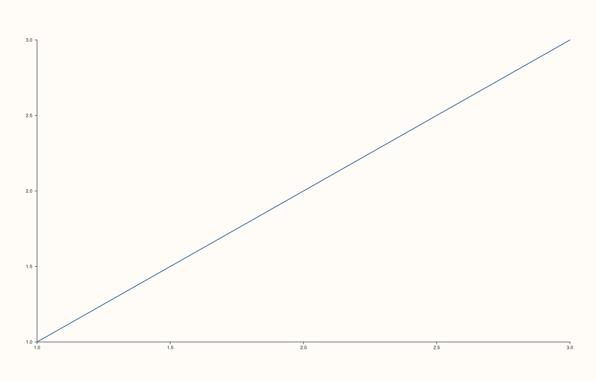
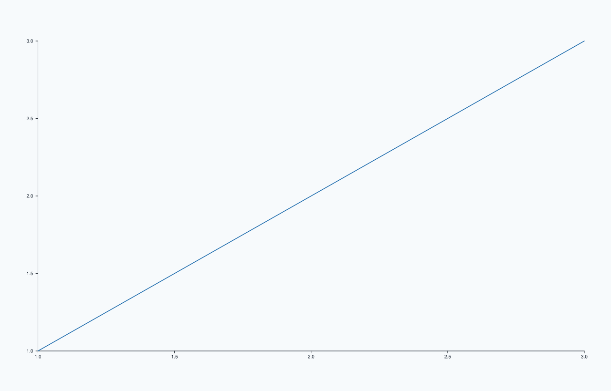

<!-- pluss-hand-authored -->

# pluss::pl::studio

[Back to Studio API Reference](../../studio_api_reference)

## Signatures

```cpp
pluss::pl::studio(std::string name = {}) -> Studio

// The constructor studio() wraps:
Studio::Studio(std::string name = {}, Theme theme = Theme::paper())
```

## What It Does

`studio()` is the idiomatic entry point into every `PlussPl` chart — it builds an empty
`Studio` (a figure with no panes yet) and hands it back by value. It is a thin one-line
wrapper: `studio(name)` is exactly `Studio(std::move(name))`, nothing more. The only reason
to reach for the `Studio` constructor directly instead of `studio()` is to pass an explicit
`theme` as a second argument at construction time — `studio()` has no parameter for that;
every `Studio` it builds starts on `Theme::paper()` and is themed afterward via
[`Studio::theme`](theme.md) if a different theme is wanted.

```{important} An empty Studio has nothing to render yet
`studio()`/`Studio(...)` alone produces a figure with zero panes. Nothing is drawn — and
[`to_svg()`](to_svg.md)/[`show()`](show.md) on a pane-less `Studio` still succeeds, just
producing an essentially blank canvas. A real chart needs at least one
[`pane2()`](pane2.md)/[`pane3()`](pane3.md) call, followed by a `flash::` plotting function
(e.g. `pane.trend(x, y)`) drawing into that pane.
```

## Parameters

**name** (`std::string`, default `{}`)
    The figure's own name — used as the fallback window title for [`show()`](show.md), the
    fallback output-file stem some save paths use internally, and returned unchanged by
    [`name()`](name.md). Purely bookkeeping: it is **not** rendered anywhere inside the SVG
    itself (unlike [`headline()`](headline.md), which is). An empty name (the default) is a
    valid, common choice for one-off exploratory charts.

**theme** (`Theme`, default `Theme::paper()`, constructor-only)
    The starting theme every pane created afterward inherits, unless overridden per-pane.
    See [`Studio::theme`](theme.md) for the full explanation of `Theme` and the built-in
    `Theme::paper()`/`Theme::ocean()` presets. Only reachable via the `Studio` constructor
    directly — `studio()` always starts on `Theme::paper()`.

## Returns

`Studio`
    A new, empty figure — by value, ready to have panes added to it.

## Examples

Example 1. The default, no-argument call: an unnamed figure.

```cpp
using namespace pluss::pl;

auto fig = studio();
auto& pane = fig.pane2();
pane.trend(std::vector<double>{1.0, 2.0, 3.0}, std::vector<double>{1.0, 2.0, 3.0});
fig.show();
```

`fig.name()` is the empty string here — perfectly valid; nothing about rendering or export
requires a name.



Example 2. An explicit name.

```cpp
using namespace pluss::pl;

auto fig = studio("revenue");
auto& pane = fig.pane2();
pane.trend(std::vector<double>{1.0, 2.0, 3.0}, std::vector<double>{1.0, 2.0, 3.0});
fig.show();
```

`fig.name()` is now `"revenue"` — used as the window title if [`show()`](show.md)'s own
`title` argument is left empty, and as the default output-filename stem for
[`save_pdf(..., PdfEngine::SvgConvert)`](save_pdf.md)/[`save_png`](save_png.md)'s internal
temp files.


Example 3. Reaching past `studio()` to the `Studio` constructor directly, for an explicit
starting theme.

```cpp
using namespace pluss::pl;

Studio fig("revenue", Theme::ocean());
auto& pane = fig.pane2();
pane.trend(std::vector<double>{1.0, 2.0, 3.0}, std::vector<double>{1.0, 2.0, 3.0});
fig.show();
```

`studio()` alone has no way to set an initial theme — reach for the constructor when the
very first pane needs to already be themed (as opposed to calling
[`.theme(Theme::ocean())`](theme.md) as a second step, which produces an identical result
for any panes created afterward).



Example 4. `studio(name)` and `Studio(name)` (default theme) produce byte-identical SVGs
for the same subsequent calls — confirming `studio()` really is just a thin wrapper.

```cpp
using namespace pluss::pl;

auto via_factory = studio("revenue");
auto& p1 = via_factory.pane2();
p1.trend(std::vector<double>{1.0, 2.0, 3.0}, std::vector<double>{1.0, 2.0, 3.0});

Studio via_ctor("revenue");
auto& p2 = via_ctor.pane2();
p2.trend(std::vector<double>{1.0, 2.0, 3.0}, std::vector<double>{1.0, 2.0, 3.0});

via_factory.show();
```


## Notes

- `studio()` is a one-line forward to `Studio(std::move(name))` — identical output to the
  constructor's default-theme form for the same `name`.
- `name` is bookkeeping only — it never appears inside the rendered SVG. For text that
  actually renders on the figure, see [`headline()`](headline.md).
- An empty `Studio` renders successfully but has nothing visible in it — see the important
  callout above.
- The `Theme`-taking constructor overload is the only way to set a theme at construction
  time; every other path (including `studio()`) starts on `Theme::paper()` and themes
  afterward via [`theme()`](theme.md).

## See Also

- [`Studio::rename`](rename.md): change the name after construction.
- [`Studio::theme`](theme.md): change the theme after construction — the `studio()`-first,
  theme-second alternative to Example 3's constructor call.
- [`Studio::pane2`](pane2.md) / [`pane3`](pane3.md): the next step after building an empty
  `Studio` — add a pane to actually draw into.

<div class="pluss-inline-prev-next">
  <a class="next-link" href="rename.html">
    <span class="label">Next</span>
    <span class="title">rename</span>
  </a>
</div>
