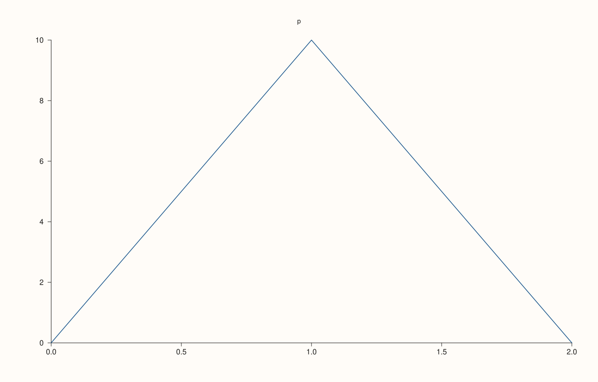
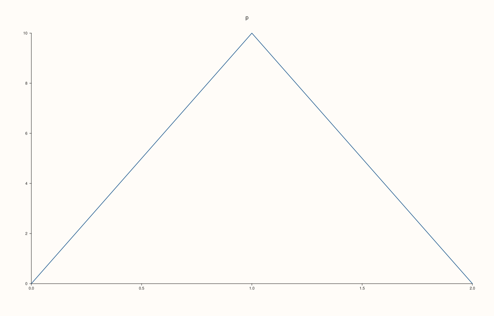
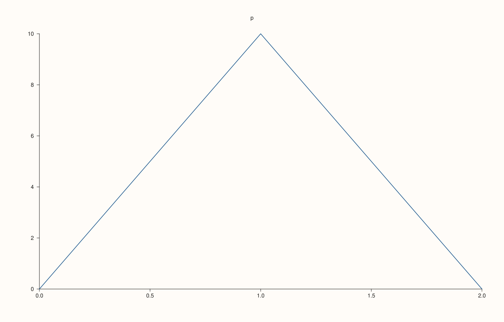
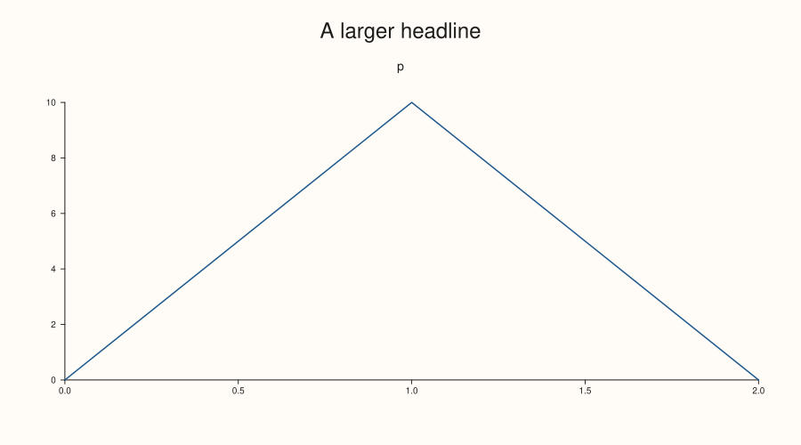

<!-- pluss-hand-authored -->

# Studio::style

[Back to Studio API Reference](../../studio_api_reference)

## Signature

```cpp
Studio& Studio::style(const StyleOptions& options)
```

## What It Does

Gives the figure a set of [`StyleOptions`](../types/StyleOptions.md): the numbers that decide its look, such as the sizes of fonts, the length of ticks, the room around a plot and the size of markers. The set is copied into the figure and used every time the figure is drawn, by [`to_svg`](to_svg.md), [`show`](show.md) and the save calls. A figure that was never given a set is drawn with the defaults.

The usual way is to take a copy of the current values with [`style_options`](style_options.md), change some, and give the copy back. A set can be given to any number of figures, and a later call replaces the earlier one entirely, so a call after a change to a copy is the way to apply it.

Every value must be a finite number. A set with a value that is not (a `NaN` or an infinity) is refused at once, with a message that names the value, and the figure keeps the style it had.

## Parameters

**options** (`StyleOptions`)
    The values to draw with.

## Returns

`Studio&`
    The same figure, for chaining.

## Examples

Example 1. Giving a figure a larger tick font. The figure drawn with the set differs from the one drawn without it.

```cpp
auto build = [&](bool styled) {
  auto fig = studio("style_basic");
  fig.pane2("p").trend(std::vector<double>{0, 1, 2}, std::vector<double>{0, 10, 0});
  if (styled) {
    StyleOptions options = fig.style_options();
    options.tick_font_pt = 16.0;
    fig.style(options);
  }
  return fig.to_svg();
};
std::cout << "styled differs: " << (build(true) != build(false)) << "\n";
auto fig = studio("style_basic_out");
fig.pane2("p").trend(std::vector<double>{0, 1, 2}, std::vector<double>{0, 10, 0});
StyleOptions options = fig.style_options();
options.tick_font_pt = 16.0;
fig.style(options);
fig.save_svg("figure.svg");
```

### Output

```text
styled differs: 1
```



Example 2. A later call replaces the earlier set as a whole: values changed by the first call and not by the second are back at their defaults, because the second set was made from the defaults.

```cpp
auto fig = studio("style_replace");
fig.pane2("p").trend(std::vector<double>{0, 1, 2}, std::vector<double>{0, 10, 0});
StyleOptions first;
first.tick_font_pt = 16.0;
fig.style(first);
StyleOptions second;
second.axis_label_font_pt = 15.0;
fig.style(second);
std::cout << "tick font " << fig.style_options().tick_font_pt << ", axis label font " << fig.style_options().axis_label_font_pt << "\n";
fig.save_svg("figure.svg");
```

### Output

```text
tick font 10, axis label font 15
```



Example 3. The set is copied when it is given. Changing the variable afterwards does not change the figure.

```cpp
auto fig = studio("style_copy");
fig.pane2("p").trend(std::vector<double>{0, 1, 2}, std::vector<double>{0, 10, 0});
StyleOptions options;
options.tick_font_pt = 14.0;
fig.style(options);
options.tick_font_pt = 30.0;
std::cout << "figure uses " << fig.style_options().tick_font_pt << ", the variable holds " << options.tick_font_pt << "\n";
fig.save_svg("figure.svg");
```

### Output

```text
figure uses 14, the variable holds 30
```



Example 4. The call returns the figure, so it chains with the other figure settings.

```cpp
StyleOptions options;
options.headline_font_pt = 24.0;
auto fig = studio("style_chain");
fig.style(options).headline("A larger headline").size(900.0, 500.0);
fig.pane2("p").trend(std::vector<double>{0, 1, 2}, std::vector<double>{0, 10, 0});
fig.save_svg("figure.svg");
```



Example 5. A value that is not finite is refused, and the figure keeps its style.

```cpp
auto fig = studio("style_errors_method");
fig.pane2("p").trend(std::vector<double>{0, 1, 2}, std::vector<double>{0, 10, 0});
StyleOptions options;
options.axis_label_font_pt = std::numeric_limits<double>::infinity();
try {
  fig.style(options);
} catch (const pluss::Error& e) {
  std::cout << e.message() << "\n";
}
std::cout << "axis label font still " << fig.style_options().axis_label_font_pt << "\n";
fig.save_svg("figure.svg");
```

### Output

```text
style: axis_label_font_pt must be a finite number
axis label font still 11
```


## Notes

- Not `noexcept`: the set is copied, and a non-finite value throws `pluss::Error`.
- Only the values listed on the [`StyleOptions`](../types/StyleOptions.md) page can be changed; the layout that depends on content is still worked out from the content.

## See Also

- [`StyleOptions`](../types/StyleOptions.md): every value, with its default.
- [`Studio::style_options`](style_options.md): read the values a figure draws with.
- [`Studio::context_scales`](context_scales.md): scale the text of the whole figure.

<div class="pluss-inline-prev-next">
  <a class="prev-link" href="studio.html">
    <span class="label">Previous</span>
    <span class="title">studio</span>
  </a>
  <a class="next-link" href="style_options.html">
    <span class="label">Next</span>
    <span class="title">style_options</span>
  </a>
</div>
