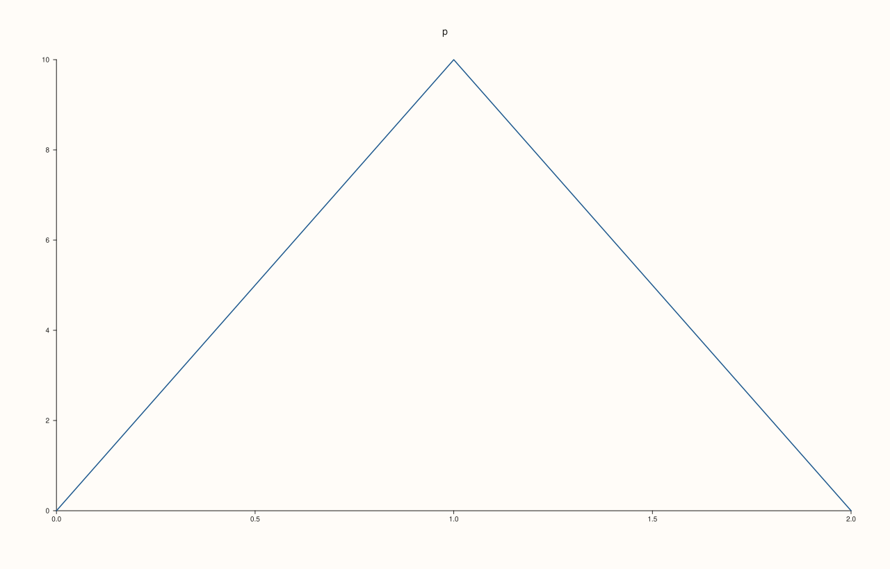
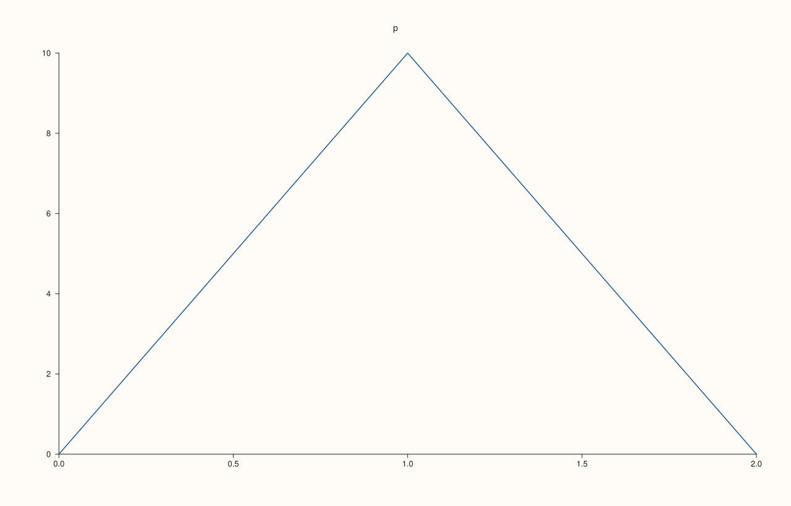
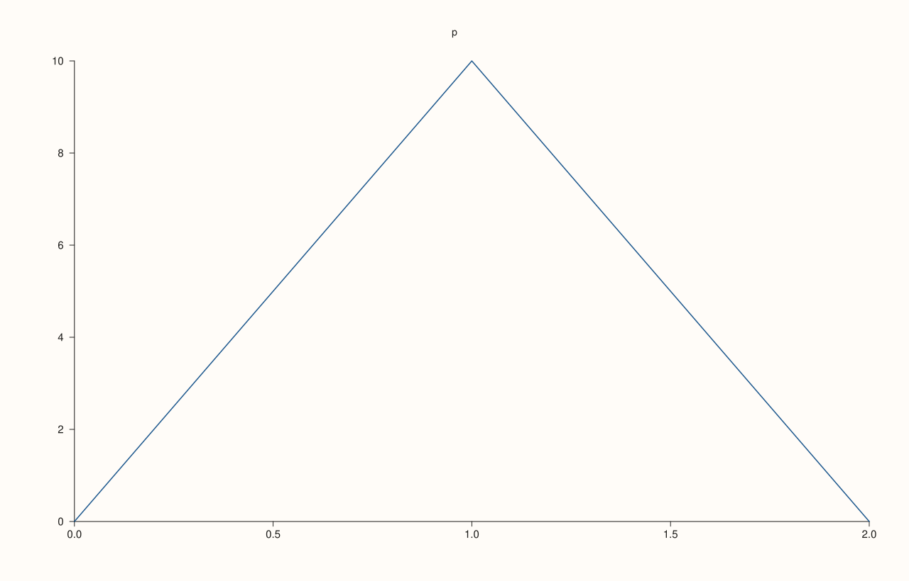
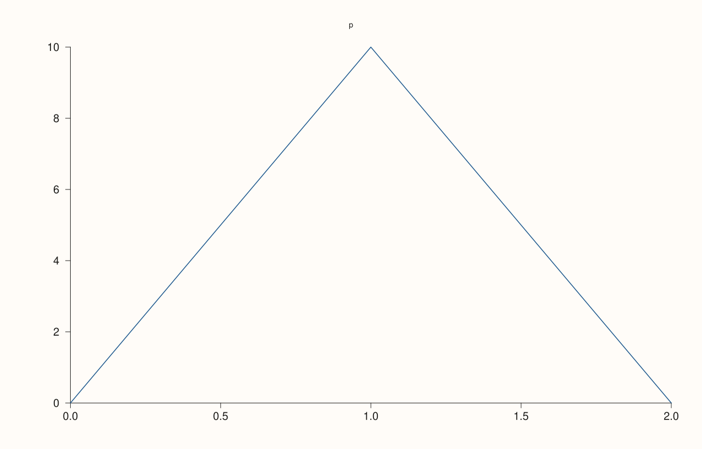

<!-- pluss-hand-authored -->

# Studio::style_options

[Back to Studio API Reference](../../studio_api_reference)

## Signature

```cpp
const StyleOptions& Studio::style_options() const
```

## What It Does

Returns the [`StyleOptions`](../types/StyleOptions.md) the figure draws with: the set it was given by [`style`](style.md), or the defaults if it was never given one. It is the way to start a restyling, by taking a copy and changing the values that should differ, and to check what a figure will use.

The reference is to the figure's own set and follows later calls to `style`; copy it to keep the values.

## Parameters

*(none)*

## Returns

`const StyleOptions&`
    The values the figure draws with.

## Examples

Example 1. A figure that was never styled reports the defaults.

```cpp
auto fig = studio("style_options_defaults");
fig.pane2("p").trend(std::vector<double>{0, 1, 2}, std::vector<double>{0, 10, 0});
const StyleOptions& options = fig.style_options();
const StyleOptions defaults;
std::cout << "tick font " << options.tick_font_pt << " pt; equal to the defaults: " << (options.tick_font_pt == defaults.tick_font_pt && options.pane_left_inset.relaxed == defaults.pane_left_inset.relaxed) << "\n";
fig.save_svg("figure.svg");
```

### Output

```text
tick font 10 pt; equal to the defaults: 1
```



Example 2. After `style` it reports the set that was given.

```cpp
auto fig = studio("style_options_after");
fig.pane2("p").trend(std::vector<double>{0, 1, 2}, std::vector<double>{0, 10, 0});
StyleOptions given;
given.tick_font_pt = 13.0;
fig.style(given);
std::cout << "tick font " << fig.style_options().tick_font_pt << "\n";
fig.save_svg("figure.svg");
```

### Output

```text
tick font 13
```



Example 3. Starting from a figure's own values. A copy of the current set is changed and given back, which changes only the value touched.

```cpp
auto fig = studio("style_options_start");
fig.pane2("p").trend(std::vector<double>{0, 1, 2}, std::vector<double>{0, 10, 0});
StyleOptions options = fig.style_options();
const double before_label = options.axis_label_font_pt;
options.tick_font_pt = 15.0;
fig.style(options);
std::cout << "tick font " << fig.style_options().tick_font_pt << ", axis label font unchanged: " << (fig.style_options().axis_label_font_pt == before_label) << "\n";
fig.save_svg("figure.svg");
```

### Output

```text
tick font 15, axis label font unchanged: 1
```



Example 4. Each figure has its own set: one figure styled, another not.

```cpp
auto styled = studio("style_options_styled");
auto plain = studio("style_options_plain");
StyleOptions options;
options.tick_font_pt = 20.0;
styled.style(options);
plain.pane2("p").trend(std::vector<double>{0, 1, 2}, std::vector<double>{0, 10, 0});
styled.pane2("p").trend(std::vector<double>{0, 1, 2}, std::vector<double>{0, 10, 0});
std::cout << "styled " << styled.style_options().tick_font_pt << ", plain " << plain.style_options().tick_font_pt << "\n";
styled.save_svg("figure.svg");
```

### Output

```text
styled 20, plain 10
```



## Notes

- Reads only; a reference into the figure, valid until the figure is destroyed.

## See Also

- [`Studio::style`](style.md): give the figure a set.
- [`StyleOptions`](../types/StyleOptions.md): every value, with its default.

<div class="pluss-inline-prev-next">
  <a class="prev-link" href="style.html">
    <span class="label">Previous</span>
    <span class="title">style</span>
  </a>
  <a class="next-link" href="subpane2.html">
    <span class="label">Next</span>
    <span class="title">subpane2</span>
  </a>
</div>
