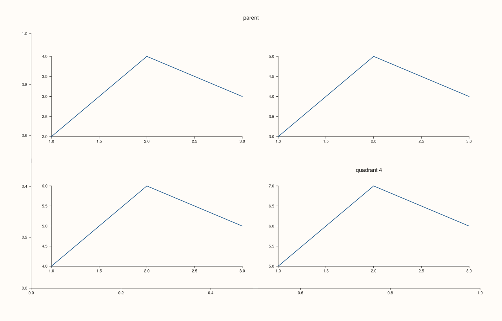
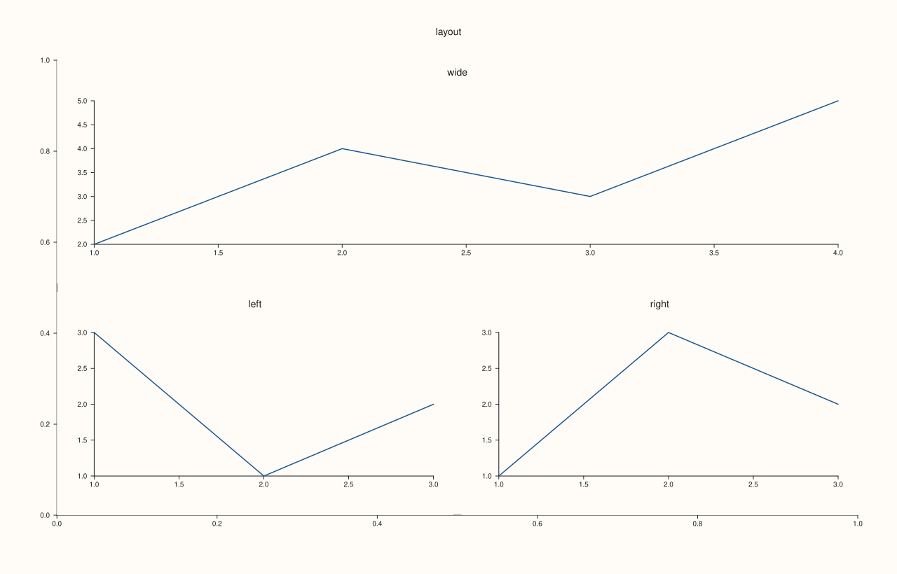

<!-- pluss-hand-authored -->

# Studio::subpane2

[Back to Studio API Reference](../../studio_api_reference)

## Signature

```cpp
Pane& Studio::subpane2(
    std::size_t parent_index,
    std::int64_t rows,
    std::int64_t cols,
    std::int64_t row,
    std::int64_t col,
    std::int64_t row_span = 1,
    std::int64_t col_span = 1,
    std::string title = {})
```

## What It Does

Creates a new 2D pane that occupies a cell (or a spanning block of cells) within a **local
subgrid** nested inside an existing top-level pane, rather than a cell in the figure's own
top-level [`mosaic()`](mosaic.md). `parent_index` names the existing pane whose area the
subgrid divides (typically a pane created purely to act as a placeholder container — see
Example 1); `rows`/`cols` define the local subgrid's shape *for this call*, and `row`/`col`
(plus `row_span`/`col_span`) place the new pane within it.

Internally, `subpane2()` is exactly `pane2(title)` followed by setting the new pane's
`PanePlacement` to reference `parent_index` and the given local grid coordinates — it
inherits every other `pane2()` behavior unchanged: the same `context_scales()`/
`pane_style_defaults()` creation-time snapshots, and the same
`Pane&`-invalidated-by-later-pane-creation-calls hazard described in
[`pane2()`](pane2.md)'s important callout.

```{important} Each subpane2() call re-declares the local subgrid's shape
`rows`/`cols` aren't stored once per parent — they're passed on *every* `subpane2()` call
for that parent, and every call for the same `parent_index` must agree on the same
`rows`/`cols` to form a coherent grid. This is a low-level, per-call construction detail:
there's no separate "define this parent's subgrid" step to call first.
```

Four validation checks run, in order, before the new pane is created — see Example 3 for
all four failure demonstrations:

1. `parent_index` must be a valid index into this figure's current pane list, or throws
   `std::out_of_range("subpane2: parent_index out of range")`.
2. `rows` and `cols` must both be positive, or throws
   `std::invalid_argument("subpane2: rows and cols must be positive")`.
3. `row`, `col` must be non-negative and `row_span`, `col_span` must be positive, or throws
   `std::invalid_argument("subpane2: row/col must be non-negative and spans must be positive")`.
4. The requested cell/span must fit within the declared `rows`x`cols` grid
   (`row + row_span <= rows` and `col + col_span <= cols`), or throws
   `std::invalid_argument("subpane2: requested slot exceeds local subgrid bounds")`.

## Parameters

**parent_index** (`std::size_t`)
    The index (from [`pane_index()`](pane_index.md), or simply the creation order) of the
    existing pane whose area this subgrid divides.

**rows**, **cols** (`std::int64_t`)
    The shape of the local subgrid for this call. Both must be positive.

**row**, **col** (`std::int64_t`)
    The 0-indexed cell this new pane occupies within the local subgrid. Both must be
    non-negative.

**row_span**, **col_span** (`std::int64_t`, default `1`, `1`)
    How many rows/columns this pane spans starting from `row`/`col`. Both must be positive.

**title** (`std::string`, default `{}`)
    The new subpane's title.

## Returns

`Pane&`
    A reference to the newly created subpane, valid until the next pane-creation call (see
    [`pane2()`](pane2.md)'s important callout).

## Examples

Example 1. A `2x2` local subgrid inside one parent pane, filled with four subpanes — one
per cell.

```cpp
using namespace pluss::pl;

auto fig = studio("subpane2_basic");
fig.pane2("parent");  // index 0 -- a placeholder container for the subgrid
auto& top_left = fig.subpane2(0, 2, 2, 0, 0);
flash::lineplot(top_left, std::vector<double>{1.0, 2.0, 3.0}, std::vector<double>{2.0, 4.0, 3.0});
auto& top_right = fig.subpane2(0, 2, 2, 0, 1);
flash::lineplot(top_right, std::vector<double>{1.0, 2.0, 3.0}, std::vector<double>{3.0, 5.0, 4.0});
auto& bottom_left = fig.subpane2(0, 2, 2, 1, 0);
flash::lineplot(bottom_left, std::vector<double>{1.0, 2.0, 3.0}, std::vector<double>{4.0, 6.0, 5.0});
auto& bottom_right = fig.subpane2(0, 2, 2, 1, 1, 1, 1, "quadrant 4");
flash::lineplot(bottom_right, std::vector<double>{1.0, 2.0, 3.0}, std::vector<double>{5.0, 7.0, 6.0});
fig.show();

std::cout << fig.pane_count() << "\n";  // parent + 4 subpanes
```

### Output

```text
5
```



Example 2. A `2x3` local subgrid using `row_span`/`col_span` to make one subpane span both
rows, and two others each span two columns.

```cpp
using namespace pluss::pl;

auto fig = studio("subpane2_span");
fig.pane2("parent");  // index 0
auto& tall = fig.subpane2(0, 2, 3, 0, 0, 2, 1, "spans both rows");
flash::lineplot(tall, std::vector<double>{1.0, 2.0, 3.0}, std::vector<double>{2.0, 4.0, 3.0});
auto& top = fig.subpane2(0, 2, 3, 0, 1, 1, 2, "spans two cols, row 0");
flash::lineplot(top, std::vector<double>{1.0, 2.0, 3.0}, std::vector<double>{3.0, 5.0, 4.0});
auto& bottom = fig.subpane2(0, 2, 3, 1, 1, 1, 2, "spans two cols, row 1");
flash::lineplot(bottom, std::vector<double>{1.0, 2.0, 3.0}, std::vector<double>{4.0, 6.0, 5.0});
fig.show();
```



Example 3. All four validation failures, one at a time.

```cpp
using namespace pluss::pl;

auto fig = studio("subpane2_failures");
fig.pane2("parent");  // index 0

try {
  fig.subpane2(5, 2, 2, 0, 0);
} catch (const std::out_of_range& e) {
  std::cout << e.what() << "\n";
}

try {
  fig.subpane2(0, 0, 2, 0, 0);
} catch (const std::invalid_argument& e) {
  std::cout << e.what() << "\n";
}

try {
  fig.subpane2(0, 2, 2, -1, 0);
} catch (const std::invalid_argument& e) {
  std::cout << e.what() << "\n";
}

try {
  fig.subpane2(0, 2, 2, 0, 0, 3, 1);
} catch (const std::invalid_argument& e) {
  std::cout << e.what() << "\n";
}
```

### Output

```text
subpane2: parent_index out of range
subpane2: rows and cols must be positive
subpane2: row/col must be non-negative and spans must be positive
subpane2: requested slot exceeds local subgrid bounds
```

## Notes

- Not `noexcept` — validates four separate conditions and throws on the first violated one.
- Equivalent to `pane2(title)` plus a `PanePlacement` referencing `parent_index`/local grid
  coordinates — inherits every `pane2()` behavior, including the reference-invalidation
  hazard (its own returned `Pane&`, and the parent's, are both invalidated by any later
  pane-creation call).
- `rows`/`cols` are re-declared on every call for the same `parent_index`, not defined once
  — see the important callout above.
- The parent pane (`parent_index`) is typically created purely as a placeholder container
  and never plotted into directly, though nothing prevents plotting into it as well.

## See Also

- [`Studio::subpane3`](subpane3.md): the 3D counterpart.
- [`Studio::pane2`](pane2.md): the underlying mechanism, and the reference-invalidation
  hazard documented in full.
- [`Studio::pane_index`](pane_index.md): how to obtain `parent_index` for a pane created
  earlier.
- [`Studio::mosaic`](mosaic.md): the figure's own *top-level* grid, as opposed to this
  pane-local subgrid.

<div class="pluss-inline-prev-next">
  <a class="prev-link" href="pane_index.html">
    <span class="label">Previous</span>
    <span class="title">pane_index</span>
  </a>
  <a class="next-link" href="subpane3.html">
    <span class="label">Next</span>
    <span class="title">subpane3</span>
  </a>
</div>
