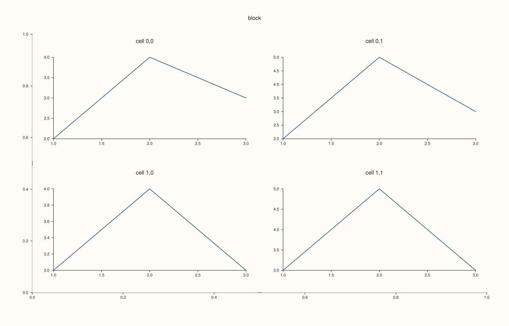
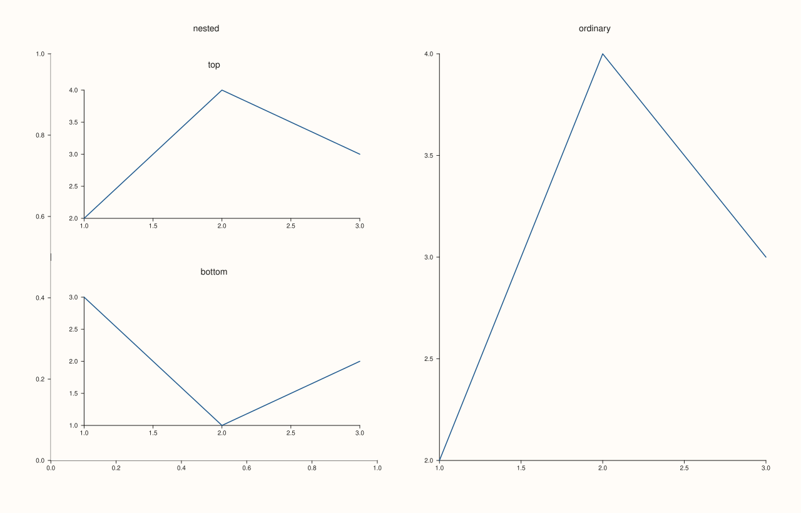
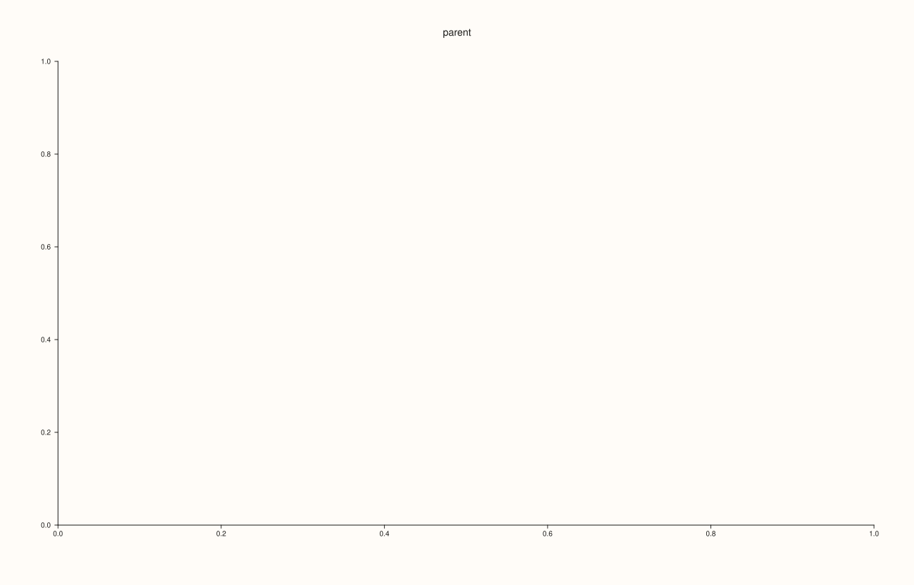
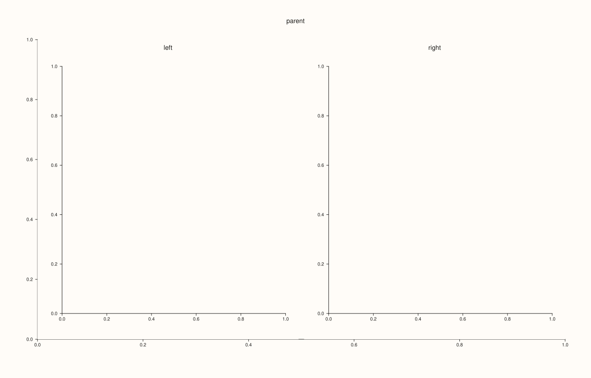
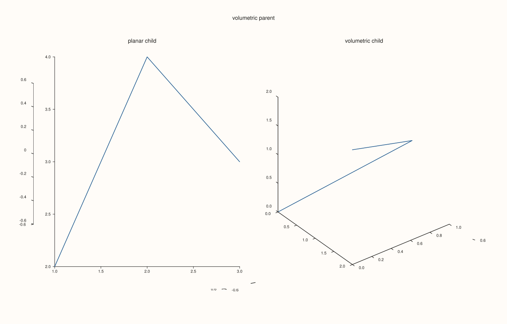

<!-- pluss-hand-authored -->

# Studio::subpane2

[Back to Studio API Reference](../../studio_api_reference)

## Signature

```cpp
Pane& Studio::subpane2(std::size_t parent_index, std::int64_t rows, std::int64_t cols, std::int64_t row, std::int64_t col, std::int64_t row_span = 1, std::int64_t col_span = 1, std::string title = {})
```

## What It Does

Adds a two-dimensional pane that sits inside another pane's area, on a small grid of its own. The parent pane (named by its index, from [`pane_index`](pane_index.md)) is created first and acts as a container; its area is divided into `rows` by `cols` cells with 12-point gutters, and the new pane takes the block of cells that starts at `(row, col)` and covers `row_span` by `col_span` cells. It is the way to put several small plots inside one cell of a [`mosaic`](mosaic.md): a pane that holds a 2 by 2 block of panels, or a wide plot over two narrow ones. Otherwise it behaves exactly like [`pane2`](pane2.md): the title is drawn above it, the returned reference stays valid for the life of the figure, and the figure's theme, font scales and style defaults are copied in at creation. The kind is the one of the call, whatever the parent is.

The grid is declared on every call, so all sub-panes of one parent must pass the same `rows` and `cols`; the checks happen when the sub-pane is created, and the figure is unchanged when one fails:

- `parent_index` must name an existing pane;
- `rows` and `cols` must be positive, `row` and `col` not negative, the spans positive;
- the block must lie inside the grid (`row + row_span <= rows`, `col + col_span <= cols`);
- the grid must be the same shape as that of the parent's earlier sub-panes;
- the block must not overlap the block of an earlier sub-pane of the same parent.

All of these throw `pluss::Error` with a message that names the problem. A sub-pane can itself be the parent of further sub-panes.

## Parameters

**parent_index** (`std::size_t`)
    Index of the parent pane, as returned by [`pane_index`](pane_index.md).

**rows**, **cols** (`std::int64_t`)
    The shape of the nested grid. Positive; the same for every sub-pane of this parent.

**row**, **col** (`std::int64_t`)
    The first cell of the sub-pane, counted from 0 at the top left of the parent.

**row_span**, **col_span** (`std::int64_t`, default 1)
    How many rows and columns the sub-pane covers.

**title** (`std::string`, default empty)
    The sub-pane's title. Empty draws none.

## Returns

`Pane&`
    The new pane, valid for the life of the figure.

## Examples

Example 1. A 2 by 2 block inside one pane. The parent is a container; four sub-panes fill its grid, one cell each.

```cpp
auto fig = studio("subpane2_grid");
auto& parent = fig.pane2("block");
const std::size_t parent_index = fig.pane_index(parent);
for (int r = 0; r < 2; ++r) {
  for (int c = 0; c < 2; ++c) {
    auto& cell = fig.subpane2(parent_index, 2, 2, r, c, 1, 1, "cell " + std::to_string(r) + "," + std::to_string(c));
    cell.trend(std::vector<double>{1, 2, 3}, std::vector<double>{2.0 + r, 4.0 + c, 3.0});
  }
}
std::cout << "panes: " << fig.pane_count() << "\n";
fig.save_svg("figure.svg");
```

### Output

```text
panes: 5
```



Example 2. Blocks of cells. A wide sub-pane covers the top row (`col_span = 2`) and two narrow ones share the bottom row.

```cpp
auto fig = studio("subpane2_span");
auto& parent = fig.pane2("layout");
const std::size_t parent_index = fig.pane_index(parent);
auto& wide = fig.subpane2(parent_index, 2, 2, 0, 0, 1, 2, "wide");
wide.trend(std::vector<double>{1, 2, 3, 4}, std::vector<double>{2, 4, 3, 5});
auto& left = fig.subpane2(parent_index, 2, 2, 1, 0, 1, 1, "left");
left.trend(std::vector<double>{1, 2, 3}, std::vector<double>{3, 1, 2});
auto& right = fig.subpane2(parent_index, 2, 2, 1, 1, 1, 1, "right");
right.trend(std::vector<double>{1, 2, 3}, std::vector<double>{1, 3, 2});
const auto& p = wide.placement();
std::cout << "wide: cell " << p.row << "," << p.col << " span " << p.row_span << "x" << p.col_span << ", parent " << p.parent << "\n";
fig.save_svg("figure.svg");
```

### Output

```text
wide: cell 0,0 span 1x2, parent 0
```


Example 3. Inside a mosaic. The parent is one cell of a 1 by 2 mosaic; the other cell is an ordinary pane, so a figure mixes plain and nested panes.

```cpp
auto fig = studio("subpane2_mosaic");
fig.mosaic(1, 2);
auto& parent = fig.pane2("nested");
const std::size_t parent_index = fig.pane_index(parent);
auto& top = fig.subpane2(parent_index, 2, 1, 0, 0, 1, 1, "top");
top.trend(std::vector<double>{1, 2, 3}, std::vector<double>{2, 4, 3});
auto& bottom = fig.subpane2(parent_index, 2, 1, 1, 0, 1, 1, "bottom");
bottom.trend(std::vector<double>{1, 2, 3}, std::vector<double>{3, 1, 2});
fig.pane2("ordinary").trend(std::vector<double>{1, 2, 3}, std::vector<double>{2, 4, 3});
fig.save_svg("figure.svg");
```



Example 4. Shape errors. A missing parent, a bad grid, a negative cell, a zero span and a block that does not fit are each refused with a message, and no pane is added.

```cpp
auto fig = studio("subpane2_shape");
auto& parent = fig.pane2("parent");
const std::size_t p = fig.pane_index(parent);
auto attempt = [&](const char* label, auto call) {
  try {
    call();
    std::cout << label << ": ok\n";
  } catch (const pluss::Error& e) {
    std::cout << label << ": " << e.message() << "\n";
  }
};
attempt("no such parent", [&] { fig.subpane2(7, 1, 2, 0, 0); });
attempt("zero rows", [&] { fig.subpane2(p, 0, 2, 0, 0); });
attempt("negative row", [&] { fig.subpane2(p, 1, 2, -1, 0); });
attempt("zero span", [&] { fig.subpane2(p, 1, 2, 0, 0, 0, 1); });
attempt("does not fit", [&] { fig.subpane2(p, 1, 2, 0, 1, 1, 2); });
std::cout << "panes: " << fig.pane_count() << "\n";
fig.save_svg("figure.svg");
```

### Output

```text
no such parent: subpane2: parent_index out of range
zero rows: subpane2: rows and cols must be positive
negative row: subpane2: row/col must be non-negative and spans must be positive
zero span: subpane2: row/col must be non-negative and spans must be positive
does not fit: subpane2: requested slot exceeds local subgrid bounds
panes: 1
```



Example 5. Clashes between sub-panes. A second sub-pane on an occupied cell, and one that declares a different grid for the same parent, are refused when they are created; a free cell is accepted.

```cpp
auto fig = studio("subpane2_clash");
auto& parent = fig.pane2("parent");
const std::size_t p = fig.pane_index(parent);
fig.subpane2(p, 1, 2, 0, 0, 1, 1, "left");
auto attempt = [&](const char* label, auto call) {
  try {
    call();
    std::cout << label << ": ok\n";
  } catch (const pluss::Error& e) {
    std::cout << label << ": " << e.message() << "\n";
  }
};
attempt("same cell again", [&] { fig.subpane2(p, 1, 2, 0, 0, 1, 1, "again"); });
attempt("another grid", [&] { fig.subpane2(p, 2, 2, 1, 1, 1, 1, "other grid"); });
attempt("free cell", [&] { fig.subpane2(p, 1, 2, 0, 1, 1, 1, "right"); });
std::cout << "panes: " << fig.pane_count() << "\n";
fig.save_svg("figure.svg");
```

### Output

```text
same cell again: subpane2: cell (0, 0) overlaps the sub-pane 'left' already placed there
another grid: subpane2: all sub-panes of pane 0 share one local grid, which is 1 x 2, not 2 x 2
free cell: ok
panes: 3
```



Example 6. The kind follows the call, not the parent. A planar parent can hold 3D sub-panes and the reverse; each sub-pane reports the kind of the method that made it.

```cpp
auto fig = studio("subpane2_kinds");
auto& parent = fig.pane3("volumetric parent");
const std::size_t p = fig.pane_index(parent);
auto& two = fig.subpane2(p, 1, 2, 0, 0, 1, 1, "planar child");
auto& three = fig.subpane3(p, 1, 2, 0, 1, 1, 1, "volumetric child");
std::cout << "subpane2: " << (two.kind() == PaneKind::Planar ? "planar" : "volumetric") << ", subpane3: " << (three.kind() == PaneKind::Planar ? "planar" : "volumetric") << "\n";
std::cout << "parent kind: " << (fig.panes()[p].kind() == PaneKind::Planar ? "planar" : "volumetric") << "\n";
two.trend(std::vector<double>{1, 2, 3}, std::vector<double>{2, 4, 3});
three.path3(std::vector<double>{0, 1, 2}, std::vector<double>{0, 1, 0}, std::vector<double>{0, 1, 2});
fig.save_svg("figure.svg");
```

### Output

```text
subpane2: planar, subpane3: volumetric
parent kind: volumetric
```



## Notes

- Not `noexcept`. A failed call adds nothing, so the figure is exactly as it was before it.
- The parent is an ordinary pane and can also hold traces of its own; it is usually left as a container.
- Read the nested position back with [`Pane::placement`](../pane/placement.md): `parent`, `local_rows`, `local_cols` and the cell.

## See Also

- [`Studio::subpane3`](subpane3.md): the 3D counterpart.
- [`Studio::pane2`](pane2.md): the top-level form and the rules shared by every pane.
- [`Studio::pane_index`](pane_index.md): how to get `parent_index`.
- [`Pane::placement`](../pane/placement.md): the stored position.
- [`Studio::mosaic`](mosaic.md): the figure-level grid.

<div class="pluss-inline-prev-next">
  <a class="prev-link" href="style_options.html">
    <span class="label">Previous</span>
    <span class="title">style_options</span>
  </a>
  <a class="next-link" href="subpane3.html">
    <span class="label">Next</span>
    <span class="title">subpane3</span>
  </a>
</div>
