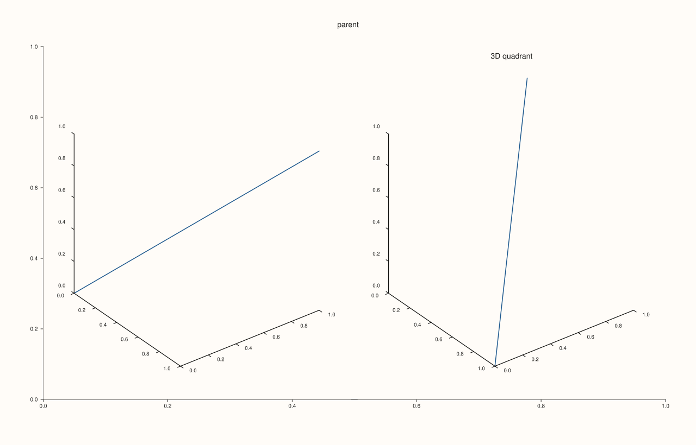

<!-- pluss-hand-authored -->

# Studio::subpane3

[Back to Studio API Reference](../../studio_api_reference)

## Signature

```cpp
Pane& Studio::subpane3(
    std::size_t parent_index,
    std::int64_t rows,
    std::int64_t cols,
    std::int64_t row,
    std::int64_t col,
    std::int64_t row_span = 1,
    std::int64_t col_span = 1,
    std::string title = {})
```

## What It Does

The 3D counterpart of [`subpane2()`](subpane2.md): creates a new `PaneKind::Volumetric`
pane occupying a cell (or spanning block of cells) within a local subgrid nested inside an
existing top-level pane. Every behavioral detail from `subpane2()` carries over
unchanged — it's exactly `pane3(title)` plus a `PanePlacement`, with the identical four
validation checks, in the identical order, throwing the same category of exceptions with
`subpane3`-prefixed messages instead of `subpane2`-prefixed ones:

1. `parent_index` out of range → `std::out_of_range("subpane3: parent_index out of range")`.
2. `rows`/`cols` not positive → `std::invalid_argument("subpane3: rows and cols must be positive")`.
3. `row`/`col` negative or spans not positive →
   `std::invalid_argument("subpane3: row/col must be non-negative and spans must be positive")`.
4. Requested slot exceeds the local subgrid bounds →
   `std::invalid_argument("subpane3: requested slot exceeds local subgrid bounds")`.

The **parent** pane named by `parent_index` does not itself need to be a 3D pane — a
`pane2()`-created parent can host `subpane3()` children (and vice versa); `parent_index`
only names whose area the local subgrid divides, not what kind of pane the children must
be. See Example 1.

```{important} Same reference-invalidation hazard as pane2()/pane3()
The returned `Pane&`, and every earlier pane reference, is invalidated by any later
pane-creation call. See [`pane2()`](pane2.md)'s important callout for the full explanation
and the safe usage pattern (configure and plot into each pane immediately after creating
it).
```

## Parameters

**parent_index** (`std::size_t`)
    The index of the existing pane whose area this subgrid divides. Need not itself be a
    3D pane.

**rows**, **cols** (`std::int64_t`)
    The shape of the local subgrid for this call. Both must be positive.

**row**, **col** (`std::int64_t`)
    The 0-indexed cell this new pane occupies. Both must be non-negative.

**row_span**, **col_span** (`std::int64_t`, default `1`, `1`)
    How many rows/columns this pane spans. Both must be positive.

**title** (`std::string`, default `{}`)
    The new subpane's title.

## Returns

`Pane&`
    A reference to the newly created 3D subpane, valid until the next pane-creation call.

## Examples

Example 1. A `1x2` local subgrid inside a `pane2()`-created parent, holding two 3D
subpanes side by side — demonstrating that the parent's own kind is independent of the
children's.

```cpp
using namespace pluss::pl;

auto fig = studio("subpane3_basic");
fig.pane2("parent");  // a 2D pane used purely as the subgrid's container
auto& left = fig.subpane3(0, 1, 2, 0, 0);
flash::path3(left, std::vector<double>{0.0, 1.0}, std::vector<double>{0.0, 1.0}, std::vector<double>{0.0, 1.0});
auto& right = fig.subpane3(0, 1, 2, 0, 1, 1, 1, "3D quadrant");
flash::path3(right, std::vector<double>{0.0, 1.0}, std::vector<double>{1.0, 0.0}, std::vector<double>{1.0, 0.0});
fig.show();

std::cout << fig.pane_count() << "\n";  // parent + 2 subpanes
```

### Output

```text
3
```



Example 2. All four validation failures, mirroring [`subpane2()`](subpane2.md)'s Example 3
but with `subpane3`-prefixed messages.

```cpp
using namespace pluss::pl;

auto fig = studio("subpane3_failures");
fig.pane2("parent");

try {
  fig.subpane3(9, 1, 2, 0, 0);
} catch (const std::out_of_range& e) {
  std::cout << e.what() << "\n";
}

try {
  fig.subpane3(0, 1, -1, 0, 0);
} catch (const std::invalid_argument& e) {
  std::cout << e.what() << "\n";
}

try {
  fig.subpane3(0, 1, 2, 0, 0, 1, 0);
} catch (const std::invalid_argument& e) {
  std::cout << e.what() << "\n";
}

try {
  fig.subpane3(0, 1, 2, 0, 1, 1, 2);
} catch (const std::invalid_argument& e) {
  std::cout << e.what() << "\n";
}
```

### Output

```text
subpane3: parent_index out of range
subpane3: rows and cols must be positive
subpane3: row/col must be non-negative and spans must be positive
subpane3: requested slot exceeds local subgrid bounds
```

## Notes

- Not `noexcept`.
- Equivalent to `pane3(title)` plus a `PanePlacement` — inherits every `pane3()` behavior,
  including the reference-invalidation hazard.
- The parent pane's own kind (2D or 3D) is unrelated to the subpane's kind — a `pane2()`
  parent can host `subpane3()` children and vice versa.
- See [`subpane2()`](subpane2.md) for the shared "subgrid shape is re-declared on every
  call" caveat, which applies identically here.

## See Also

- [`Studio::subpane2`](subpane2.md): the 2D counterpart, with the shared mechanics
  documented in full.
- [`Studio::pane3`](pane3.md): the underlying 3D-pane creation this builds on.
- [`Studio::pane_index`](pane_index.md): how to obtain `parent_index`.

<div class="pluss-inline-prev-next">
  <a class="prev-link" href="subpane2.html">
    <span class="label">Previous</span>
    <span class="title">subpane2</span>
  </a>
  <a class="next-link" href="to_svg.html">
    <span class="label">Next</span>
    <span class="title">to_svg</span>
  </a>
</div>
