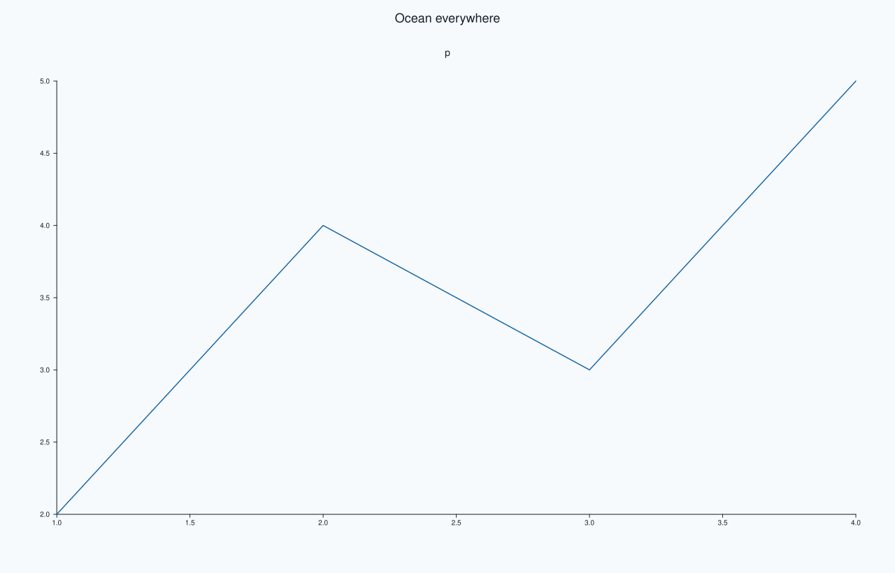
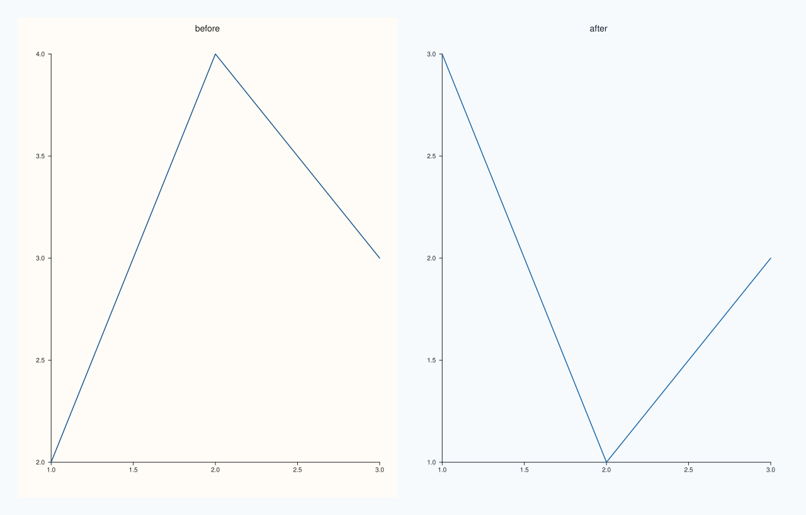
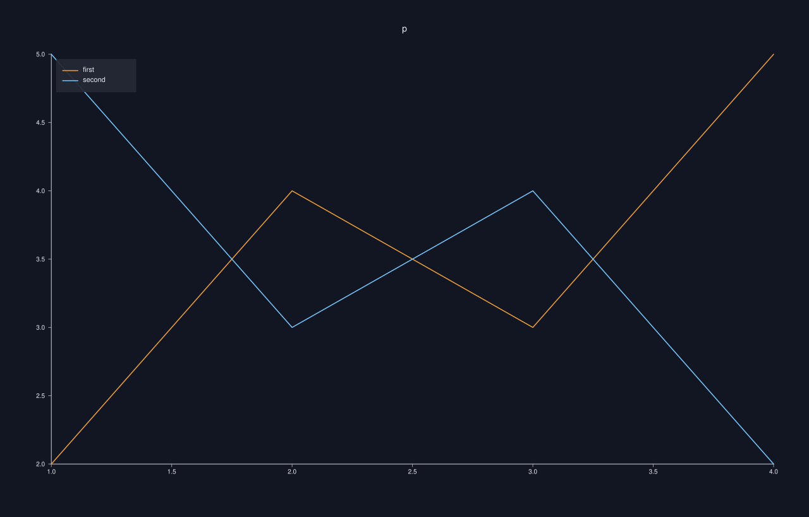

<!-- pluss-hand-authored -->

# Studio::theme

[Back to Studio API Reference](../../studio_api_reference)

## Signature

```cpp
Studio& Studio::theme(Theme theme)
```

## What It Does

Replaces the figure's theme. A `Theme` bundles a name, a sequence of accent colours (the default colours of successive traces), a background, a foreground (text and lines) and a surface palette. The figure uses it for its own parts, which are the canvas background, the headline, captions, row titles and the docked legend, and every pane created afterwards copies it.

Panes that already exist keep the theme they were created with, exactly as with [`context_scales`](context_scales.md): the figure holds a default that new panes pick up. So the usual order is to set the theme first and then add panes; setting it after the panes changes only the canvas and the figure-level text. [`theme_tokens`](theme_tokens.md) reads the current theme, and a pane's own theme can be changed through the pane. The call takes a theme by value and never throws.

## Parameters

**theme** (`Theme`)
    The new theme: `Theme::paper()`, `Theme::ocean()`, or a theme built from its parts.

## Returns

`Studio&`
    The same figure, for chaining.

## Examples

Example 1. Before the panes. The theme is set first, so the canvas and the pane both use `ocean`.

```cpp
auto fig = studio("theme_before");
fig.theme(Theme::ocean());
fig.headline("Ocean everywhere");
fig.pane2("p").trend(std::vector<double>{1, 2, 3, 4}, std::vector<double>{2, 4, 3, 5});
std::cout << "figure: " << fig.theme_tokens().name() << ", pane: " << fig.panes()[0].theme_tokens().name() << "\n";
fig.save_svg("figure.svg");
```

### Output

```text
figure: ocean, pane: ocean
```



Example 2. After the panes. The canvas changes to `ocean` but the pane created before the call keeps `paper`, so the figure mixes two themes; a pane created after the call is `ocean`.

```cpp
auto fig = studio("theme_after");
fig.mosaic(1, 2);
fig.pane2("before").trend(std::vector<double>{1, 2, 3}, std::vector<double>{2, 4, 3});
fig.theme(Theme::ocean());
fig.pane2("after").trend(std::vector<double>{1, 2, 3}, std::vector<double>{3, 1, 2});
std::cout << "figure: " << fig.theme_tokens().name() << ", pane 0: " << fig.panes()[0].theme_tokens().name() << ", pane 1: " << fig.panes()[1].theme_tokens().name() << "\n";
fig.save_svg("figure.svg");
```

### Output

```text
figure: ocean, pane 0: paper, pane 1: ocean
```



Example 3. A theme from its parts. A custom theme with its own name, two accent colours, background, foreground and a surface palette; the traces take the accents in turn.

```cpp
Theme custom("midnight",
             {Rgba::from_u8(240, 160, 60), Rgba::from_u8(120, 200, 255)},
             Rgba::from_u8(18, 22, 34), Rgba::from_u8(235, 238, 245), PaletteRamp::ocean());
auto fig = studio("theme_built");
fig.theme(custom);
auto& pane = fig.pane2("p");
pane.trend(std::vector<double>{1, 2, 3, 4}, std::vector<double>{2, 4, 3, 5}).label("first");
pane.trend(std::vector<double>{1, 2, 3, 4}, std::vector<double>{5, 3, 4, 2}).label("second");
pane.legend(KeyPlace::NorthWest);
std::cout << "theme: " << fig.theme_tokens().name() << ", accents: " << fig.theme_tokens().accents().size() << "\n";
fig.save_svg("figure.svg");
```

### Output

```text
theme: midnight, accents: 2
```



Example 4. The two built-in themes differ. The same figure in `paper` and in `ocean` renders differently, and replacing the theme again replaces it entirely.

```cpp
auto build = [](Theme theme) {
  auto fig = studio("theme_two");
  fig.theme(std::move(theme));
  fig.pane2("p").trend(std::vector<double>{1, 2, 3}, std::vector<double>{2, 4, 3});
  return fig.to_svg();
};
std::cout << "paper vs ocean differ: " << (build(Theme::paper()) != build(Theme::ocean())) << "\n";
auto fig = studio("theme_two_out");
fig.theme(Theme::ocean()).theme(Theme::paper());
std::cout << "last call wins: " << fig.theme_tokens().name() << "\n";
fig.pane2("p").trend(std::vector<double>{1, 2, 3}, std::vector<double>{2, 4, 3});
fig.save_svg("figure.svg");
```

### Output

```text
paper vs ocean differ: 1
last call wins: paper
```


## Notes

- The theme is copied into each pane at its creation. To restyle a pane afterwards, change the pane's own theme.
- [`pane_style_defaults`](pane_style_defaults.md) can give new panes a different theme from the figure's.

## See Also

- [`Studio::theme_tokens`](theme_tokens.md): reads or edits the theme.
- [`Studio::pane_style_defaults`](pane_style_defaults.md): defaults for new panes.
- [`Theme`](../types/Theme.md): the fields and the built-in themes.

<div class="pluss-inline-prev-next">
  <a class="prev-link" href="subpane3.html">
    <span class="label">Previous</span>
    <span class="title">subpane3</span>
  </a>
  <a class="next-link" href="theme_tokens.html">
    <span class="label">Next</span>
    <span class="title">theme_tokens</span>
  </a>
</div>
