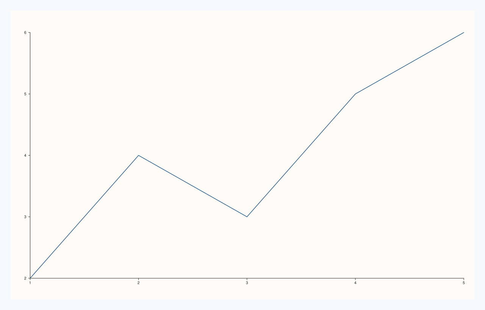

<!-- pluss-hand-authored -->

# Studio::theme_tokens

[Back to Studio API Reference](../../studio_api_reference)

## Signatures

```cpp
const Theme& Studio::theme_tokens() const noexcept
Theme& Studio::theme_tokens() noexcept
```

## What It Does

Returns the figure's current `Theme`. The `const` overload is a read-only accessor. The
non-`const` overload returns a **mutable reference** — a second, more surgical way to
change the theme in place, as an alternative to calling [`theme()`](theme.md) with a
whole new `Theme` value.

```{important} Same creation-time-only rule as theme() itself
Mutating through `theme_tokens()` still only affects panes created **after** the mutation —
identical timing semantics to calling [`theme()`](theme.md) directly, since both paths
change the same underlying `Theme` object new panes read from at creation time. See
[`theme()`](theme.md)'s important callout.
```

## Parameters

*(none)*

## Returns

`const Theme&` (const overload) / `Theme&` (non-const overload)
    A reference to the current theme.

## Examples

Example 1. Reading the theme name back through the `const` overload.

```cpp
using namespace pluss::pl;

auto fig = studio("paper_theme");
auto& pane = fig.pane2();
pane.trend(std::vector<double>{1.0, 2.0, 3.0, 4.0, 5.0}, std::vector<double>{2.0, 4.0, 3.0, 5.0, 6.0});
fig.show();

std::cout << fig.theme_tokens().name() << "\n";
```

### Output

```text
paper
```


Example 2. Mutating in place through the non-`const` overload — assigning a whole new
`Theme` value via the returned mutable reference, called before adding the pane so it
actually takes effect.

```cpp
using namespace pluss::pl;

auto fig = studio("mutated_theme");
fig.theme_tokens() = Theme::ocean();

auto& pane = fig.pane2();
pane.trend(std::vector<double>{1.0, 2.0, 3.0, 4.0, 5.0}, std::vector<double>{2.0, 4.0, 3.0, 5.0, 6.0});
fig.show();

std::cout << fig.theme_tokens().name() << "\n";
```

Assigning through `theme_tokens()` produces byte-identical output to calling
`fig.theme(Theme::ocean())` directly — both paths replace the same underlying `Theme`.

### Output

```text
ocean
```



## Notes

- Both overloads are `noexcept`.
- The non-`const` overload's mutable reference is a full alternative to
  [`theme()`](theme.md), not a narrower one — anything assignable to a `Theme` (including
  a whole replacement value, as in Example 2) works through it.
- Same "only affects panes created afterward" timing as [`theme()`](theme.md) — see the
  important callout above.

## See Also

- [`Studio::theme`](theme.md): the primary, whole-value way to change the theme.
- [`Studio::name`](name.md) / [`headline_text`](headline_text.md): the other
  const-reference-only accessors on `Studio`.

<div class="pluss-inline-prev-next">
  <a class="prev-link" href="name.html">
    <span class="label">Previous</span>
    <span class="title">name</span>
  </a>
  <a class="next-link" href="size.html">
    <span class="label">Next</span>
    <span class="title">size</span>
  </a>
</div>
