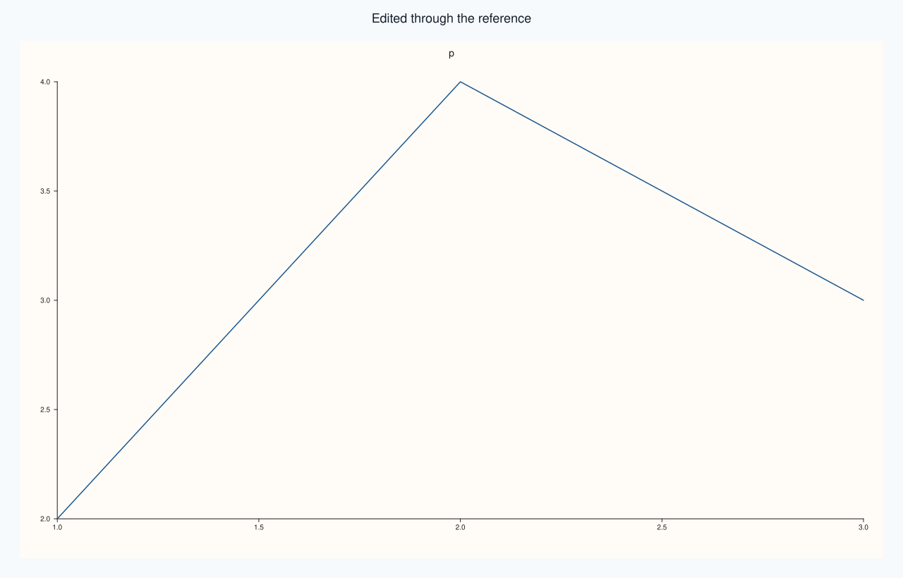
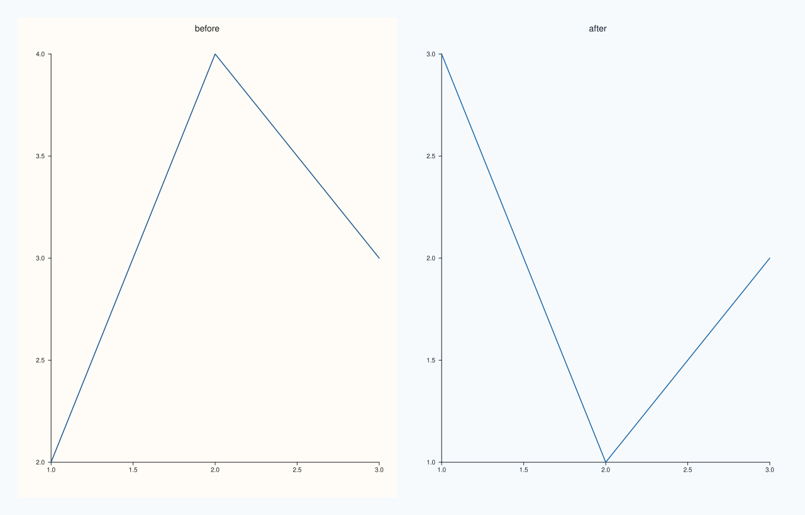
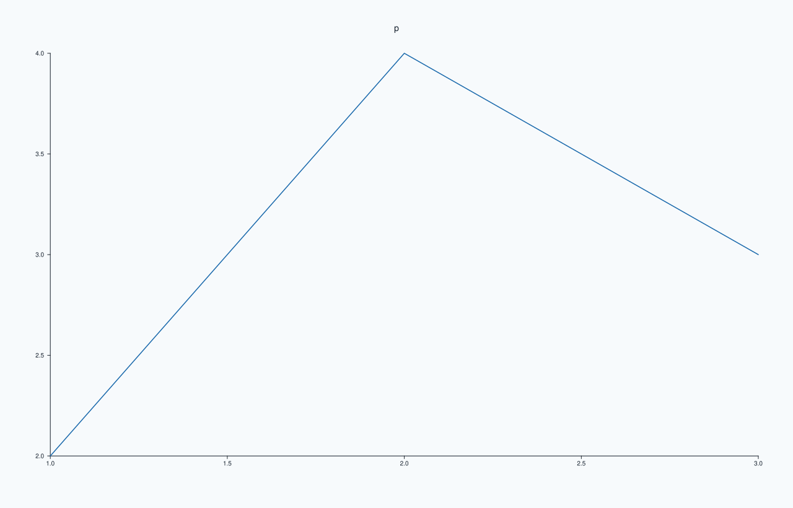

<!-- pluss-hand-authored -->

# Studio::theme_tokens

[Back to Studio API Reference](../../studio_api_reference)

## Signature

```cpp
const Theme& Studio::theme_tokens() const noexcept
Theme& Studio::theme_tokens() noexcept
```

## What It Does

Returns the figure's own `Theme`: the name, accent colours, background, foreground and surface palette that the figure was given by [`theme`](theme.md) or its constructor (the paper theme for a new figure). The figure uses it for what belongs to the figure itself, which is the canvas background, the headline, the captions, the row titles and the docked legend. It is separate from the themes of the panes: each pane copies the figure's theme when it is created and keeps its own copy, so changing the figure's theme afterwards does not restyle panes that already exist.

The const overload reads it. The non-const overload returns a reference that can be assigned to or modified in place, which changes the figure's own parts at the next render exactly as `theme` does, without the copy that `theme` takes. The reference stays valid for the life of the figure.

## Parameters

*(none)*

## Returns

`const Theme&` / `Theme&`
    The figure's theme.

## Examples

Example 1. Reading the theme. A new figure has the paper theme; the name, background and the number of accent colours can be read.

```cpp
auto fig = studio("theme_tokens_read");
const Theme& theme = fig.theme_tokens();
std::cout << "name: " << theme.name() << ", accents: " << theme.accents().size() << "\n";
std::cout << "background (r, g, b): " << theme.background().red << ", " << theme.background().green << ", " << theme.background().blue << "\n";
fig.pane2("p").trend(std::vector<double>{1, 2, 3}, std::vector<double>{2, 4, 3});
fig.save_svg("figure.svg");
```

### Output

```text
name: paper, accents: 5
background (r, g, b): 1, 0.988235, 0.972549
```


Example 2. Editing in place. Assigning a theme through the reference changes the figure's own parts at the next render; the figure differs from before and the name reads back.

```cpp
auto fig = studio("theme_tokens_edit");
fig.headline("Edited through the reference");
fig.pane2("p").trend(std::vector<double>{1, 2, 3}, std::vector<double>{2, 4, 3});
const std::string before = fig.to_svg();
fig.theme_tokens() = Theme::ocean();
std::cout << "name now: " << fig.theme_tokens().name() << ", figure changed: " << (fig.to_svg() != before) << "\n";
fig.save_svg("figure.svg");
```

### Output

```text
name now: ocean, figure changed: 1
```



Example 3. Panes keep their own copy. A pane created before the edit keeps the theme it was created with, while one created after takes the new one.

```cpp
auto fig = studio("theme_tokens_panes");
fig.mosaic(1, 2);
fig.pane2("before").trend(std::vector<double>{1, 2, 3}, std::vector<double>{2, 4, 3});
fig.theme_tokens() = Theme::ocean();
fig.pane2("after").trend(std::vector<double>{1, 2, 3}, std::vector<double>{3, 1, 2});
std::cout << "pane 0: " << fig.panes()[0].theme_tokens().name() << ", pane 1: " << fig.panes()[1].theme_tokens().name() << ", figure: " << fig.theme_tokens().name() << "\n";
fig.save_svg("figure.svg");
```

### Output

```text
pane 0: paper, pane 1: ocean, figure: ocean
```



Example 4. The same as `theme`. Setting the figure's theme with `theme(...)` or by assigning through the reference gives the same figure.

```cpp
auto build = [](bool through_reference) {
  auto fig = studio("theme_tokens_same");
  if (through_reference) fig.theme_tokens() = Theme::ocean();
  else fig.theme(Theme::ocean());
  fig.pane2("p").trend(std::vector<double>{1, 2, 3}, std::vector<double>{2, 4, 3});
  return fig.to_svg();
};
std::cout << "equal: " << (build(true) == build(false)) << "\n";
auto fig = studio("theme_tokens_same_out");
fig.theme_tokens() = Theme::ocean();
fig.pane2("p").trend(std::vector<double>{1, 2, 3}, std::vector<double>{2, 4, 3});
fig.save_svg("figure.svg");
```

### Output

```text
equal: 1
```



## Notes

- `noexcept` in both forms. The non-const form lets the caller change the figure, so a reference taken from a `const Studio` is the const one.
- To restyle a pane, change the pane's own theme, or set the figure's theme before creating the pane.

## See Also

- [`Studio::theme`](theme.md): replaces the theme.
- [`Studio::pane_style_defaults`](pane_style_defaults.md): the defaults new panes copy.
- [`Theme`](../types/Theme.md): the fields.

<div class="pluss-inline-prev-next">
  <a class="prev-link" href="theme.html">
    <span class="label">Previous</span>
    <span class="title">theme</span>
  </a>
  <a class="next-link" href="tight_layout.html">
    <span class="label">Next</span>
    <span class="title">tight_layout</span>
  </a>
</div>
