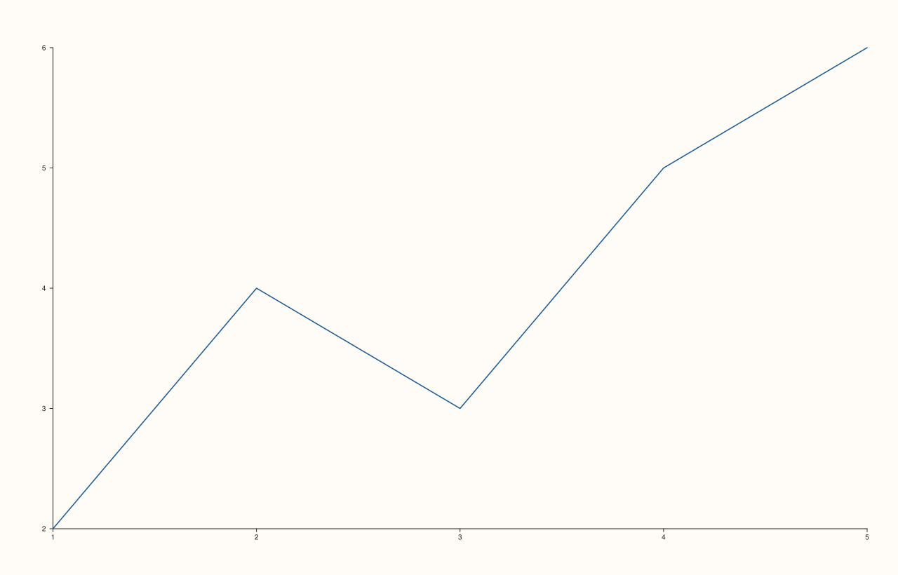

<!-- pluss-hand-authored -->

# Studio::tight_layout

[Back to Studio API Reference](../../studio_api_reference)

## Signature

```cpp
Studio& Studio::tight_layout(bool enable = true, double padding = 6.0)
```

## What It Does

Switches the figure between its default ("relaxed") outer margins and a compact set of
margins with a small, explicit `padding` added back around every edge — shrinking the
figure-wide top/left/right/bottom margins (and several per-pane inset values: tick-label
depth, axis-label gaps, legend width, and more) so more of the canvas is given over to the
actual plotted data.

```{important} The effect is real but modest by default — verify visually, don't assume by name
`tight_layout(true)` with the default `padding = 6.0` does change the rendered output — for
a plain single-pane figure with no headline/captions/legend, the outer background frame
moves from a 28px margin (relaxed) to a 24px margin (compact `18.0` base + `6.0` padding).
The two renders are **not** byte-length-identical by coincidence, either — comparing
`to_svg()` string content (not just `.size()`) is the only reliable way to confirm a real
difference exists; two unrelated changes can produce SVGs of the exact same byte length by
chance. See Example 2.
```

## Parameters

**enable** (`bool`, default `true`)
    `true` switches on the compact margin/inset set; `false` (or never calling this method
    at all) uses the relaxed defaults.

**padding** (`double`, default `6.0`)
    An additional margin added back on top of the compact base values, on every edge. Must
    be finite and non-negative, or the call throws
    `"tight_layout: padding must be finite and non-negative"`. Only meaningful when
    `enable = true`; still validated even when `enable = false`, though a non-`true` call
    has no visible effect either way.

## Returns

`Studio&`
    A reference to the same figure, for chaining.

## Examples

Example 1. The default (never called): relaxed margins.

```cpp
using namespace pluss::pl;

auto fig = studio("tight_off");
auto& pane = fig.pane2();
flash::lineplot(pane, std::vector<double>{1.0, 2.0, 3.0, 4.0, 5.0}, std::vector<double>{2.0, 4.0, 3.0, 5.0, 6.0});
fig.show();

std::cout << fig.tight_layout_enabled() << "\n";
```

### Output

```text
0
```


Example 2. `tight_layout(true)` with the default `padding`, on an otherwise-identical
figure — the outer frame genuinely shrinks (28px margin down to 24px, in this figure's
case).

```cpp
using namespace pluss::pl;

auto fig = studio("tight_on");
fig.tight_layout(true);

auto& pane = fig.pane2();
flash::lineplot(pane, std::vector<double>{1.0, 2.0, 3.0, 4.0, 5.0}, std::vector<double>{2.0, 4.0, 3.0, 5.0, 6.0});
fig.show();

std::cout << fig.tight_layout_enabled() << " " << fig.tight_layout_padding() << "\n";
```

### Output

```text
1 6
```


Example 3. An explicit, larger `padding`, giving back more room than the default `6.0`
does.

```cpp
using namespace pluss::pl;

auto fig = studio("tight_custom_padding");
fig.tight_layout(true, 20.0);

auto& pane = fig.pane2();
flash::lineplot(pane, std::vector<double>{1.0, 2.0, 3.0, 4.0, 5.0}, std::vector<double>{2.0, 4.0, 3.0, 5.0, 6.0});
fig.show();

std::cout << fig.tight_layout_padding() << "\n";
```

### Output

```text
20
```


Example 4. The no-argument call: `enable` defaults to `true`, so `tight_layout()` alone
turns tight layout on with the default padding — equivalent to Example 2's explicit
`tight_layout(true)`.

```cpp
using namespace pluss::pl;

auto fig = studio("tight_reenabled_default_true");
fig.tight_layout();

auto& pane = fig.pane2();
flash::lineplot(pane, std::vector<double>{1.0, 2.0, 3.0, 4.0, 5.0}, std::vector<double>{2.0, 4.0, 3.0, 5.0, 6.0});
fig.show();

std::cout << fig.tight_layout_enabled() << "\n";
```

### Output

```text
1
```



Example 5. A negative `padding` throws.

```cpp
using namespace pluss::pl;

auto fig = studio("bad_pad");
try {
  fig.tight_layout(true, -1.0);
} catch (const std::exception& e) {
  std::cout << e.what();
}
```

### Output

```text
tight_layout: padding must be finite and non-negative
```

Example 6. A `NaN` `padding` throws the same way.

```cpp
using namespace pluss::pl;

auto fig = studio("bad_pad2");
try {
  fig.tight_layout(true, std::numeric_limits<double>::quiet_NaN());
} catch (const std::exception& e) {
  std::cout << e.what();
}
```

### Output

```text
tight_layout: padding must be finite and non-negative
```

## Notes

- Applies figure-wide, at render time — unlike `theme()`/`context_scales()`/
  `pane_style_defaults()`, there is no "only affects panes created afterward" timing
  subtlety here; `tight_layout()` can be called any time before rendering.
- `padding` is validated (finite, non-negative) regardless of `enable`'s value.
- The visual effect can be subtle for a plain, unlabeled single-pane figure — it becomes
  more pronounced once headlines, captions, or a legend are present, since those are exactly
  the elements whose reserved space `tight_layout` shrinks.

## See Also

- [`Studio::tight_layout_enabled`](tight_layout_enabled.md) /
  [`tight_layout_padding`](tight_layout_padding.md): read the current settings back.
- [`Studio::size`](size.md): the outer canvas dimensions `tight_layout` reallocates margin
  space within.
- [`Studio::pane_style_defaults`](pane_style_defaults.md): a different, per-pane-scoped
  style default, versus this figure-wide margin control.

<div class="pluss-inline-prev-next">
  <a class="prev-link" href="mosaic_layout.html">
    <span class="label">Previous</span>
    <span class="title">mosaic_layout</span>
  </a>
  <a class="next-link" href="tight_layout_enabled.html">
    <span class="label">Next</span>
    <span class="title">tight_layout_enabled</span>
  </a>
</div>
