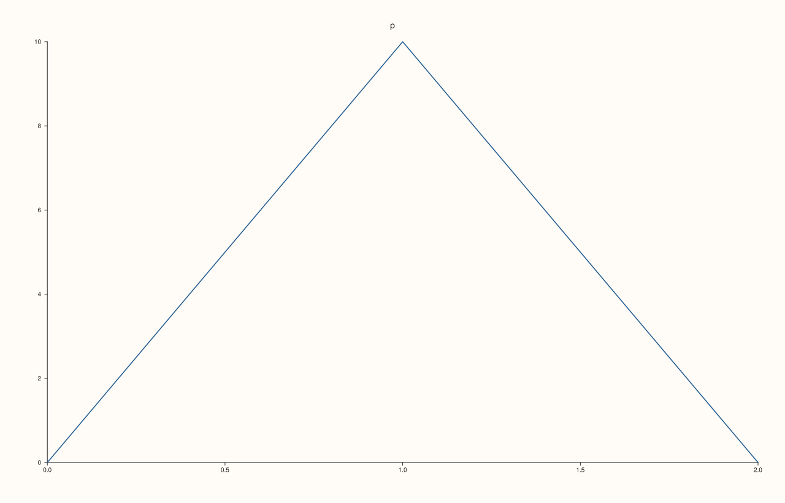
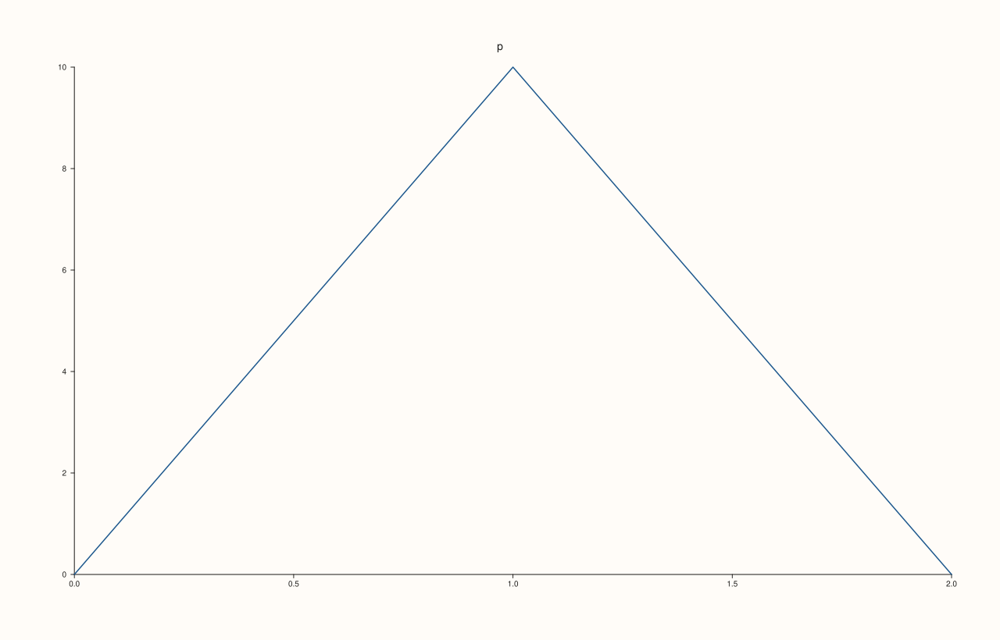
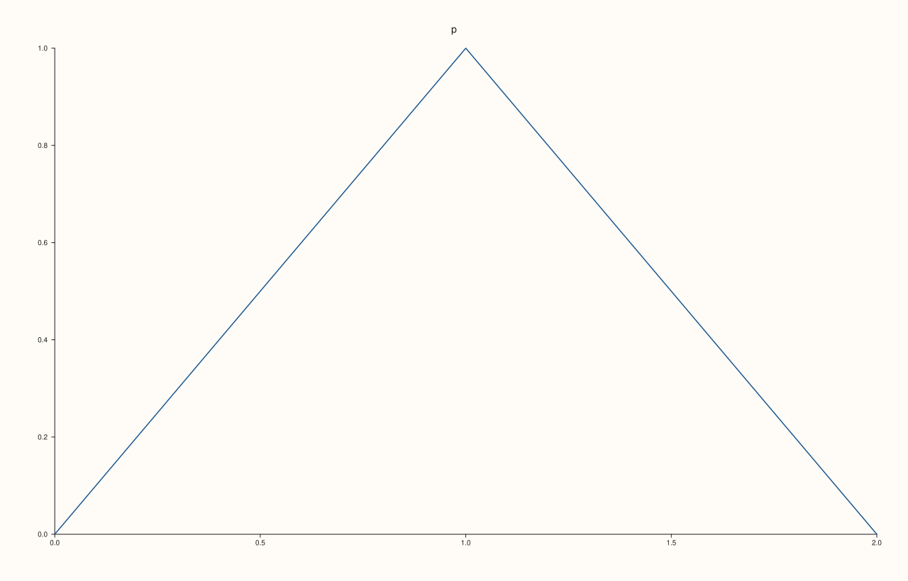
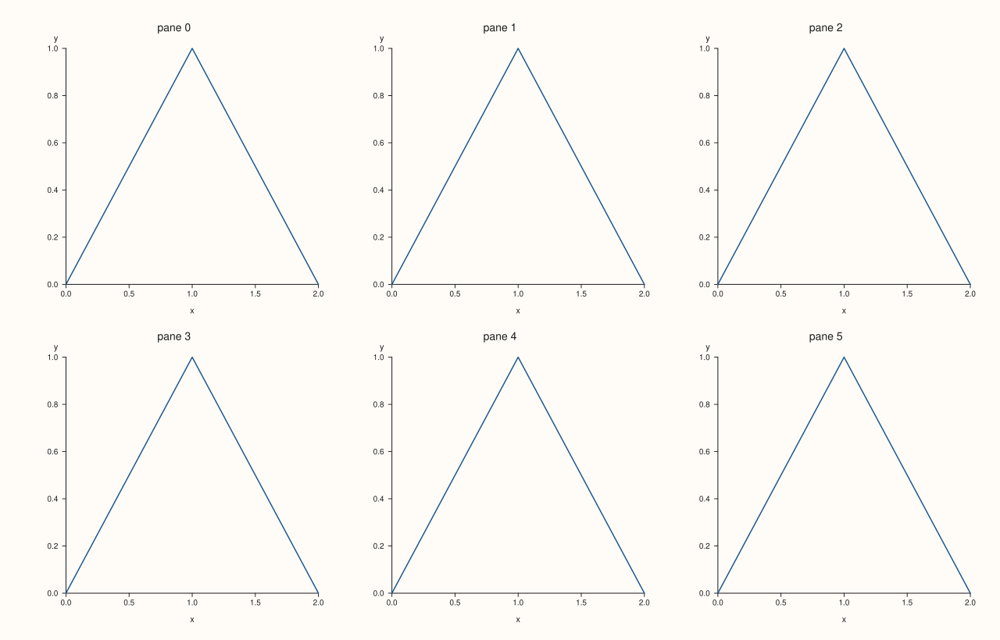

<!-- pluss-hand-authored -->

# Studio::tight_layout

[Back to Studio API Reference](../../studio_api_reference)

## Signature

```cpp
Studio& Studio::tight_layout(bool enable = true, double padding = 6.0)
```

## What It Does

Switches the figure between its relaxed layout (the default) and a compact one that gives more of the canvas to the plots. The compact layout uses smaller margins at the figure's edges, smaller room around each plot for tick labels and axis labels, and smaller gutters between the cells of a [`mosaic`](mosaic.md); a `padding` is then added back around the edges.

Use it for figures with many small panes, or for a figure that is going to be placed in a page where the margins are already there. The layout is a set of proportions, not a fixed shrinkage: texts and labels are measured as before, so nothing is cut off in the compact layout that was not cut in the relaxed one.

`enable = false` returns to the relaxed layout. The padding is only used while the compact layout is on, but it is stored and checked in every call, so a bad value is always refused.

## Parameters

**enable** (`bool`, default `true`)
    `true` for the compact layout, `false` for the relaxed one.

**padding** (`double`, default 6.0)
    Room added back around the edges of the figure, in drawing units. Finite and not negative.

## Returns

`Studio&`
    The same figure, for chaining.

## Examples

Example 1. A new figure uses the relaxed layout.

```cpp
auto fig = studio("tight_default");
fig.pane2("p").trend(std::vector<double>{0, 1, 2}, std::vector<double>{0, 1, 0});
std::cout << "enabled: " << fig.tight_layout_enabled() << ", padding " << fig.tight_layout_padding() << "\n";
fig.save_svg("figure.svg");
```

### Output

```text
enabled: 0, padding 6
```


Example 2. With the compact layout the plot area is larger: the tick labels of the y axis, which end at the axis, stand further to the left, and the data is drawn over more of the canvas.

```cpp
auto build = [&](bool tight) {
  auto fig = studio("tight_on");
  if (tight) fig.tight_layout();
  fig.pane2("p").trend(std::vector<double>{0, 1, 2}, std::vector<double>{0, 10, 0});
  return fig.to_svg();
};
auto at = [](const std::string& svg, const std::string& text) {
  const auto hit = svg.find(">" + text + "<");
  if (hit == std::string::npos) return std::string("absent");
  const auto open = svg.rfind("<text", hit);
  auto number = [&](const char* key) {
    const auto k = svg.find(std::string(key) + "=\"", open) + std::string(key).size() + 2;
    return std::stod(svg.substr(k, svg.find('"', k) - k));
  };
  return "(" + std::to_string(static_cast<int>(number("x"))) + ", " + std::to_string(static_cast<int>(number("y"))) + ")";
};
std::cout << "tick '10' at " << at(build(false), "10") << " relaxed, " << at(build(true), "10") << " compact\n";
auto fig = studio("tight_on_out");
fig.tight_layout();
fig.pane2("p").trend(std::vector<double>{0, 1, 2}, std::vector<double>{0, 10, 0});
fig.save_svg("figure.svg");
```

### Output

```text
tick '10' at (71, 89) relaxed, (67, 71) compact
```



Example 3. The padding is room given back around the edges of the figure. 0 is the most compact, and a larger padding moves everything in from the edge.

```cpp
auto build = [&](double padding) {
  auto fig = studio("tight_padding");
  fig.tight_layout(true, padding);
  fig.pane2("p").trend(std::vector<double>{0, 1, 2}, std::vector<double>{0, 10, 0});
  return fig.to_svg();
};
auto at = [](const std::string& svg, const std::string& text) {
  const auto hit = svg.find(">" + text + "<");
  if (hit == std::string::npos) return std::string("absent");
  const auto open = svg.rfind("<text", hit);
  auto number = [&](const char* key) {
    const auto k = svg.find(std::string(key) + "=\"", open) + std::string(key).size() + 2;
    return std::stod(svg.substr(k, svg.find('"', k) - k));
  };
  return "(" + std::to_string(static_cast<int>(number("x"))) + ", " + std::to_string(static_cast<int>(number("y"))) + ")";
};
for (double padding : {0.0, 6.0, 24.0}) std::cout << "padding " << padding << ": tick '10' at " << at(build(padding), "10") << "\n";
auto fig = studio("tight_padding_out");
fig.tight_layout(true, 24.0);
fig.pane2("p").trend(std::vector<double>{0, 1, 2}, std::vector<double>{0, 10, 0});
fig.save_svg("figure.svg");
```

### Output

```text
padding 0: tick '10' at (61, 65)
padding 6: tick '10' at (67, 71)
padding 24: tick '10' at (85, 89)
```



Example 4. `tight_layout()` is `tight_layout(true, 6.0)`.

```cpp
auto build = [&](bool explicit_args) {
  auto fig = studio("tight_no_args");
  if (explicit_args) fig.tight_layout(true, 6.0);
  else fig.tight_layout();
  fig.pane2("p").trend(std::vector<double>{0, 1, 2}, std::vector<double>{0, 1, 0});
  return fig.to_svg();
};
std::cout << "same figure: " << (build(true) == build(false)) << "\n";
auto fig = studio("tight_no_args_out");
fig.tight_layout();
fig.pane2("p").trend(std::vector<double>{0, 1, 2}, std::vector<double>{0, 1, 0});
fig.save_svg("figure.svg");
```

### Output

```text
same figure: 1
```



Example 5. `tight_layout(false)` goes back to the relaxed layout: the figure is the one that never asked for the compact one.

```cpp
auto build = [&](bool toggled) {
  auto fig = studio("tight_off_again");
  if (toggled) fig.tight_layout().tight_layout(false);
  fig.pane2("p").trend(std::vector<double>{0, 1, 2}, std::vector<double>{0, 1, 0});
  return fig.to_svg();
};
std::cout << "same as never set: " << (build(true) == build(false)) << "\n";
auto fig = studio("tight_off_again_out");
fig.pane2("p").trend(std::vector<double>{0, 1, 2}, std::vector<double>{0, 1, 0});
fig.save_svg("figure.svg");
```

### Output

```text
same as never set: 1
```


Example 6. It matters most with many panes, where each cell has little room: a 2x3 grid of small plots in the relaxed and in the compact layout. The compact figure gives the plots more of the canvas.

```cpp
auto build = [&](bool tight) {
  auto fig = studio("tight_many");
  fig.mosaic(2, 3);
  if (tight) fig.tight_layout(true, 0.0);
  for (int i = 0; i < 6; ++i) {
    auto& pane = fig.pane2("pane " + std::to_string(i));
    pane.trend(std::vector<double>{0, 1, 2}, std::vector<double>{0, 1, 0});
    pane.x_label("x").y_label("y");
  }
  return fig;
};
auto relaxed = build(false);
auto compact = build(true);
std::cout << "figures differ: " << (relaxed.to_svg() != compact.to_svg()) << "\n";
compact.save_svg("figure.svg");
```

### Output

```text
figures differ: 1
```



Example 7. The padding must be finite and not negative; otherwise the call throws, and the layout and padding stay as they were.

```cpp
auto fig = studio("tight_errors");
for (double bad : {-1.0, std::numeric_limits<double>::quiet_NaN(), std::numeric_limits<double>::infinity()}) {
  try {
    fig.tight_layout(true, bad);
  } catch (const pluss::Error& e) {
    std::cout << e.message() << "\n";
  }
}
std::cout << "enabled: " << fig.tight_layout_enabled() << ", padding " << fig.tight_layout_padding() << "\n";
fig.pane2("p").trend(std::vector<double>{0, 1, 2}, std::vector<double>{0, 1, 0});
fig.save_svg("figure.svg");
```

### Output

```text
tight_layout: padding must be finite and non-negative
tight_layout: padding must be finite and non-negative
tight_layout: padding must be finite and non-negative
enabled: 0, padding 6
```


## Notes

- The padding is stored by every call, with the default when none is given, so `tight_layout()` after `tight_layout(true, 20)` resets it to 6.
- Read the state with [`tight_layout_enabled`](tight_layout_enabled.md) and [`tight_layout_padding`](tight_layout_padding.md).

## See Also

- [`Studio::tight_layout_enabled`](tight_layout_enabled.md), [`tight_layout_padding`](tight_layout_padding.md): read the state.
- [`Studio::mosaic`](mosaic.md): the gutters the compact layout reduces.
- [`Studio::size`](size.md): the canvas.

<div class="pluss-inline-prev-next">
  <a class="prev-link" href="theme_tokens.html">
    <span class="label">Previous</span>
    <span class="title">theme_tokens</span>
  </a>
  <a class="next-link" href="tight_layout_enabled.html">
    <span class="label">Next</span>
    <span class="title">tight_layout_enabled</span>
  </a>
</div>
