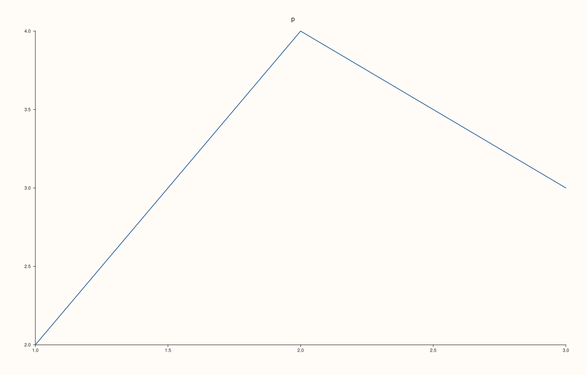

<!-- pluss-hand-authored -->

# Studio::tight_layout_enabled

[Back to Studio API Reference](../../studio_api_reference)

## Signature

```cpp
bool Studio::tight_layout_enabled() const noexcept
```

## What It Does

Returns whether the figure uses the compact layout: `false` for a new figure, and whatever the `enable` argument of the last [`tight_layout`](tight_layout.md) call was. It reads the switch and has no effect on the figure. The padding that goes with the compact layout is read separately with [`tight_layout_padding`](tight_layout_padding.md), and it is kept even while the layout is off, so switching the layout off and on again does not forget it.

## Parameters

*(none)*

## Returns

`bool`
    `true` when the compact layout is on.

## Examples

Example 1. Off by default. `tight_layout()` turns it on, `tight_layout(false)` turns it off, and the last call decides.

```cpp
auto fig = studio("tight_enabled_values");
std::cout << "new figure: " << fig.tight_layout_enabled() << "\n";
fig.tight_layout();
std::cout << "after tight_layout(): " << fig.tight_layout_enabled() << "\n";
fig.tight_layout(false);
std::cout << "after tight_layout(false): " << fig.tight_layout_enabled() << "\n";
fig.pane2("p").trend(std::vector<double>{1, 2, 3}, std::vector<double>{2, 4, 3});
fig.save_svg("figure.svg");
```

### Output

```text
new figure: 0
after tight_layout(): 1
after tight_layout(false): 0
```


Example 2. The switch changes the picture. The same figure drawn with the layout off and on gives different SVG, and switching it off again restores the original exactly.

```cpp
auto fig = studio("tight_enabled_effect");
fig.pane2("p").trend(std::vector<double>{1, 2, 3}, std::vector<double>{2, 4, 3});
const std::string relaxed = fig.to_svg();
fig.tight_layout();
const std::string tight = fig.to_svg();
fig.tight_layout(false);
std::cout << "tight differs from relaxed: " << (tight != relaxed) << "\n";
std::cout << "off again equals the original: " << (fig.to_svg() == relaxed) << "\n";
fig.tight_layout();
fig.save_svg("figure.svg");
```

### Output

```text
tight differs from relaxed: 1
off again equals the original: 1
```



Example 3. The padding is kept while the layout is off. Setting a padding with `enable = false` stores it, and turning the layout on later without a padding argument resets it to the default of 6.

```cpp
auto fig = studio("tight_enabled_padding");
fig.tight_layout(false, 12.0);
std::cout << "enabled: " << fig.tight_layout_enabled() << ", padding kept: " << fig.tight_layout_padding() << "\n";
fig.tight_layout();
std::cout << "tight_layout() again: enabled " << fig.tight_layout_enabled() << ", padding " << fig.tight_layout_padding() << "\n";
fig.pane2("p").trend(std::vector<double>{1, 2, 3}, std::vector<double>{2, 4, 3});
fig.save_svg("figure.svg");
```

### Output

```text
enabled: 0, padding kept: 12
tight_layout() again: enabled 1, padding 6
```


## Notes

- `noexcept`, and has no effect on the figure.
- Only `tight_layout` changes the switch; no other setting turns the compact layout on.

## See Also

- [`Studio::tight_layout`](tight_layout.md): switches the layout and sets the padding.
- [`Studio::tight_layout_padding`](tight_layout_padding.md): reads the padding.

<div class="pluss-inline-prev-next">
  <a class="prev-link" href="tight_layout.html">
    <span class="label">Previous</span>
    <span class="title">tight_layout</span>
  </a>
  <a class="next-link" href="tight_layout_padding.html">
    <span class="label">Next</span>
    <span class="title">tight_layout_padding</span>
  </a>
</div>
