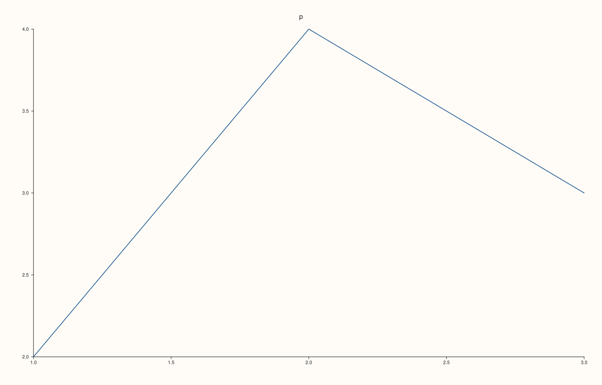
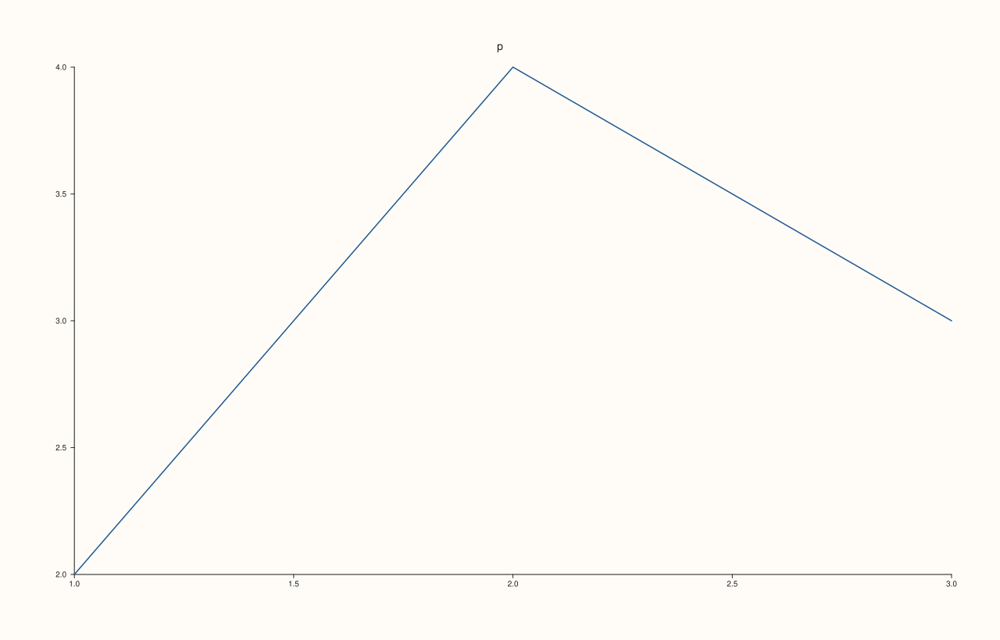
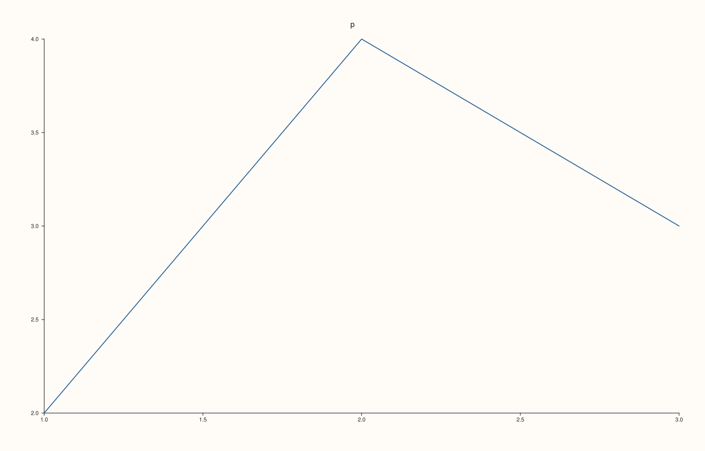

<!-- pluss-hand-authored -->

# Studio::tight_layout_padding

[Back to Studio API Reference](../../studio_api_reference)

## Signature

```cpp
double Studio::tight_layout_padding() const noexcept
```

## What It Does

Returns the padding of the compact layout, in drawing units: 6 for a new figure, and the `padding` argument of the last [`tight_layout`](tight_layout.md) call (a call with no padding argument resets it to 6). The padding is the extra room added back around the edges when the compact layout is on; it is stored even while the layout is off ([`tight_layout_enabled`](tight_layout_enabled.md) tells which), and it has no effect on the figure until the layout is switched on.

The value is always finite and not negative, because `tight_layout` refuses anything else and leaves the previous value in place.

## Parameters

*(none)*

## Returns

`double`
    The padding, 6 by default.

## Examples

Example 1. The default and each call. A new figure reports 6; `tight_layout(true, p)` stores `p`, and a call without a padding resets it to 6.

```cpp
auto fig = studio("tight_padding_values");
std::cout << "new figure: " << fig.tight_layout_padding() << "\n";
fig.tight_layout(true, 14.0);
std::cout << "tight_layout(true, 14): " << fig.tight_layout_padding() << "\n";
fig.tight_layout();
std::cout << "tight_layout(): " << fig.tight_layout_padding() << "\n";
fig.tight_layout(true, 0.0);
std::cout << "zero is allowed: " << fig.tight_layout_padding() << "\n";
fig.pane2("p").trend(std::vector<double>{1, 2, 3}, std::vector<double>{2, 4, 3});
fig.save_svg("figure.svg");
```

### Output

```text
new figure: 6
tight_layout(true, 14): 14
tight_layout(): 6
zero is allowed: 0
```



Example 2. The padding changes the picture once the layout is on. Three paddings give three different figures, and a larger padding leaves more room around the plot.

```cpp
auto build = [](double padding) {
  auto fig = studio("tight_padding_effect");
  fig.tight_layout(true, padding);
  fig.pane2("p").trend(std::vector<double>{1, 2, 3}, std::vector<double>{2, 4, 3});
  return fig.to_svg();
};
std::cout << "0 vs 6: " << (build(0.0) != build(6.0)) << ", 6 vs 24: " << (build(6.0) != build(24.0)) << "\n";
auto fig = studio("tight_padding_effect_out");
fig.tight_layout(true, 24.0);
fig.pane2("p").trend(std::vector<double>{1, 2, 3}, std::vector<double>{2, 4, 3});
fig.save_svg("figure.svg");
```

### Output

```text
0 vs 6: 1, 6 vs 24: 1
```



Example 3. No effect while the layout is off. A padding stored with the layout off leaves the figure exactly as it was.

```cpp
auto build = [](bool store_padding) {
  auto fig = studio("tight_padding_off");
  if (store_padding) fig.tight_layout(false, 30.0);
  fig.pane2("p").trend(std::vector<double>{1, 2, 3}, std::vector<double>{2, 4, 3});
  return fig.to_svg();
};
std::cout << "padding stored, layout off == untouched figure: " << (build(true) == build(false)) << "\n";
auto fig = studio("tight_padding_off_out");
fig.pane2("p").trend(std::vector<double>{1, 2, 3}, std::vector<double>{2, 4, 3});
fig.save_svg("figure.svg");
```

### Output

```text
padding stored, layout off == untouched figure: 1
```


Example 4. Invalid paddings are refused and the stored value is kept: a negative number, infinity and NaN each throw `pluss::Error`.

```cpp
auto fig = studio("tight_padding_invalid");
fig.tight_layout(true, 9.0);
const double inf = std::numeric_limits<double>::infinity();
for (double bad : {-1.0, inf, std::numeric_limits<double>::quiet_NaN()}) {
  try {
    fig.tight_layout(true, bad);
  } catch (const pluss::Error& e) {
    std::cout << "padding " << bad << ": " << e.message() << "\n";
  }
}
std::cout << "still " << fig.tight_layout_padding() << ", enabled: " << fig.tight_layout_enabled() << "\n";
fig.pane2("p").trend(std::vector<double>{1, 2, 3}, std::vector<double>{2, 4, 3});
fig.save_svg("figure.svg");
```

### Output

```text
padding -1: tight_layout: padding must be finite and non-negative
padding inf: tight_layout: padding must be finite and non-negative
padding nan: tight_layout: padding must be finite and non-negative
still 9, enabled: 1
```



## Notes

- `noexcept`, and has no effect on the figure.
- Padding is in drawing units, the same units as [`size`](size.md).

## See Also

- [`Studio::tight_layout`](tight_layout.md): sets the padding.
- [`Studio::tight_layout_enabled`](tight_layout_enabled.md): whether the compact layout is on.

<div class="pluss-inline-prev-next">
  <a class="prev-link" href="tight_layout_enabled.html">
    <span class="label">Previous</span>
    <span class="title">tight_layout_enabled</span>
  </a>
  <a class="next-link" href="to_pdf.html">
    <span class="label">Next</span>
    <span class="title">to_pdf</span>
  </a>
</div>
