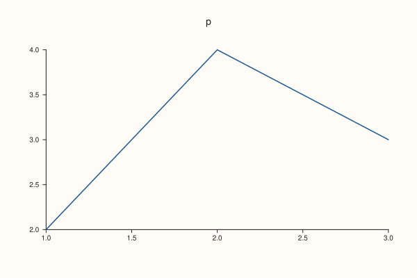

<!-- pluss-hand-authored -->

# Studio::to_pdf

[Back to Studio API Reference](../../studio_api_reference)

## Signature

```cpp
std::string Studio::to_pdf() const
```

## What It Does

Renders the figure with the built-in PDF writer and returns the file as a `std::string` of bytes. It needs no other program and writes nothing to disk. The document is a single page the size of the figure ([`size`](size.md)), with the plot drawn as vector graphics and text as real text, so it scales without loss and can be searched.

The result is binary: it starts with `%PDF-1.4` and ends with `%%EOF`, may contain bytes that are not text, and should be written with a binary stream. [`save_pdf`](save_pdf.md) does that for you and can also use an external converter; `to_pdf` always uses the built-in writer, which is the one `PdfEngine::Auto` and `PdfEngine::Internal` select. Greek letters and symbols in math text are written in a symbol font, so a math label is several text pieces, not one string.

Like [`to_svg`](to_svg.md) it reads the figure as it is at the moment of the call, is repeatable, and does not change the figure.

## Parameters

*(none)*

## Returns

`std::string`
    The PDF bytes.

## Examples

Example 1. The bytes. The result is a PDF 1.4 file: it starts with the version line and ends with the end-of-file marker.

```cpp
auto fig = studio("to_pdf_header");
fig.pane2("p").trend(std::vector<double>{1, 2, 3, 4}, std::vector<double>{2, 4, 3, 5});
const std::string pdf = fig.to_pdf();
std::cout << "starts: " << pdf.substr(0, 8) << "\n";
std::cout << "ends with EOF marker: " << (pdf.rfind("%%EOF") != std::string::npos) << "\n";
std::cout << "non-empty: " << (pdf.size() > 200) << "\n";
fig.save_svg("figure.svg");
```

### Output

```text
starts: %PDF-1.4
ends with EOF marker: 1
non-empty: 1
```


Example 2. One page of the figure size. The page box in the file is the figure size, so a 600 by 400 figure is a 600 by 400 point page.

```cpp
auto fig = studio("to_pdf_page");
fig.size(600.0, 400.0);
fig.pane2("p").trend(std::vector<double>{1, 2, 3}, std::vector<double>{2, 4, 3});
const std::string pdf = fig.to_pdf();
const auto at = pdf.find("/MediaBox");
std::cout << pdf.substr(at, pdf.find(']', at) - at + 1) << "\n";
fig.save_svg("figure.svg");
```

### Output

```text
/MediaBox [0 0 600.0000 400.0000]
```



Example 3. Repeatable, and the same writer as the default engine. Two calls give identical bytes, and they equal what `save_pdf` writes with the default engine.

```cpp
auto fig = studio("to_pdf_repeat");
fig.pane2("p").trend(std::vector<double>{1, 2, 3}, std::vector<double>{2, 4, 3}).label("series");
std::cout << "same bytes twice: " << (fig.to_pdf() == fig.to_pdf()) << "\n";
fig.save_pdf("repeat.pdf");
std::ifstream in("repeat.pdf", std::ios::binary);
const std::string file((std::istreambuf_iterator<char>(in)), std::istreambuf_iterator<char>());
std::cout << "equals save_pdf's file: " << (file == fig.to_pdf()) << "\n";
fig.save_svg("figure.svg");
```

### Output

```text
same bytes twice: 1
equals save_pdf's file: 1
```


Example 4. Text stays text. The headline and a pane title are in the file as text, and a math label is split into pieces, with the Greek letters in the symbol font.

```cpp
auto fig = studio("to_pdf_text");
fig.headline("Readable headline");
fig.pane2("pane title").y_label("$\\mu + \\sigma$").trend(std::vector<double>{1, 2, 3}, std::vector<double>{2, 4, 3});
const std::string pdf = fig.to_pdf();
std::cout << "headline: " << (pdf.find("(Readable headline) Tj") != std::string::npos) << "\n";
std::cout << "pane title: " << (pdf.find("(pane title) Tj") != std::string::npos) << "\n";
std::cout << "symbol font declared: " << (pdf.find("/BaseFont /Symbol") != std::string::npos) << "\n";
std::cout << "mu is the symbol glyph m: " << (pdf.find("(m) Tj") != std::string::npos) << "\n";
fig.save_svg("figure.svg");
```

### Output

```text
headline: 1
pane title: 1
symbol font declared: 1
mu is the symbol glyph m: 1
```


Example 5. A figure with no panes is a valid PDF of an empty page.

```cpp
auto fig = studio("to_pdf_empty");
const std::string pdf = fig.to_pdf();
std::cout << "valid: " << (pdf.rfind("%PDF-1.4", 0) == 0 && pdf.rfind("%%EOF") != std::string::npos) << "\n";
auto shown = studio("to_pdf_empty_out");
shown.pane2("p").trend(std::vector<double>{1, 2, 3}, std::vector<double>{2, 4, 3});
shown.save_svg("figure.svg");
```

### Output

```text
valid: 1
```


## Notes

- The string holds binary data: do not print it, and write it with `std::ios::binary`.
- A PDF made by an external converter (`PdfEngine::SvgConvert` in [`save_pdf`](save_pdf.md)) is a different file and is not available as a string.

## See Also

- [`Studio::save_pdf`](save_pdf.md): writes the PDF to a file, with a choice of engine.
- [`Studio::to_svg`](to_svg.md): the SVG as a string.
- [`PdfEngine`](../types/PdfEngine.md): the engines.

<div class="pluss-inline-prev-next">
  <a class="prev-link" href="tight_layout_padding.html">
    <span class="label">Previous</span>
    <span class="title">tight_layout_padding</span>
  </a>
  <a class="next-link" href="to_svg.html">
    <span class="label">Next</span>
    <span class="title">to_svg</span>
  </a>
</div>
