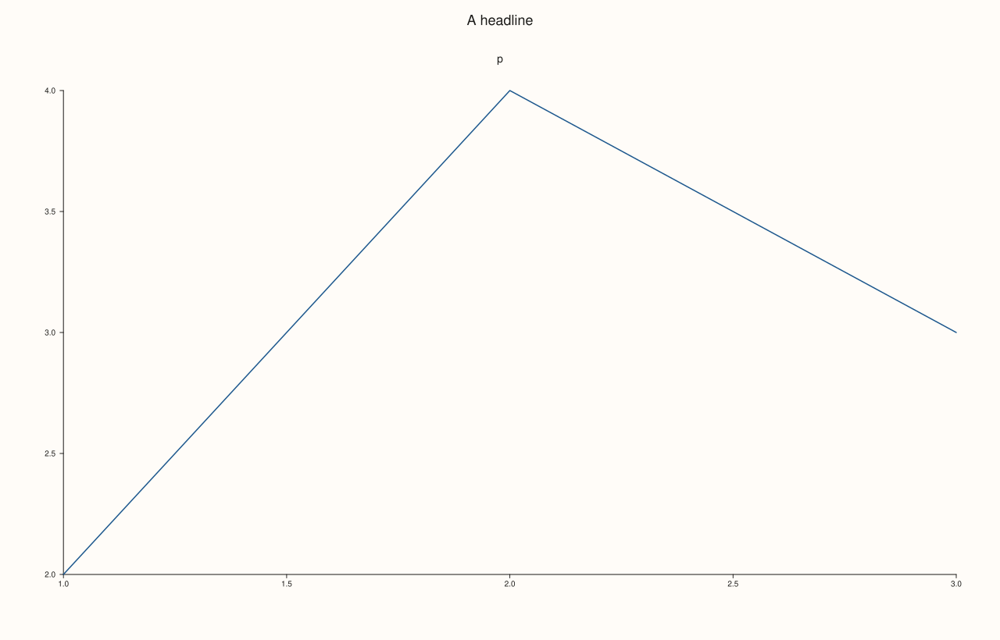
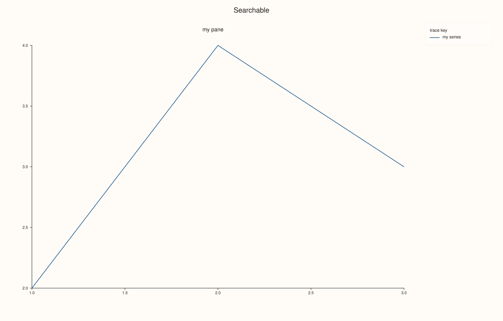

<!-- pluss-hand-authored -->

# Studio::to_svg

[Back to Studio API Reference](../../studio_api_reference)

## Signature

```cpp
std::string Studio::to_svg() const
```

## What It Does

Renders the figure and returns it as an SVG document in a `std::string`. Nothing is written to disk and the figure is not changed, so the call can be repeated: the same figure gives the same text every time, byte for byte. [`save_svg`](save_svg.md) is this string written to a file.

The document starts with the XML declaration and an `<svg>` element whose `width`, `height` and `viewBox` are the figure size ([`size`](size.md)), and is a complete, self-contained file: text is real `<text>` elements, so it can be searched, restyled or embedded in a web page. A figure with no panes still renders, as an empty canvas with its background.

The render reads the figure as it is at the moment of the call. Panes, traces, themes and legends changed afterwards are not in a string that was already returned, and a figure changed between two calls gives two different strings.

## Parameters

*(none)*

## Returns

`std::string`
    The SVG document, UTF-8, ending with `</svg>`.

## Examples

Example 1. The document. The header carries the figure size, and the string is a complete SVG that closes with `</svg>`.

```cpp
auto fig = studio("to_svg_basic");
fig.pane2("p").trend(std::vector<double>{1, 2, 3, 4}, std::vector<double>{2, 4, 3, 5});
const std::string svg = fig.to_svg();
std::cout << svg.substr(0, svg.find('\n')) << "\n";
const auto at = svg.find("<svg");
std::cout << svg.substr(at, svg.find('>', at) - at + 1) << "\n";
std::cout << "ends with </svg>: " << (svg.rfind("</svg>") + 7 >= svg.size()) << "\n";
fig.save_svg("figure.svg");
```

### Output

```text
<?xml version="1.0" encoding="UTF-8"?>
<svg xmlns="http://www.w3.org/2000/svg" width="1280.0000" height="820.0000" viewBox="0 0 1280.0000 820.0000">
ends with </svg>: 1
```


Example 2. Repeatable and side-effect free. Rendering twice gives the same text, and rendering does not change the figure: the pane count and size are the same before and after.

```cpp
auto fig = studio("to_svg_repeat");
fig.pane2("p").trend(std::vector<double>{1, 2, 3}, std::vector<double>{2, 4, 3}).label("series");
const std::string first = fig.to_svg();
const std::string second = fig.to_svg();
std::cout << "same text twice: " << (first == second) << "\n";
std::cout << "panes: " << fig.pane_count() << ", size: " << fig.extent().width << " x " << fig.extent().height << "\n";
fig.save_svg("figure.svg");
```

### Output

```text
same text twice: 1
panes: 1, size: 1280 x 820
```


Example 3. The figure at the moment of the call. Adding a headline changes what `to_svg` returns, and the text rendered earlier is a snapshot that is not updated.

```cpp
auto fig = studio("to_svg_now");
fig.pane2("p").trend(std::vector<double>{1, 2, 3}, std::vector<double>{2, 4, 3});
const std::string before = fig.to_svg();
fig.headline("A headline");
const std::string after = fig.to_svg();
std::cout << "headline in the first string: " << (before.find("A headline") != std::string::npos) << "\n";
std::cout << "headline in the second string: " << (after.find("A headline") != std::string::npos) << "\n";
fig.save_svg("figure.svg");
```

### Output

```text
headline in the first string: 0
headline in the second string: 1
```



Example 4. The text is real text. Titles, tick labels and legend entries are `<text>` elements in the document, so they can be found in the string; the path data of the traces are `<path>` elements.

```cpp
auto fig = studio("to_svg_text");
fig.headline("Searchable");
fig.pane2("my pane").trend(std::vector<double>{1, 2, 3}, std::vector<double>{2, 4, 3}).label("my series");
fig.legend(KeyDock::East);
const std::string svg = fig.to_svg();
std::cout << "headline: " << (svg.find(">Searchable<") != std::string::npos) << "\n";
std::cout << "pane title: " << (svg.find(">my pane<") != std::string::npos) << "\n";
std::cout << "legend entry: " << (svg.find("my series") != std::string::npos) << "\n";
std::cout << "has path data: " << (svg.find("<path") != std::string::npos) << "\n";
fig.save_svg("figure.svg");
```

### Output

```text
headline: 1
pane title: 1
legend entry: 1
has path data: 1
```



Example 5. A figure with no panes. It is not an error: the result is a valid document with the canvas and no text on it.

```cpp
auto fig = studio("to_svg_empty");
const std::string svg = fig.to_svg();
std::cout << "panes: " << fig.pane_count() << "\n";
std::cout << "valid document: " << (svg.find("<svg") != std::string::npos && svg.rfind("</svg>") != std::string::npos) << "\n";
std::cout << "has any text: " << (svg.find("<text") != std::string::npos) << "\n";
auto shown = studio("to_svg_empty_out");
shown.pane2("p").trend(std::vector<double>{1, 2, 3}, std::vector<double>{2, 4, 3});
shown.save_svg("figure.svg");
```

### Output

```text
panes: 0
valid document: 1
has any text: 0
```


## Notes

- Large figures produce large strings; for a file, [`save_svg`](save_svg.md) writes the same text without the caller holding it.
- The string is independent of the figure: it keeps its content if the figure changes or is destroyed afterwards.
- For a vector file that needs no browser, see [`to_pdf`](to_pdf.md) and [`save_pdf`](save_pdf.md); for pixels, [`save_png`](save_png.md).

## See Also

- [`Studio::save_svg`](save_svg.md): the same document written to a file.
- [`Studio::to_pdf`](to_pdf.md): the PDF as a string.
- [`Studio::size`](size.md): sets the size in the header.
- [`Studio::show`](show.md): opens the figure in a viewer.

<div class="pluss-inline-prev-next">
  <a class="prev-link" href="to_pdf.html">
    <span class="label">Previous</span>
    <span class="title">to_pdf</span>
  </a>
  <a class="next-link" href="x_caption.html">
    <span class="label">Next</span>
    <span class="title">x_caption</span>
  </a>
</div>
