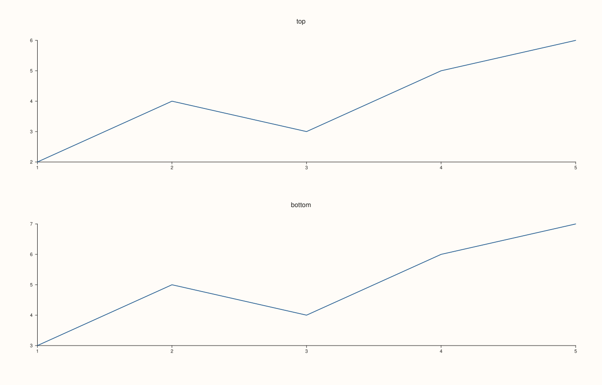
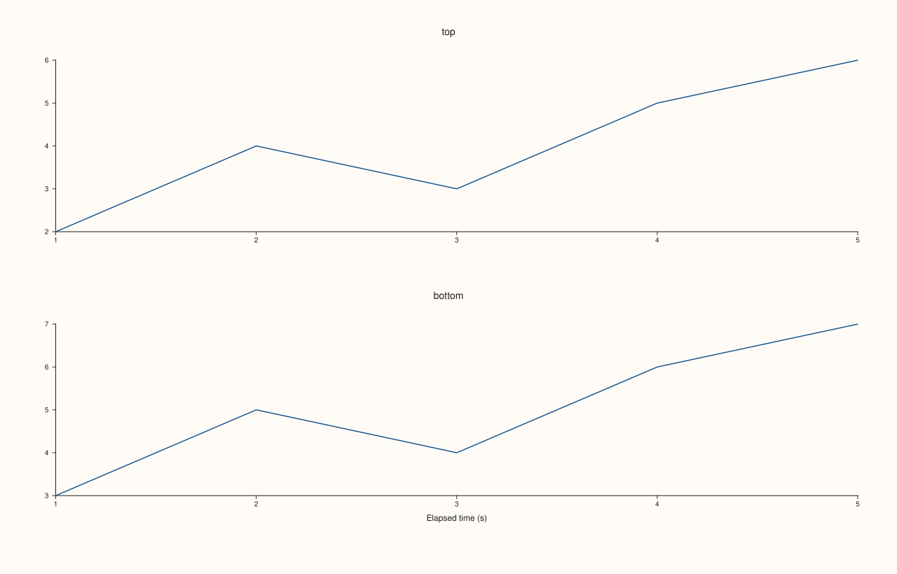
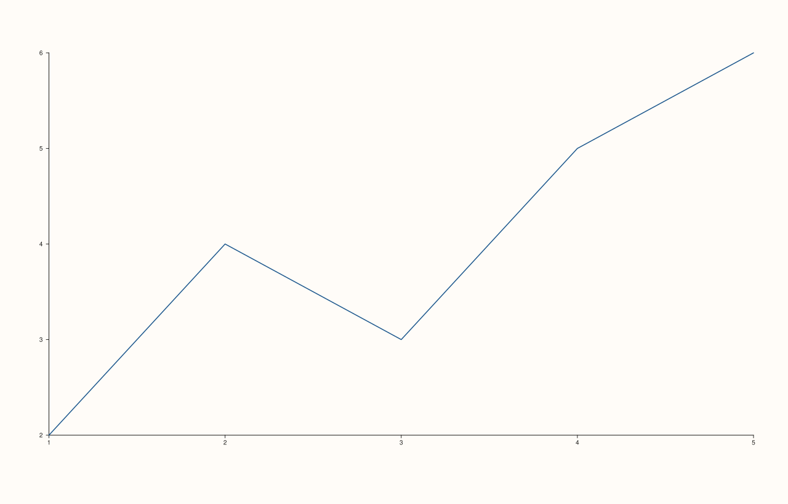

<!-- pluss-hand-authored -->

# Studio::x_caption

[Back to Studio API Reference](../../studio_api_reference)

## Signature

```cpp
Studio& Studio::x_caption(std::string group, std::string text)
```

## What It Does

Registers (or overwrites) a **shared caption** for one alignment *group* — a caption
drawn once, figure-wide, for the x-axis shared by every pane opted into that group. Panes
opt in by calling [`Pane::align_x(group)`](../pane/align_x.md) (or the combined
[`align_xy`](../pane/align_xy.md) / [`align_xyz`](../pane/align_xyz.md)) with a matching
group string — `x_caption` and `align_x` are linked purely by that shared string, with no
other API connecting them.

```{important} A caption with no matching pane renders nothing — but still reserves its layout space
If no pane's `align_x()` group matches the caption's `group` argument, the caption **text
never appears** — but the vertical space reserved for a caption row is *still* claimed at
the bottom of the figure, shrinking every pane's plot area by the same amount a rendered
caption would have. Verified by direct SVG diff: a figure with an unmatched
`x_caption("nonexistent_group", ...)` call renders byte-different output from an otherwise
identical figure with no `x_caption` call at all — the bottom plot-area edge moves up by
28px in both cases, even though no caption text is drawn in the unmatched case. In other
words, once you've called `x_caption()` at all, budget for the reserved row whether or not
some pane ends up wearing that group. See Example 3.
```

Calling `x_caption()` again with the same `group` string overwrites the previous text for
that group (it's a `std::map<std::string, std::string>` upsert, not an append) — there is
exactly one caption per group at a time.

## Parameters

**group** (`std::string`)
    The alignment-group key. Must match the string passed to some pane's
    [`align_x`](../pane/align_x.md)/[`align_xy`](../pane/align_xy.md)/
    [`align_xyz`](../pane/align_xyz.md) for the caption to actually render.

**text** (`std::string`)
    The caption text to draw for that group.

## Returns

`Studio&`
    A reference to the same figure, for chaining.

## Examples

Example 1. Two stacked panes, both opted into the same x-align group via `align_x`, but
**no** `x_caption()` call — no caption row is reserved or drawn.

```cpp
using namespace pluss::pl;

auto fig = studio("caption_none");
fig.mosaic(2, 1);
auto& top = fig.pane2("top");
top.trend(std::vector<double>{1.0, 2.0, 3.0, 4.0, 5.0}, std::vector<double>{2.0, 4.0, 3.0, 5.0, 6.0}).label("series a");
top.align_x("shared_x");
auto& bottom = fig.pane2("bottom");
bottom.trend(std::vector<double>{1.0, 2.0, 3.0, 4.0, 5.0}, std::vector<double>{3.0, 5.0, 4.0, 6.0, 7.0}).label("series b");
bottom.align_x("shared_x");
fig.show();
```



Example 2. The same layout, now with `x_caption("shared_x", "Elapsed time (s)")` —
matching both panes' `align_x("shared_x")` — so the caption renders once, shared across
both panes' x-axis.

```cpp
using namespace pluss::pl;

auto fig = studio("caption_x");
fig.mosaic(2, 1);
fig.x_caption("shared_x", "Elapsed time (s)");
auto& top = fig.pane2("top");
top.trend(std::vector<double>{1.0, 2.0, 3.0, 4.0, 5.0}, std::vector<double>{2.0, 4.0, 3.0, 5.0, 6.0}).label("series a");
top.align_x("shared_x");
auto& bottom = fig.pane2("bottom");
bottom.trend(std::vector<double>{1.0, 2.0, 3.0, 4.0, 5.0}, std::vector<double>{3.0, 5.0, 4.0, 6.0, 7.0}).label("series b");
bottom.align_x("shared_x");
fig.show();

std::cout << fig.x_captions().size() << "\n";
std::cout << fig.x_captions().at("shared_x") << "\n";
```

### Output

```text
1
Elapsed time (s)
```



Example 3. An **unmatched** group — the caption text never draws, but the layout still
reserves the caption row, so the plot area is the same (smaller) size as Example 2's,
not Example 1's.

```cpp
using namespace pluss::pl;

auto fig = studio("caption_control");
fig.x_caption("nonexistent_group", "Never Shown");
auto& pane = fig.pane2();
pane.trend(std::vector<double>{1.0, 2.0, 3.0, 4.0, 5.0}, std::vector<double>{2.0, 4.0, 3.0, 5.0, 6.0}).label("series a");
fig.show();
```



## Notes

- Not `noexcept` (constructs/moves `std::string`s and inserts into a `std::map`).
- Linked to `Pane::align_x`/`align_xy`/`align_xyz` purely by matching `group` string — no
  compile-time or construction-time check ties them together, so a typo in either string
  silently produces "no caption drawn, but its layout space is still reserved" (see the
  important callout above) rather than an error.
- Re-calling with the same `group` overwrites that group's text (map upsert semantics),
  it does not add a second caption line.
- Read back the full set of registered captions via [`x_captions()`](x_captions.md).
- [`y_caption`](y_caption.md) and [`z_caption`](z_caption.md) are the exact same mechanism
  for the y- and z-axes respectively, paired with `align_y`/`align_z`.

## See Also

- [`Studio::x_captions`](x_captions.md): reads back the full map of registered x-captions.
- [`Pane::align_x`](../pane/align_x.md) / [`align_xy`](../pane/align_xy.md) /
  [`align_xyz`](../pane/align_xyz.md): how a pane opts into a caption's group.
- [`Studio::y_caption`](y_caption.md) / [`z_caption`](z_caption.md): the y- and z-axis
  equivalents.

<div class="pluss-inline-prev-next">
  <a class="prev-link" href="legend_shape.html">
    <span class="label">Previous</span>
    <span class="title">legend_shape</span>
  </a>
  <a class="next-link" href="x_captions.html">
    <span class="label">Next</span>
    <span class="title">x_captions</span>
  </a>
</div>
