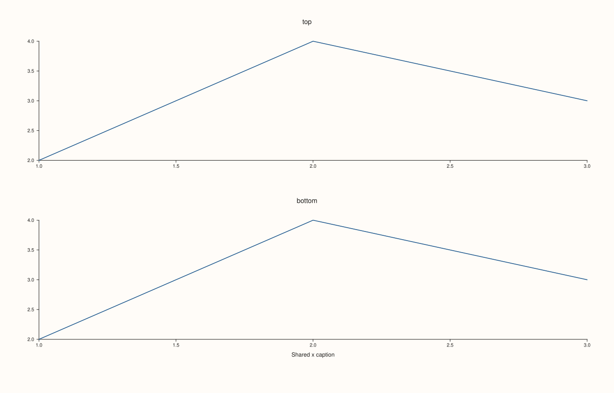
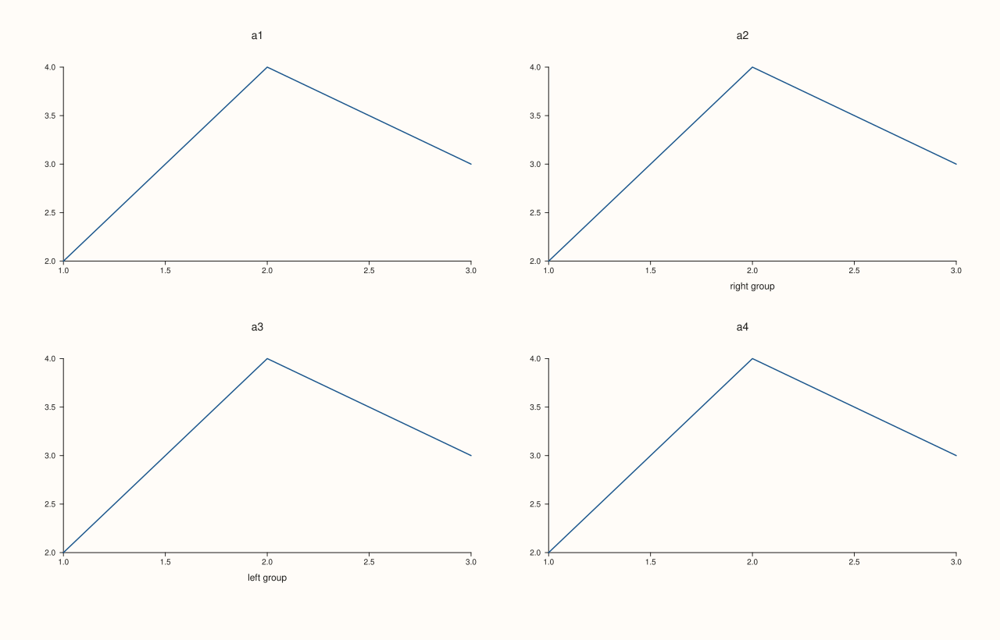
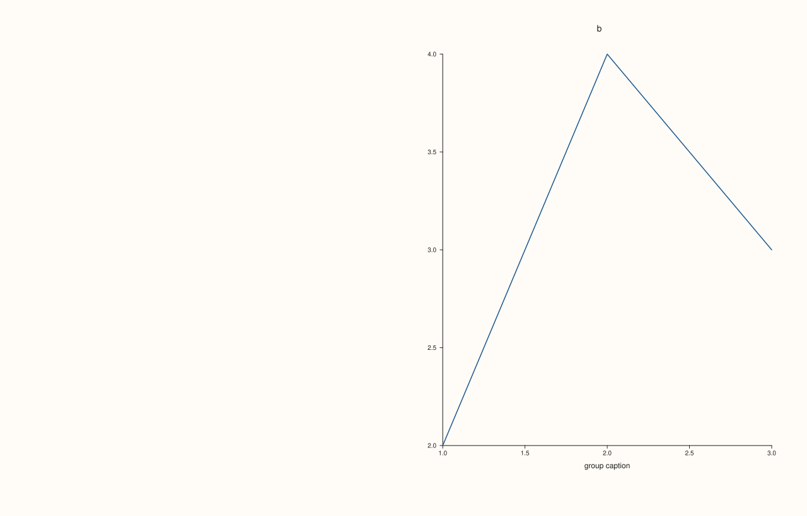

<!-- pluss-hand-authored -->

# Studio::x_caption

[Back to Studio API Reference](../../studio_api_reference)

## Signature

```cpp
Studio& Studio::x_caption(std::string group, std::string text)
```

## What It Does

Sets a **shared x caption**: one line of text drawn once for the x axes of every pane that belongs to the alignment group `group`. A pane joins a group with [`Pane::align_x`](../pane/align_x.md) (or `align_xy` / `align_xyz`); the caption and the panes are tied together only by that string. Several panes in one group get a single caption, placed below the group's plot areas.

The caption is drawn only when something shows it. A caption whose group no visible pane belongs to, and a caption whose text is empty, are stored and read back by [`x_captions`](x_captions.md) but draw nothing and take no space: the figure is the same as one without the call. The caption takes its room (the bottom margin) as soon as at least one visible pane belongs to its group, so adding or hiding panes changes the layout the way you would expect.

Calling `x_caption` again with the same group replaces the text; there is one caption per group. Different groups are independent, so two columns of panes can each carry their own caption.

## Parameters

**group** (`std::string`)
    The alignment-group name. Panes join it with `align_x`, `align_xy` or `align_xyz` using the same string; the match is exact and case-sensitive.

**text** (`std::string`)
    The caption. Math text between dollar signs is typeset. An empty string draws nothing.

## Returns

`Studio&`
    The same figure, for chaining.

## Examples

Example 1. One caption for two panes. Both panes join the group `shared` and the caption is drawn once, below them.

```cpp
auto fig = studio("x_caption_shared");
fig.mosaic(2, 1);
fig.x_caption("shared", "Shared x caption");
auto& top = fig.pane2("top");
top.trend(std::vector<double>{1, 2, 3}, std::vector<double>{2, 4, 3});
top.align_x("shared");
auto& bottom = fig.pane2("bottom");
bottom.trend(std::vector<double>{1, 2, 3}, std::vector<double>{2, 4, 3});
bottom.align_x("shared");
std::cout << "captions: " << fig.x_captions().size() << ", text: " << fig.x_captions().at("shared") << "\n";
fig.save_svg("figure.svg");
```

### Output

```text
captions: 1, text: Shared x caption
```



Example 2. Calling again with the same group replaces the text. The map still holds one entry; the figure shows the second text only.

```cpp
auto fig = studio("x_caption_overwrite");
fig.mosaic(2, 1);
auto& t1 = fig.pane2("top");
t1.trend(std::vector<double>{1, 2, 3}, std::vector<double>{2, 4, 3});
t1.align_x("g");
auto& t2 = fig.pane2("bottom");
t2.trend(std::vector<double>{1, 2, 3}, std::vector<double>{2, 4, 3});
t2.align_x("g");
fig.x_caption("g", "first text");
fig.x_caption("g", "second text");
std::cout << "entries: " << fig.x_captions().size() << ", text: " << fig.x_captions().at("g") << "\n";
const std::string svg = fig.to_svg();
std::cout << "first text drawn: " << (svg.find("first text") != std::string::npos) << ", second text drawn: " << (svg.find("second text") != std::string::npos) << "\n";
fig.save_svg("figure.svg");
```

### Output

```text
entries: 1, text: second text
first text drawn: 0, second text drawn: 1
```


Example 3. Two groups, two captions. The panes of each group are captioned separately; a pane in neither group has no caption.

```cpp
auto fig = studio("x_caption_groups");
fig.mosaic(2, 2);
auto& a1 = fig.pane2("a1");
a1.trend(std::vector<double>{1, 2, 3}, std::vector<double>{2, 4, 3});
a1.align_x("left");
auto& a2 = fig.pane2("a2");
a2.trend(std::vector<double>{1, 2, 3}, std::vector<double>{2, 4, 3});
a2.align_x("right");
auto& a3 = fig.pane2("a3");
a3.trend(std::vector<double>{1, 2, 3}, std::vector<double>{2, 4, 3});
a3.align_x("left");
auto& a4 = fig.pane2("a4");
a4.trend(std::vector<double>{1, 2, 3}, std::vector<double>{2, 4, 3});
fig.x_caption("left", "left group");
fig.x_caption("right", "right group");
std::cout << "captions: " << fig.x_captions().size() << "\n";
fig.save_svg("figure.svg");
```

### Output

```text
captions: 2
```



Example 4. A caption nobody shows. The group `nobody` has no pane, so the caption is stored but the SVG is identical to the figure without the call: no text, no reserved space. An empty text behaves the same way.

```cpp
auto build = [](int variant) {
  auto fig = studio("x_caption_unmatched");
  auto& pane = fig.pane2("p");
  pane.trend(std::vector<double>{1, 2, 3}, std::vector<double>{2, 4, 3});
  pane.align_x("g");
  if (variant == 1) fig.x_caption("nobody", "never drawn");
  if (variant == 2) fig.x_caption("g", "");
  return fig.to_svg();
};
std::cout << "no call == unmatched group: " << (build(0) == build(1)) << "\n";
std::cout << "no call == empty text:      " << (build(0) == build(2)) << "\n";
auto fig = studio("x_caption_unmatched_out");
auto& pane = fig.pane2("p");
  pane.trend(std::vector<double>{1, 2, 3}, std::vector<double>{2, 4, 3});
  pane.align_x("g");
fig.x_caption("nobody", "never drawn");
fig.save_svg("figure.svg");
```

### Output

```text
no call == unmatched group: 1
no call == empty text:      1
```


Example 5. Hiding the panes of a group removes the caption and its room. The caption is drawn while at least one pane of the group is visible, and is not drawn once every one of them is hidden.

```cpp
auto build = [](bool hide_a, bool hide_b) {
  auto fig = studio("x_caption_hidden");
  fig.mosaic(1, 2);
  fig.x_caption("g", "group caption");
  auto& a = fig.pane2("a");
  a.trend(std::vector<double>{1, 2, 3}, std::vector<double>{2, 4, 3});
  a.align_x("g");
  if (hide_a) a.hide();
  auto& b = fig.pane2("b");
  b.trend(std::vector<double>{1, 2, 3}, std::vector<double>{2, 4, 3});
  b.align_x("g");
  if (hide_b) b.hide();
  return fig.to_svg();
};
auto drawn = [](const std::string& svg) { return svg.find("group caption") != std::string::npos; };
std::cout << "both visible:  " << drawn(build(false, false)) << "\n";
std::cout << "a hidden:      " << drawn(build(true, false)) << "\n";
std::cout << "both hidden:   " << drawn(build(true, true)) << "\n";
auto fig = studio("x_caption_hidden_out");
fig.mosaic(1, 2);
fig.x_caption("g", "group caption");
auto& a = fig.pane2("a");
a.trend(std::vector<double>{1, 2, 3}, std::vector<double>{2, 4, 3});
a.align_x("g");
a.hide();
auto& b = fig.pane2("b");
b.trend(std::vector<double>{1, 2, 3}, std::vector<double>{2, 4, 3});
b.align_x("g");
fig.save_svg("figure.svg");
```

### Output

```text
both visible:  1
a hidden:      1
both hidden:   0
```



## Notes

- The group string is the only link between the caption and the panes, so a misspelt group draws nothing. [`x_captions`](x_captions.md) lists the registered groups, which makes a mismatch easy to spot.
- A caption is figure-level text. For text that belongs to one pane use the pane's own axis label ([`Pane::x_label`](../pane/x_label.md)).
- Pane groups are set on the pane, so they follow the pane when it is moved with [`mosaic`](mosaic.md) or [`subpane2`](subpane2.md).

## See Also

- [`Studio::x_captions`](x_captions.md): reads the registered captions back.
- [`Pane::align_x`](../pane/align_x.md): how a pane joins a group.
- [`Studio::x_caption`](x_caption.md), [`y_caption`](y_caption.md), [`z_caption`](z_caption.md): the three axes.
- [`Studio::row_title`](row_title.md): a title for a whole row of the mosaic.

<div class="pluss-inline-prev-next">
  <a class="prev-link" href="to_svg.html">
    <span class="label">Previous</span>
    <span class="title">to_svg</span>
  </a>
  <a class="next-link" href="x_captions.html">
    <span class="label">Next</span>
    <span class="title">x_captions</span>
  </a>
</div>
