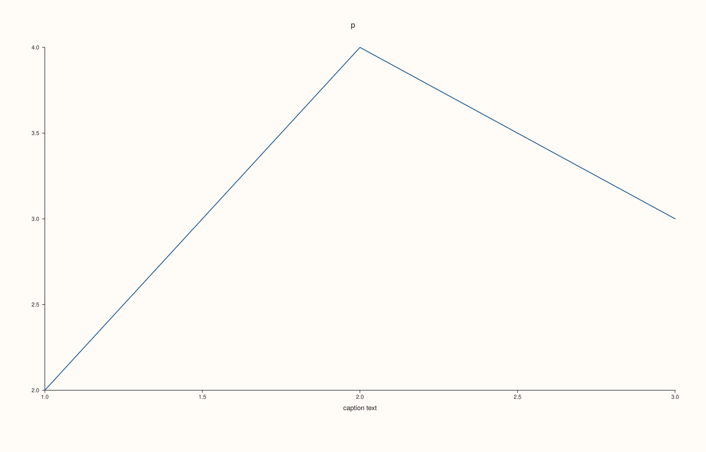

<!-- pluss-hand-authored -->

# Studio::x_captions

[Back to Studio API Reference](../../studio_api_reference)

## Signature

```cpp
const std::map<std::string, std::string>& Studio::x_captions() const noexcept
```

## What It Does

Returns every shared x caption that [`x_caption`](x_caption.md) has registered, as a map from group name to text, sorted by group name (not by the order of the calls). It is what is registered, not what is drawn: a caption whose group no visible pane belongs to, and a caption with empty text, are in the map but draw nothing and take no room. The map is empty for a figure that never called `x_caption`, and a caption cannot be removed, only replaced (an empty text draws nothing).

The reference is to the figure's own map, so it shows later calls and should be copied when a snapshot is needed.

## Parameters

*(none)*

## Returns

`const std::map<std::string, std::string>&`
    The registered captions, keyed by group.

## Examples

Example 1. Reading the registry. Empty by default; each group is one entry, sorted by group name, and calling again for a group replaces its text.

```cpp
auto fig = studio("x_captions_read");
std::cout << "empty: " << fig.x_captions().empty() << "\n";
fig.x_caption("zeta", "last group").x_caption("alpha", "first group");
fig.x_caption("alpha", "first group, revised");
for (const auto& [group, text] : fig.x_captions()) std::cout << group << " => " << text << "\n";
fig.pane2("p").trend(std::vector<double>{1, 2, 3}, std::vector<double>{2, 4, 3});
fig.save_svg("figure.svg");
```

### Output

```text
empty: 1
alpha => first group, revised
zeta => last group
```


Example 2. Registered is not drawn. A caption for a group nobody joined is in the map while the figure is exactly the figure without it; a pane joining the group makes it appear.

```cpp
auto build = [](bool join) {
  auto fig = studio("x_captions_drawn");
  fig.x_caption("g", "caption text");
  auto& pane = fig.pane2("p");
  pane.trend(std::vector<double>{1, 2, 3}, std::vector<double>{2, 4, 3});
  if (join) pane.align_x("g");
  return fig;
};
auto alone = build(false), joined = build(true);
std::cout << "registered either way: " << alone.x_captions().size() << " and " << joined.x_captions().size() << "\n";
std::cout << "drawn without the group: " << (alone.to_svg().find("caption text") != std::string::npos) << ", with it: " << (joined.to_svg().find("caption text") != std::string::npos) << "\n";
joined.save_svg("figure.svg");
```

### Output

```text
registered either way: 1 and 1
drawn without the group: 0, with it: 1
```



Example 3. The three axes are separate registries. A caption set for one axis is not in the maps of the others.

```cpp
auto fig = studio("x_captions_axes");
fig.x_caption("g", "x only");
std::cout << "x: " << fig.x_captions().size() << ", y: " << fig.y_captions().size() << ", z: " << fig.z_captions().size() << "\n";
fig.pane2("p").trend(std::vector<double>{1, 2, 3}, std::vector<double>{2, 4, 3});
fig.save_svg("figure.svg");
```

### Output

```text
x: 1, y: 0, z: 0
```


## Notes

- `noexcept`, and has no effect on the figure.
- Groups are matched exactly and case-sensitively against the names panes pass to [`Pane::align_x`](../pane/align_x.md).

## See Also

- [`Studio::x_caption`](x_caption.md): registers a caption and says when it is drawn.
- [`Pane::align_x`](../pane/align_x.md): how a pane joins a group.
- [`Studio::x_captions`](x_captions.md), [`y_captions`](y_captions.md), [`z_captions`](z_captions.md): the three axes.

<div class="pluss-inline-prev-next">
  <a class="prev-link" href="x_caption.html">
    <span class="label">Previous</span>
    <span class="title">x_caption</span>
  </a>
  <a class="next-link" href="y_caption.html">
    <span class="label">Next</span>
    <span class="title">y_caption</span>
  </a>
</div>
