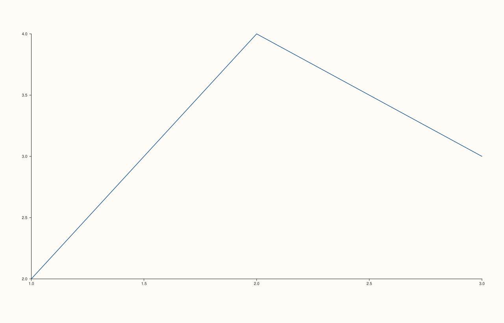

<!-- pluss-hand-authored -->

# Studio::x_captions

[Back to Studio API Reference](../../studio_api_reference)

## Signature

```cpp
const std::map<std::string, std::string>& Studio::x_captions() const noexcept
```

## What It Does

Returns the full map of registered x-axis captions — every `group → text` pair set via
[`x_caption(group, text)`](x_caption.md), keyed by group string. Empty if `x_caption()` has
never been called.

## Parameters

*(none)*

## Returns

`const std::map<std::string, std::string>&`
    A reference to the figure's internal x-caption map. `std::map` keeps entries sorted
    lexicographically by group key.

## Examples

Example 1. Empty by default, then populated by two `x_caption` calls for two different
groups.

```cpp
using namespace pluss::pl;

auto fig = studio("x_captions_check");
std::cout << fig.x_captions().empty() << "\n";

fig.x_caption("group_a", "Time (s)");
fig.x_caption("group_b", "Distance (m)");
std::cout << fig.x_captions().size() << "\n";
for (const auto& [group, text] : fig.x_captions()) {
  std::cout << group << " => " << text << "\n";
}

auto& pane = fig.pane2();
pane.trend(std::vector<double>{1.0, 2.0, 3.0}, std::vector<double>{2.0, 4.0, 3.0}).label("series");
fig.show();
```

### Output

```text
1
2
group_a => Time (s)
group_b => Distance (m)
```



## Notes

- `noexcept`.
- Returns a reference into the `Studio`'s own storage — valid as long as the `Studio`
  itself is alive and not modified through a non-`const` caption call in between.
- Entries are sorted by group key (`std::map`'s ordering), not insertion order.
- Reading this map doesn't tell you whether any pane's `align_x` actually matches a given
  group — see the important callout on [`x_caption`](x_caption.md) for what happens when it
  doesn't.

## See Also

- [`Studio::x_caption`](x_caption.md): the only way to add or overwrite entries in this map.
- [`Studio::y_captions`](y_captions.md) / [`z_captions`](z_captions.md): the y- and z-axis
  equivalents.

<div class="pluss-inline-prev-next">
  <a class="prev-link" href="x_caption.html">
    <span class="label">Previous</span>
    <span class="title">x_caption</span>
  </a>
  <a class="next-link" href="y_caption.html">
    <span class="label">Next</span>
    <span class="title">y_caption</span>
  </a>
</div>
