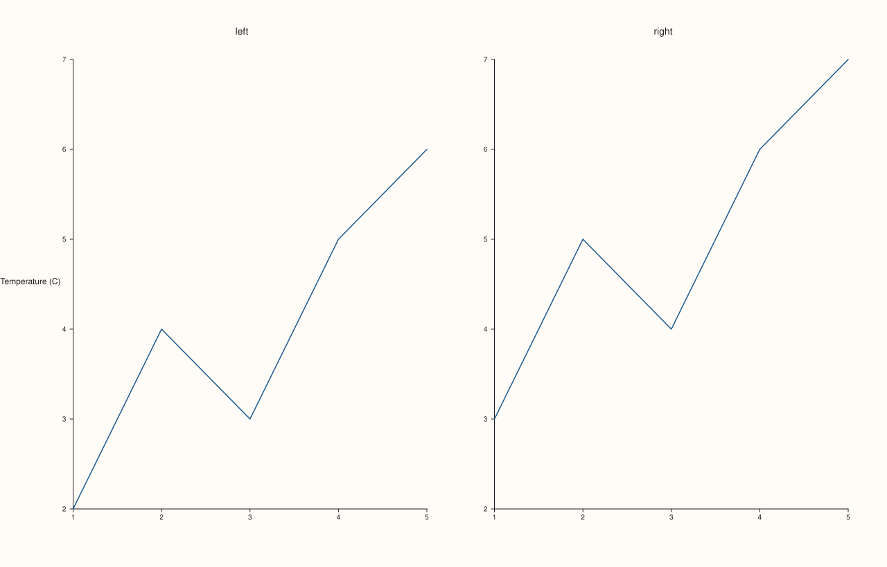

<!-- pluss-hand-authored -->

# Studio::y_caption

[Back to Studio API Reference](../../studio_api_reference)

## Signature

```cpp
Studio& Studio::y_caption(std::string group, std::string text)
```

## What It Does

The y-axis counterpart of [`x_caption`](x_caption.md): registers (or overwrites) a shared
caption for one alignment group, drawn once, figure-wide, for the y-axis shared by every
pane opted into that group via [`Pane::align_y(group)`](../pane/align_y.md) (or the
combined [`align_xy`](../pane/align_xy.md) / [`align_xyz`](../pane/align_xyz.md)). Every
behavioral detail from `x_caption` carries over unchanged:

- Linked to `align_y`/`align_xy`/`align_xyz` purely by matching `group` string.
- An unmatched group renders no text but still reserves the caption's layout space (this
  time along the left edge, where a y-caption is drawn).
- Re-calling with the same `group` overwrites that group's text.

## Parameters

**group** (`std::string`)
    The alignment-group key. Must match the string passed to some pane's
    `align_y`/`align_xy`/`align_xyz` for the caption to render.

**text** (`std::string`)
    The caption text to draw for that group.

## Returns

`Studio&`
    A reference to the same figure, for chaining.

## Examples

Example 1. Two side-by-side panes, both opted into the same y-align group via `align_y`,
with a matching `y_caption` — the caption renders once, shared across both panes' y-axis.

```cpp
using namespace pluss::pl;

auto fig = studio("caption_y");
fig.mosaic(1, 2);
fig.y_caption("shared_y", "Temperature (C)");
auto& left = fig.pane2("left");
left.trend(std::vector<double>{1.0, 2.0, 3.0, 4.0, 5.0}, std::vector<double>{2.0, 4.0, 3.0, 5.0, 6.0}).label("series a");
left.align_y("shared_y");
auto& right = fig.pane2("right");
right.trend(std::vector<double>{1.0, 2.0, 3.0, 4.0, 5.0}, std::vector<double>{3.0, 5.0, 4.0, 6.0, 7.0}).label("series b");
right.align_y("shared_y");
fig.show();

std::cout << fig.y_captions().at("shared_y") << "\n";
```

### Output

```text
Temperature (C)
```



## Notes

- Not `noexcept`.
- See [`x_caption`](x_caption.md)'s Notes and important callout — every detail (map-upsert
  overwrite semantics, unmatched-group layout reservation, no compile-time link to
  `align_y`) applies identically here, just for the y-axis.

## See Also

- [`Studio::y_captions`](y_captions.md): reads back the full map of registered y-captions.
- [`Pane::align_y`](../pane/align_y.md) / [`align_xy`](../pane/align_xy.md) /
  [`align_xyz`](../pane/align_xyz.md): how a pane opts into a caption's group.
- [`Studio::x_caption`](x_caption.md) / [`z_caption`](z_caption.md): the x- and z-axis
  equivalents.

<div class="pluss-inline-prev-next">
  <a class="prev-link" href="x_captions.html">
    <span class="label">Previous</span>
    <span class="title">x_captions</span>
  </a>
  <a class="next-link" href="y_captions.html">
    <span class="label">Next</span>
    <span class="title">y_captions</span>
  </a>
</div>
