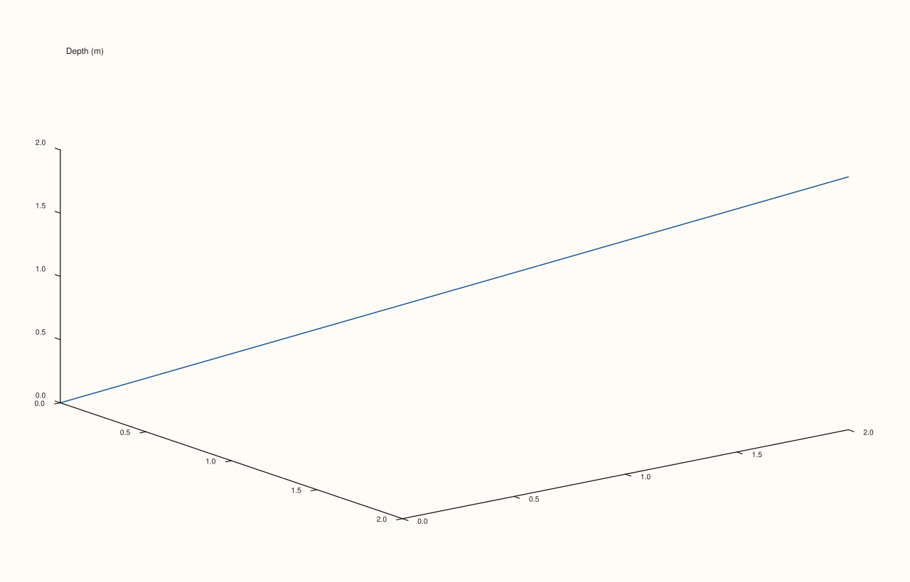

<!-- pluss-hand-authored -->

# Studio::z_caption

[Back to Studio API Reference](../../studio_api_reference)

## Signature

```cpp
Studio& Studio::z_caption(std::string group, std::string text)
```

## What It Does

The z-axis counterpart of [`x_caption`](x_caption.md) and [`y_caption`](y_caption.md):
registers (or overwrites) a shared caption for one alignment group, drawn once,
figure-wide, for the z-axis shared by every pane opted into that group via
[`Pane::align_z(group)`](../pane/align_z.md) (or the combined
[`align_xyz`](../pane/align_xyz.md)). Since only 3D panes (built via
[`Studio::pane3()`](pane3.md)) have a meaningful z-axis, this is primarily useful across
figures made up of multiple 3D panes. Every other behavioral detail from `x_caption`
carries over unchanged: linked purely by matching `group` string, an unmatched group
renders no text but still reserves layout space, and re-calling with the same `group`
overwrites the previous text.

## Parameters

**group** (`std::string`)
    The alignment-group key. Must match the string passed to some pane's
    `align_z`/`align_xyz` for the caption to render.

**text** (`std::string`)
    The caption text to draw for that group.

## Returns

`Studio&`
    A reference to the same figure, for chaining.

## Examples

Example 1. A single 3D pane with a `path3` trace, opted into a z-align group, paired with
a matching `z_caption`.

```cpp
using namespace pluss::pl;

auto fig = studio("caption_z");
fig.z_caption("shared_z", "Depth (m)");
auto& pane = fig.pane3();
std::vector<double> x{0.0, 1.0, 2.0};
std::vector<double> y{0.0, 1.0, 2.0};
std::vector<double> z{0.0, 1.0, 2.0};
flash::path3(pane, x, y, z);
pane.align_z("shared_z");
fig.show();

std::cout << fig.z_captions().at("shared_z") << "\n";
```

### Output

```text
Depth (m)
```



## Notes

- Not `noexcept`.
- See [`x_caption`](x_caption.md)'s Notes and important callout — the map-upsert overwrite
  semantics and unmatched-group layout reservation apply identically here.
- Most useful with 3D panes (`pane3()`); 2D panes (`pane2()`) do carry a `z_axis()` state
  internally but it plays no role in ordinary 2D rendering, so a z-caption paired with a
  2D-only figure has nothing meaningful to align.

## See Also

- [`Studio::z_captions`](z_captions.md): reads back the full map of registered z-captions.
- [`Pane::align_z`](../pane/align_z.md) / [`align_xyz`](../pane/align_xyz.md): how a pane
  opts into a caption's group.
- [`Studio::x_caption`](x_caption.md) / [`y_caption`](y_caption.md): the x- and y-axis
  equivalents.

<div class="pluss-inline-prev-next">
  <a class="prev-link" href="y_captions.html">
    <span class="label">Previous</span>
    <span class="title">y_captions</span>
  </a>
  <a class="next-link" href="z_captions.html">
    <span class="label">Next</span>
    <span class="title">z_captions</span>
  </a>
</div>
