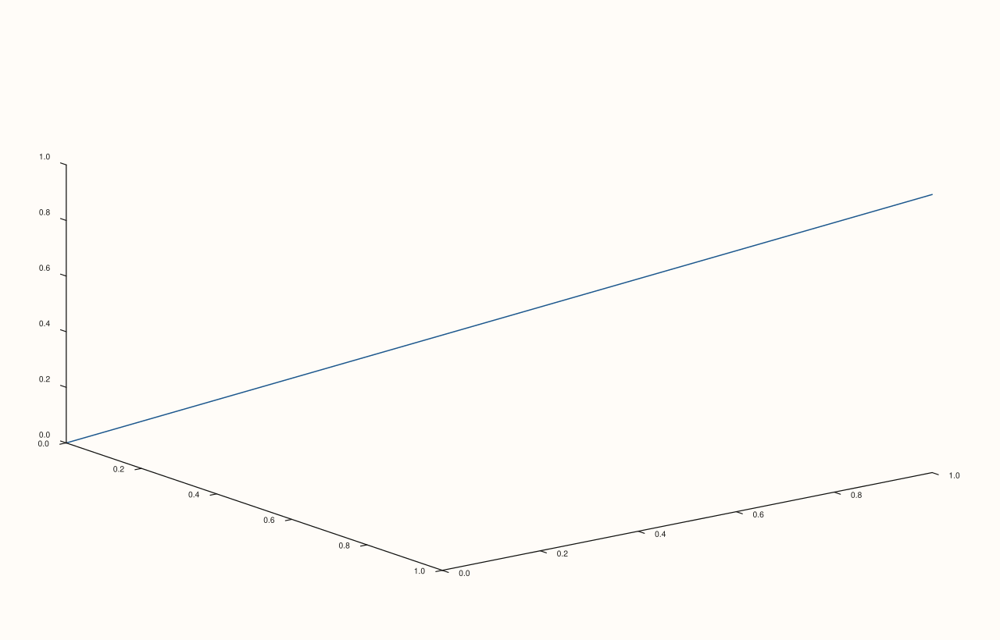

<!-- pluss-hand-authored -->

# Studio::z_captions

[Back to Studio API Reference](../../studio_api_reference)

## Signature

```cpp
const std::map<std::string, std::string>& Studio::z_captions() const noexcept
```

## What It Does

The z-axis counterpart of [`x_captions`](x_captions.md)/[`y_captions`](y_captions.md):
returns the full map of registered z-axis captions — every `group → text` pair set via
[`z_caption(group, text)`](z_caption.md), keyed by group string, sorted lexicographically.
Empty if `z_caption()` has never been called.

## Parameters

*(none)*

## Returns

`const std::map<std::string, std::string>&`
    A reference to the figure's internal z-caption map.

## Examples

Example 1. Empty by default, then populated.

```cpp
using namespace pluss::pl;

auto fig = studio("z_captions_check");
std::cout << fig.z_captions().empty() << "\n";

fig.z_caption("shared_z", "Depth (m)");
std::cout << fig.z_captions().size() << "\n";
std::cout << fig.z_captions().at("shared_z") << "\n";

auto& pane = fig.pane3();
pane.path3(std::vector<double>{0.0, 1.0}, std::vector<double>{0.0, 1.0}, std::vector<double>{0.0, 1.0});
fig.show();
```

### Output

```text
1
1
Depth (m)
```



## Notes

- `noexcept`.
- Returns a reference into the `Studio`'s own storage.
- Same caveats as [`x_captions`](x_captions.md): sorted by key, doesn't reflect whether any
  pane's `align_z` actually matches.

## See Also

- [`Studio::z_caption`](z_caption.md): the only way to add or overwrite entries.
- [`Studio::x_captions`](x_captions.md) / [`y_captions`](y_captions.md): the x- and y-axis
  equivalents.

<div class="pluss-inline-prev-next">
  <a class="prev-link" href="z_caption.html">
    <span class="label">Previous</span>
    <span class="title">z_caption</span>
  </a>
  <a class="next-link" href="row_title.html">
    <span class="label">Next</span>
    <span class="title">row_title</span>
  </a>
</div>
