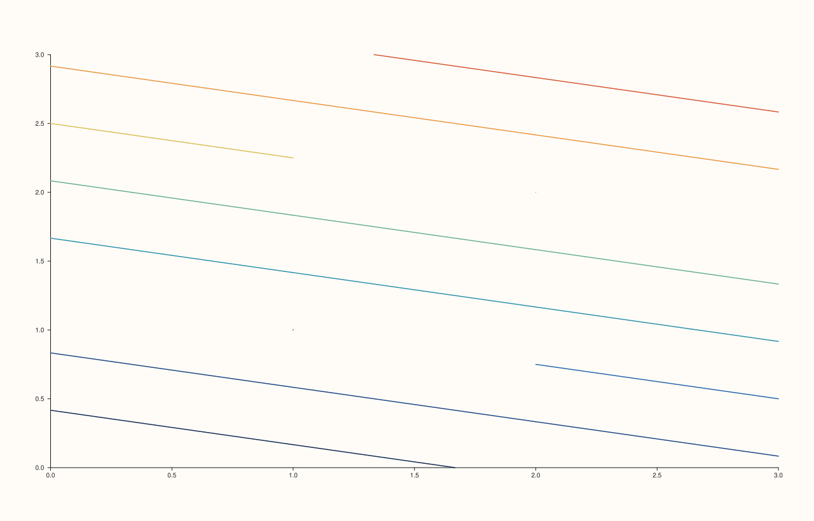
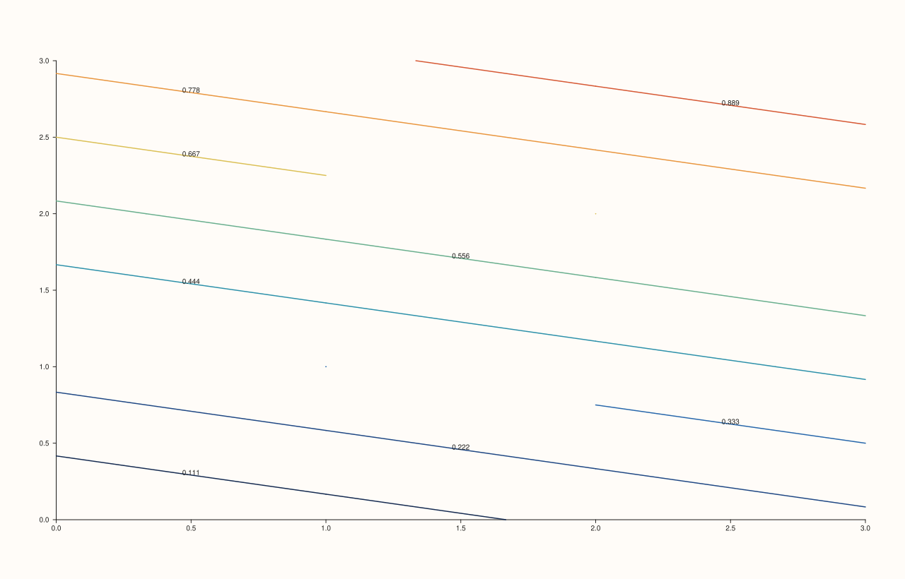

<!-- pluss-hand-authored -->

# Trace::annotate_levels

[Back to Trace API Reference](../../trace_api_reference)

## Signatures

```cpp
bool Trace::annotate_levels() const noexcept

Trace& Trace::annotate_levels(bool enable) noexcept
```

## What It Does

Gets/sets whether contour-family traces ([`contour`](../pane/contour.md),
[`isoband`](../pane/isoband.md), [`ridge3`](../pane/ridge3.md)) draw numeric level labels
alongside their contour lines/bands. Default `false`.

```{important} Fixed: enable is now required, not defaulted
Earlier revisions declared the setter as annotate_levels(bool enable = true),
sharing its name with the separate const getter overload -- exactly the same
shape as the transparent() hazard. On a non-const Trace&, the bare
zero-argument call t.annotate_levels() silently resolved to the SETTER,
directly confirmed by compiled reproduction during this documentation effort.
It has since been fixed at the source: enable no longer has a default, so
t.annotate_levels() (zero arguments) now only matches the const getter and
always safely reads the current value. To set the value, pass the argument
explicitly: t.annotate_levels(true) or t.annotate_levels(false). See
Trace::transparent for the identical fix, and Pane::visible for the same fix
applied to the three affected Pane methods.
```

## Parameters

**enable** (`bool`, required, setter only)
    Whether to draw numeric level annotations.

## Returns

`bool` (getter)
    The current annotate_levels state, `false` by default.

`Trace&` (setter)
    A reference to `*this`, for chaining.

## Examples

Example 1. The default (no level annotations) on a `contour()` trace.

```cpp
using namespace pluss::pl;

// `grid_n` is the single source of truth for the grid's row/col count -- the axis
// length, z's element count, and z's reshape dimensions all derive from it.
constexpr std::int64_t grid_n = 4;
auto coord = pluss::series::linspace(0.0, grid_n - 1.0, grid_n, pluss::ScalarType::Float64);
auto z = pluss::series::linspace(0.0, 1.0, grid_n * grid_n, pluss::ScalarType::Float64).reshape({grid_n, grid_n});

auto fig = studio("trace_annotate_levels_default");
auto& pane = fig.pane2();
pane.contour(coord, coord, z);
fig.show();
```



Example 2. `annotate_levels(true)`. Verified via direct SVG diff to render genuinely
different from Example 1 (numeric level labels now appear).

```cpp
using namespace pluss::pl;

// `grid_n` is the single source of truth for the grid's row/col count -- the axis
// length, z's element count, and z's reshape dimensions all derive from it.
constexpr std::int64_t grid_n = 4;
auto coord = pluss::series::linspace(0.0, grid_n - 1.0, grid_n, pluss::ScalarType::Float64);
auto z = pluss::series::linspace(0.0, 1.0, grid_n * grid_n, pluss::ScalarType::Float64).reshape({grid_n, grid_n});

auto fig = studio("trace_annotate_levels_enabled");
auto& pane = fig.pane2();
pane.contour(coord, coord, z).annotate_levels(true);
fig.show();
```



Example 3 (edge case). Since `enable` is now required, a bare `t.annotate_levels()` call
compiles as a *read* — it can no longer accidentally mutate state.

```cpp
using namespace pluss::pl;

constexpr std::int64_t point_count = 4;
auto x = pluss::series::linspace(0.0, point_count - 1.0, point_count, pluss::ScalarType::Float64);
auto y = pluss::series::linspace(1.0, 3.0, point_count, pluss::ScalarType::Float64);

auto fig = studio("trace_annotate_levels_safe_bare_call");
auto& pane = fig.pane2();
Trace& t = pane.trend(x, y);
std::cout << "default annotate_levels(): " << t.annotate_levels() << "\n";
t.annotate_levels(true);
std::cout << "after t.annotate_levels(true): " << t.annotate_levels() << "\n";
```

Output:

```text
default annotate_levels(): 0
after t.annotate_levels(true): 1
```

## Notes

- Both getter and setter are `noexcept`.
- `enable`'s default argument was removed specifically to eliminate the getter/setter
  overload-resolution hazard — see the important callout above.
- Meaningfully affects only contour-family trace kinds
  ([`contour`](../pane/contour.md), [`isoband`](../pane/isoband.md),
  [`ridge3`](../pane/ridge3.md)); setting it on other trace kinds is expected to have no
  visible effect, though this wasn't exhaustively checked across every kind.

## See Also

- [`Trace::transparent`](transparent.md): the other `Trace` method that received the
  identical fix.
- [`Pane::visible`](../pane/visible.md), [`Pane::axes_visible`](../pane/axes_visible.md),
  [`Pane::parallel_xy_labels`](../pane/parallel_xy_labels.md): the three `Pane`-level
  methods that received the same fix.

<div class="pluss-inline-prev-next">
  <a class="prev-link" href="transparent.html">
    <span class="label">Previous</span>
    <span class="title">transparent</span>
  </a>
  <a class="next-link" href="visible.html">
    <span class="label">Next</span>
    <span class="title">visible</span>
  </a>
</div>
