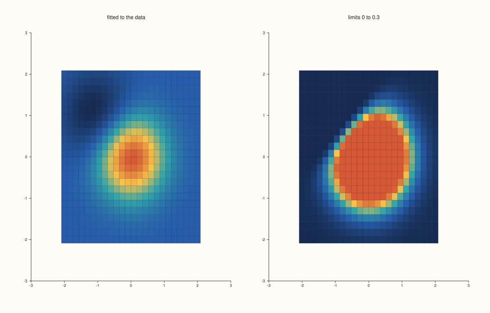
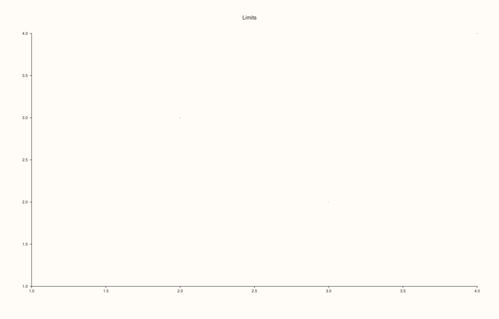
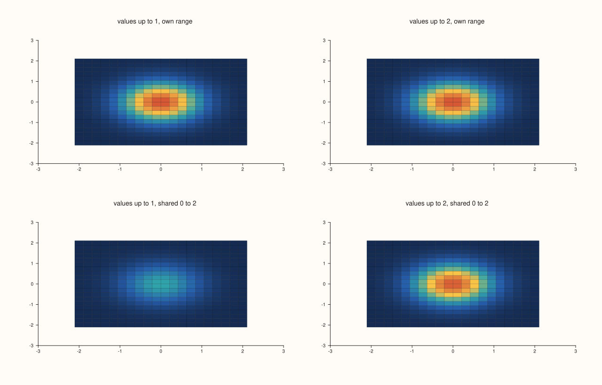
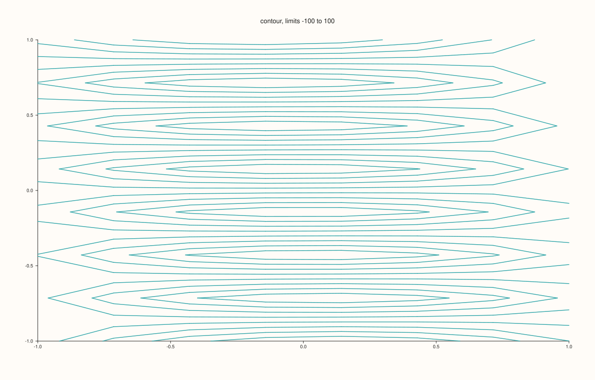

<!-- pluss-hand-authored -->

# Trace::color_limits

[Back to Trace API Reference](../../trace_api_reference)

## Signature

```cpp
const std::optional<Range1d>& Trace::color_limits() const noexcept

Trace& Trace::color_limits(Range1d limits)
```

## What It Does

Fixes the range of values that a trace's [palette](palette.md) spans. Without it the range is fitted to the trace's own colour values, the lowest value taking the first colour of the ramp and the highest the last. With `color_limits(Range1d{low, high})` the ramp spans exactly `low` to `high`: values below `low` take the first colour, values above `high` the last, and the colours of the values between are spread over the whole ramp. The getter returns an `std::optional<Range1d>` that is empty until a range is set.

Fixing the limits is what makes colours comparable: two traces, or two panes, with the same palette and the same limits colour equal values equally even when their data have different ranges. It is also how to use a ramp's full contrast on the interesting part of the data.

The range must be finite and strictly increasing (`low < high`); anything else is refused with `pluss::Error`, and the trace keeps the limits it had. The limits matter for the kinds that colour by value: `fieldmap`, `contour`, `isoband`, `ridge3`, the surface kinds (`sheet`, `lattice`, `spire3`) and a `cloud` with a colour series. For the others the call is stored and has no effect. The pane has its own colour range, [`Pane::color_limits`](../pane/color_limits.md), which a trace's range overrides.

## Parameters

**limits** (`Range1d`)
    The `low` and `high` ends of the colour range. Must be finite with `low < high`.

## Returns

`const std::optional<Range1d>&` (getter)
    The range set with the setter, or an empty optional.

`Trace&` (setter)
    The same trace, for chaining.

## Examples

Example 1. Fixing the range. The same field is coloured by its own range (here about -0.4 to 1) and with the range 0 to 0.3: everything above 0.3 takes the top colour, so the structure at low values is shown in full contrast.

```cpp
constexpr std::int64_t n = 24;
auto coord = pluss::series::linspace(-2.0, 2.0, n, pluss::ScalarType::Float64);
std::vector<double> field(static_cast<std::size_t>(n * n));
for (std::int64_t i = 0; i < n; ++i)
  for (std::int64_t j = 0; j < n; ++j) {
    const double x = -2.0 + 4.0 * i / (n - 1), y = -2.0 + 4.0 * j / (n - 1);
    field[static_cast<std::size_t>(i * n + j)] = std::exp(-(x * x + y * y)) - 0.4 * std::exp(-((x - 1) * (x - 1) + (y + 1) * (y + 1)));
  }
auto z = pluss::make_series(field, {n, n});
auto fig = studio("color_limits_narrow");
fig.mosaic(1, 2);
fig.pane2("fitted to the data").fieldmap(coord, coord, z);
fig.pane2("limits 0 to 0.3").fieldmap(coord, coord, z).color_limits(Range1d{0.0, 0.3});
fig.save_svg("figure.svg");
```



Example 2. Reading the limits. A new trace has none (the optional is empty); after the call the range is stored and returned; a second call replaces it.

```cpp
auto fig = studio("color_limits_readback");
auto& pane = fig.pane2("Limits");
Trace& t = pane.cloud(std::vector<double>{1, 2, 3, 4}, std::vector<double>{1, 3, 2, 4}, std::vector<double>(4, 9.0), std::vector<double>{1, 2, 3, 4});
std::cout << "default has a value: " << t.color_limits().has_value() << "\n";
t.color_limits(Range1d{0.0, 10.0});
std::cout << "after color_limits(0, 10): " << t.color_limits()->low << " to " << t.color_limits()->high << "\n";
t.color_limits(Range1d{1.0, 4.0});
std::cout << "after color_limits(1, 4):  " << t.color_limits()->low << " to " << t.color_limits()->high << "\n";
fig.save_svg("figure.svg");
```

### Output

```text
default has a value: 0
after color_limits(0, 10): 0 to 10
after color_limits(1, 4):  1 to 4
```



Example 3. Invalid ranges are refused and the previous limits are kept. An empty range (`low == high`), a reversed one and one with an infinite end each throw `pluss::Error`.

```cpp
auto fig = studio("color_limits_invalid");
auto& pane = fig.pane2("Limits");
Trace& t = pane.cloud(std::vector<double>{1, 2, 3, 4}, std::vector<double>{1, 3, 2, 4}, std::vector<double>(4, 9.0), std::vector<double>{1, 2, 3, 4});
t.color_limits(Range1d{0.0, 10.0});
for (const Range1d bad : {Range1d{2.0, 2.0}, Range1d{3.0, 1.0}, Range1d{0.0, std::numeric_limits<double>::infinity()}}) {
  try {
    t.color_limits(bad);
  } catch (const pluss::Error& e) {
    std::cout << "[" << bad.low << ", " << bad.high << "]: " << e.message() << "\n";
  }
}
std::cout << "limits are still " << t.color_limits()->low << " to " << t.color_limits()->high << "\n";
fig.save_svg("figure.svg");
```

### Output

```text
[2, 2]: Trace::color_limits: range must be finite and strictly increasing
[3, 1]: Trace::color_limits: range must be finite and strictly increasing
[0, inf]: Trace::color_limits: range must be finite and strictly increasing
limits are still 0 to 10
```


Example 4. Comparable panes. Two fields with different ranges, one twice the other, are coloured with the same limits so that equal values have equal colours; without shared limits the two would look the same although their values differ by a factor of two.

```cpp
constexpr std::int64_t n = 20;
auto coord = pluss::series::linspace(-2.0, 2.0, n, pluss::ScalarType::Float64);
std::vector<double> a(static_cast<std::size_t>(n * n)), b(static_cast<std::size_t>(n * n));
for (std::int64_t i = 0; i < n; ++i)
  for (std::int64_t j = 0; j < n; ++j) {
    const double x = -2.0 + 4.0 * i / (n - 1), y = -2.0 + 4.0 * j / (n - 1);
    a[static_cast<std::size_t>(i * n + j)] = std::exp(-(x * x + y * y));
    b[static_cast<std::size_t>(i * n + j)] = 2.0 * std::exp(-(x * x + y * y));
  }
auto za = pluss::make_series(a, {n, n}), zb = pluss::make_series(b, {n, n});
auto fig = studio("color_limits_shared");
fig.mosaic(2, 2);
fig.pane2("values up to 1, own range").fieldmap(coord, coord, za);
fig.pane2("values up to 2, own range").fieldmap(coord, coord, zb);
fig.pane2("values up to 1, shared 0 to 2").fieldmap(coord, coord, za).color_limits(Range1d{0.0, 2.0});
fig.pane2("values up to 2, shared 0 to 2").fieldmap(coord, coord, zb).color_limits(Range1d{0.0, 2.0});
fig.save_svg("figure.svg");
```



Example 5. Which kinds use the limits. Each is drawn with and without `Range1d{-100, 100}` and the SVG text compared: a field map, a contour and a coloured cloud change; a plain line does not.

```cpp
constexpr std::int64_t n = 8;
auto coord = pluss::series::linspace(-1.0, 1.0, n, pluss::ScalarType::Float64);
std::vector<double> hills(static_cast<std::size_t>(n * n));
for (std::int64_t i = 0; i < n * n; ++i) hills[static_cast<std::size_t>(i)] = std::sin(0.4 * i);
auto z = pluss::make_series(hills, {n, n});
const std::vector<double> x{1, 2, 3, 4, 5}, y{2, 4, 3, 5, 4};
auto changes = [&](auto make) {
  std::string svg[2];
  for (int i = 0; i < 2; ++i) {
    auto fig = studio("color_limits_kinds");
    Trace& t = make(fig.pane2("p"));
    if (i == 1) t.color_limits(Range1d{-100.0, 100.0});
    svg[i] = fig.to_svg();
  }
  return svg[0] != svg[1];
};
std::cout << "fieldmap: " << changes([&](Pane& p) -> Trace& { return p.fieldmap(coord, coord, z); }) << "\n";
std::cout << "contour:  " << changes([&](Pane& p) -> Trace& { return p.contour(coord, coord, z); }) << "\n";
std::cout << "cloud with colour: " << changes([&](Pane& p) -> Trace& { return p.cloud(x, y, std::vector<double>(5, 9.0), std::vector<double>{1, 2, 3, 4, 5}); }) << "\n";
std::cout << "trend:    " << changes([&](Pane& p) -> Trace& { return p.trend(x, y); }) << "\n";
auto fig = studio("color_limits_kinds_out");
fig.pane2("contour, limits -100 to 100").contour(coord, coord, z).color_limits(Range1d{-100.0, 100.0});
fig.save_svg("figure.svg");
```

### Output

```text
fieldmap: 1
contour:  1
cloud with colour: 1
trend:    0
```



## Notes

- `color_limits` throws, so it is not `noexcept`; code that takes the range from data should check `low < high` first (a constant field has `low == high`).
- Values outside the range are not dropped: they are drawn with the end colours of the ramp.
- A trace's range wins over the pane's colour range ([`Pane::color_limits`](../pane/color_limits.md)) and the fitted range.

## See Also

- [`Trace::palette`](palette.md): the ramp the limits are applied to.
- [`Pane::color_limits`](../pane/color_limits.md): a colour range for the whole pane.
- [`Range1d`](../types/Geometry.md): the range type.
- [`LimitMethod`](../types/LimitMethod.md): how a fitted colour range is padded.

<div class="pluss-inline-prev-next">
  <a class="prev-link" href="annotate_levels.html">
    <span class="label">Previous</span>
    <span class="title">annotate_levels</span>
  </a>
  <a class="next-link" href="kind.html">
    <span class="label">Next</span>
    <span class="title">kind</span>
  </a>
</div>
