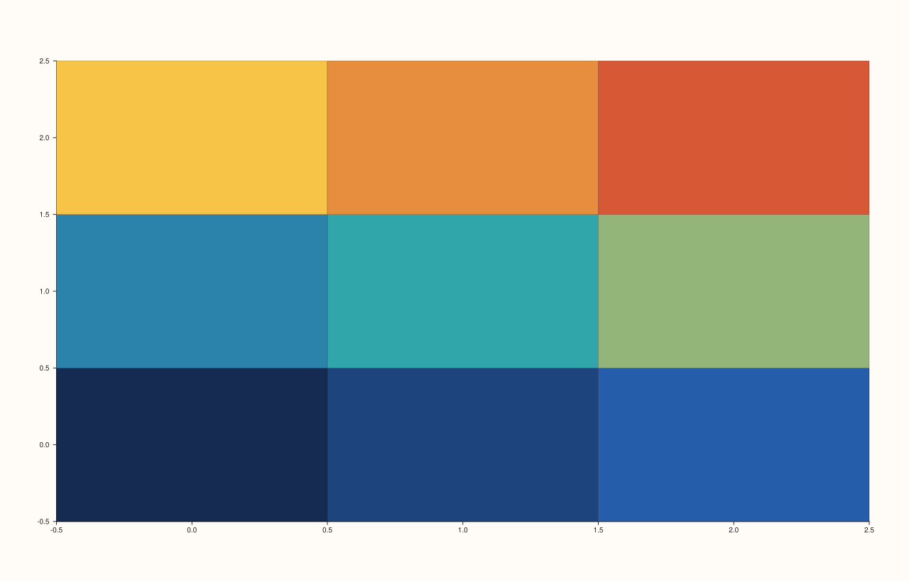
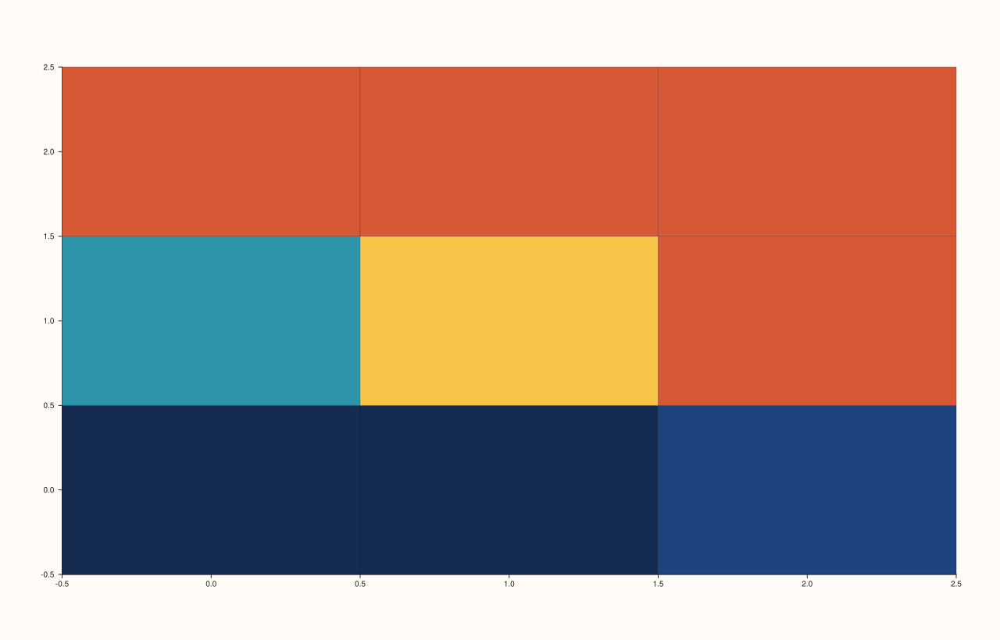

<!-- pluss-hand-authored -->

# Trace::color_limits

[Back to Trace API Reference](../../trace_api_reference)

## Signatures

```cpp
const std::optional<Range1d>& Trace::color_limits() const noexcept

Trace& Trace::color_limits(Range1d limits) noexcept
```

## What It Does

Gets/sets an explicit data range to map across this trace's [`palette()`](palette.md), for
scalar-field-colored trace kinds. Unset (`std::nullopt`) by default, in which case the
range is inferred automatically from the trace's own data. The getter and setter **share
the same name** — but unlike [`Pane::visible`](../pane/visible.md)'s hazardous pair, there
is no overload-resolution danger here: the setter always requires exactly one `Range1d`
argument (no default), so a bare zero-argument call `trace.color_limits()` can only ever
resolve to the `const` getter.

```{important} Invalid input is silently ignored, same as width()
Like width(), color_limits() validates by declining to apply an invalid range and
returning *this unchanged, rather than throwing. A range is only applied if both
bounds are finite and high is strictly greater than low
(std::isfinite(limits.low) && std::isfinite(limits.high) && limits.high >
limits.low). Directly verified: calling color_limits({5.0, 5.0}) (equal
bounds, failing the strict-inequality check) left the trace's color_limits()
at std::nullopt afterward, exactly as if the call had never been made.
```

## Parameters

**limits** (`Range1d`, setter only)
    The explicit `{low, high}` data range to map across the palette. Must satisfy
    `low < high`, both finite, or the call is a silent no-op.

## Returns

`const std::optional<Range1d>&` (getter)
    The current explicit range, or `std::nullopt` if none has been set (the default —
    the range is then inferred from the data at render time).

`Trace&` (setter)
    A reference to `*this`, for chaining — returned even when the call was a silent no-op.

## Examples

Example 1. No explicit `color_limits()` — the palette's range is auto-inferred from the
`fieldmap()` trace's own `z` data.

```cpp
using namespace pluss::pl;

// `grid_n` is the single source of truth for the grid's row/col count -- the axis length,
// z's element count, and z's reshape dimensions all derive from it.
constexpr std::int64_t grid_n = 3;
auto coord = pluss::series::linspace(0.0, grid_n - 1.0, grid_n, pluss::ScalarType::Float64);
auto z = pluss::series::linspace(0.0, 1.0, grid_n * grid_n, pluss::ScalarType::Float64).reshape({grid_n, grid_n});

auto fig = studio("trace_color_limits_auto");
auto& pane = fig.pane2();
pane.fieldmap(coord, coord, z);
fig.show();
```



Example 2. An explicit, narrower range — the same `z` data now maps across only its
middle portion of the palette. Verified via direct SVG diff to render genuinely different
from Example 1.

```cpp
using namespace pluss::pl;

constexpr std::int64_t grid_n = 3;
auto coord = pluss::series::linspace(0.0, grid_n - 1.0, grid_n, pluss::ScalarType::Float64);
auto z = pluss::series::linspace(0.0, 1.0, grid_n * grid_n, pluss::ScalarType::Float64).reshape({grid_n, grid_n});

auto fig = studio("trace_color_limits_explicit");
auto& pane = fig.pane2();
pane.fieldmap(coord, coord, z).color_limits(Range1d{0.2, 0.6});
fig.show();
```



Example 3 (edge case). An invalid range (`low == high`, failing the strict-inequality
check) is silently rejected, leaving `color_limits()` unset.

```cpp
using namespace pluss::pl;

constexpr std::int64_t point_count = 4;
auto x = pluss::series::linspace(0.0, point_count - 1.0, point_count, pluss::ScalarType::Float64);
auto y = pluss::series::linspace(1.0, 3.0, point_count, pluss::ScalarType::Float64);

auto fig = studio("trace_color_limits_invalid");
auto& pane = fig.pane2();
Trace& t = pane.trend(x, y);
std::cout << "default has_value: " << t.color_limits().has_value() << "\n";
t.color_limits(Range1d{5.0, 5.0});
std::cout << "after color_limits({5,5}) [invalid]: has_value=" << t.color_limits().has_value() << "\n";
t.color_limits(Range1d{0.0, 10.0});
std::cout << "after color_limits({0,10}) [valid]: has_value=" << t.color_limits().has_value()
          << " low=" << t.color_limits()->low << " high=" << t.color_limits()->high << "\n";
```

Output:

```text
default has_value: 0
after color_limits({5,5}) [invalid]: has_value=0
after color_limits({0,10}) [valid]: has_value=1 low=0 high=10
```

## Notes

- Both getter and setter are `noexcept`, including the rejected-invalid-input path.
- Unlike [`Pane::color_limits`](../pane/color_limits.md) (which throws
  `std::invalid_argument` for the same kind of bad range), `Trace::color_limits()` never
  throws for any input — it silently no-ops instead. Do not assume the two
  `color_limits()` methods (one on `Pane`, one on `Trace`) share validation behavior just
  because they share a name and a `Range1d` parameter type.
- No danger from the shared getter/setter name — see "What It Does" above.

## See Also

- [`Trace::palette`](palette.md): the gradient this range is mapped across.
- [`Pane::color_limits`](../pane/color_limits.md): the pane-level counterpart, which
  *does* throw on invalid input — a useful contrast when reasoning about which layer a
  given `color_limits()` call in surrounding code is operating on.

<div class="pluss-inline-prev-next">
  <a class="prev-link" href="palette.html">
    <span class="label">Previous</span>
    <span class="title">palette</span>
  </a>
  <a class="next-link" href="shade.html">
    <span class="label">Next</span>
    <span class="title">shade</span>
  </a>
</div>
