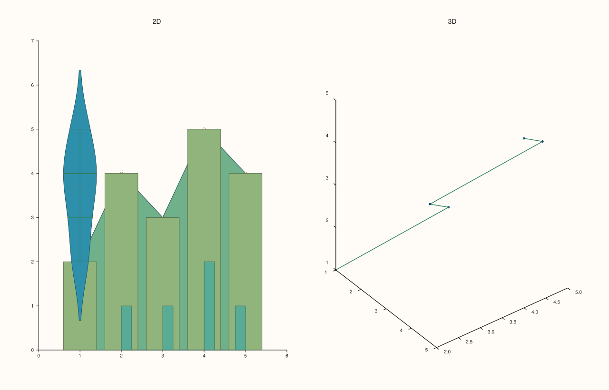
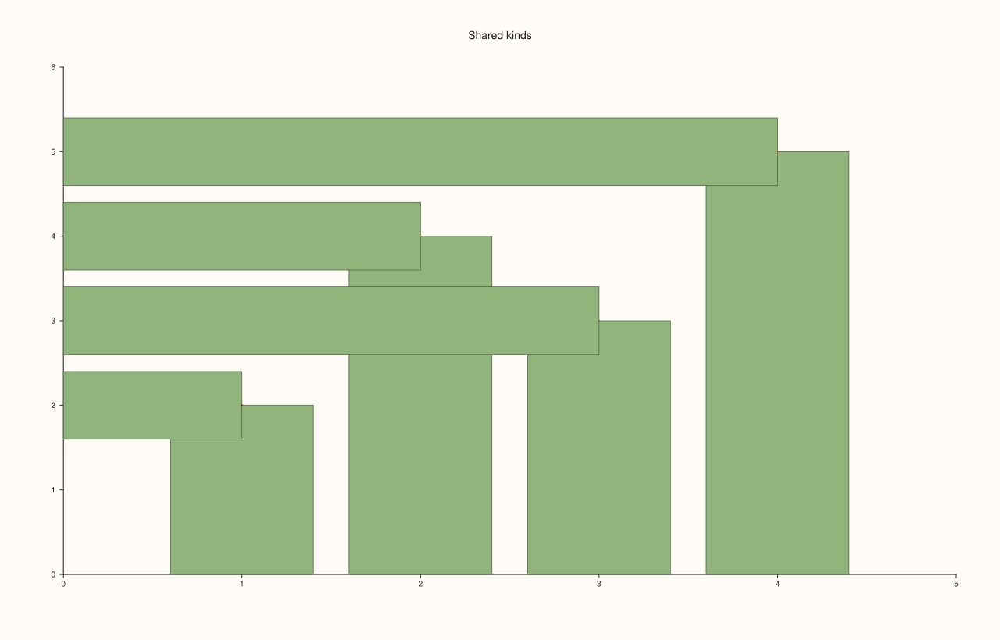
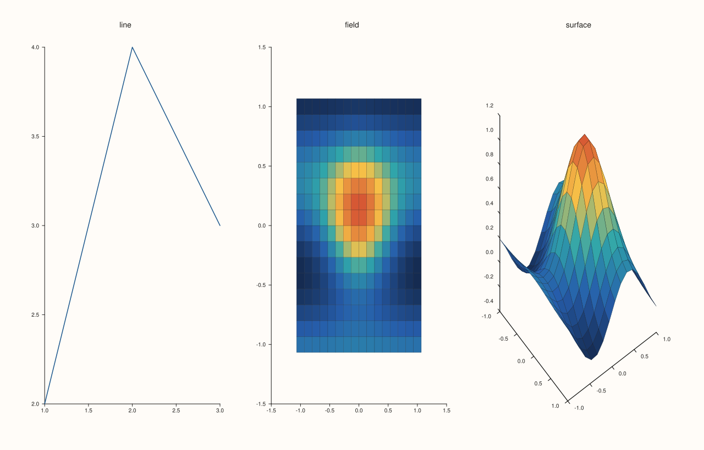
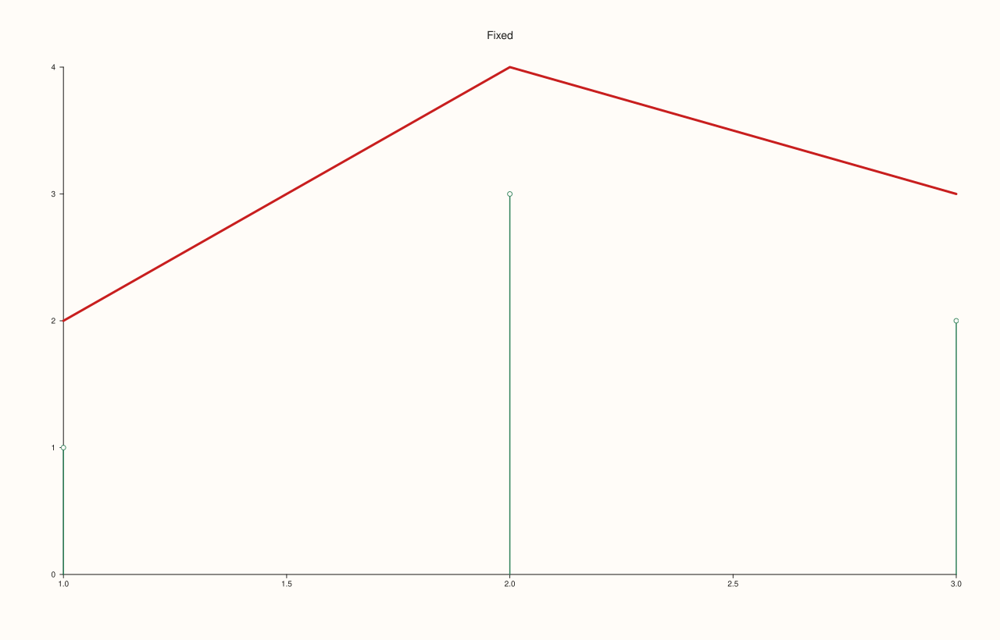

<!-- pluss-hand-authored -->

# Trace::kind

[Back to Trace API Reference](../../trace_api_reference)

## Signature

```cpp
TraceKind Trace::kind() const noexcept
```

## What It Does

Returns what the trace draws, as a [`TraceKind`](../types/TraceKind.md): `Trend`, `Cloud`, `Columns`, `Sheet` and the other twenty values. The kind is fixed when the trace is made, by whichever `Pane` method made it, and never changes afterwards; there is no setter.

Read it to find out what a trace is when the code that holds it did not make it, for example in a function that styles every trace of a pane: it decides which style calls will have a visible effect ([`Trace::width`](width.md) for lines, [`Trace::palette`](palette.md) for fields, [`Trace::shade`](shade.md) for surfaces), and with `payload()` it tells which data structure the trace holds. Two creation methods can make the same kind: `columns` and `columns_h` both make `Columns`, and `cloud` with and without a colour series both make `Cloud`; the data inside tells them apart ([`Trace::payload`](payload.md)).

## Parameters

*(none)*

## Returns

`TraceKind`
    The kind of the trace.

## Examples

Example 1. The kind each creation method makes, read back. Seven 2D methods go on a planar pane and two 3D methods on a volumetric one; the integer is the position of the kind in the enumeration.

```cpp
const std::vector<double> x{1, 2, 3, 4, 5}, y{2, 4, 3, 5, 4};
auto name = [](TraceKind k) {
  const char* names[] = {"Trend", "Cloud", "Cloud3", "Fieldmap", "Ribbon", "Spike", "Wedge", "Whisk", "Band", "Columns", "Bucket", "Quartet",
                         "Violin", "Radial", "Contour", "Isoband", "Ridge3", "IsoShell", "Path3", "Spire3", "Sheet", "Lattice"};
  return std::string(names[static_cast<int>(k)]) + " (" + std::to_string(static_cast<int>(k)) + ")";
};
auto fig = studio("kind_every_method");
fig.mosaic(1, 2);
{
  auto& pane = fig.pane2("2D");
  std::cout << "trend:   " << name(pane.trend(x, y).kind()) << "\n";
  std::cout << "cloud:   " << name(pane.cloud(x, y).kind()) << "\n";
  std::cout << "spike:   " << name(pane.spike(x, y).kind()) << "\n";
  std::cout << "ribbon:  " << name(pane.ribbon(x, y).kind()) << "\n";
  std::cout << "columns: " << name(pane.columns(x, y).kind()) << "\n";
  std::cout << "bucket:  " << name(pane.bucket(y).kind()) << "\n";
  std::cout << "violin:  " << name(pane.violin(y).kind()) << "\n";
}
{
  auto& pane = fig.pane3("3D");
  std::cout << "cloud3:  " << name(pane.cloud3(x, y, x).kind()) << "\n";
  std::cout << "path3:   " << name(pane.path3(x, y, x).kind()) << "\n";
}
fig.save_svg("figure.svg");
```

### Output

```text
trend:   Trend (0)
cloud:   Cloud (1)
spike:   Spike (5)
ribbon:  Ribbon (4)
columns: Columns (9)
bucket:  Bucket (10)
violin:  Violin (12)
cloud3:  Cloud3 (2)
path3:   Path3 (18)
```



Example 2. Different methods, one kind. `columns` and `columns_h` both make `Columns`, and a cloud with a colour series is still a `Cloud`: the kind does not tell them apart.

```cpp
const std::vector<double> x{1, 2, 3, 4}, y{2, 4, 3, 5};
auto fig = studio("kind_shared");
auto& pane = fig.pane2("Shared kinds");
std::cout << "columns:   " << static_cast<int>(pane.columns(x, y).kind()) << "\n";
std::cout << "columns_h: " << static_cast<int>(pane.columns_h(x, y).kind()) << "\n";
std::cout << "cloud:     " << static_cast<int>(pane.cloud(x, y).kind()) << "\n";
std::cout << "cloud + colour: " << static_cast<int>(pane.cloud(x, y, std::vector<double>(4, 9.0), y).kind()) << "\n";
fig.save_svg("figure.svg");
```

### Output

```text
columns:   9
columns_h: 9
cloud:     1
cloud + colour: 1
```



Example 3. Dispatching on the kind. A helper that takes any trace and reports which of the style calls will show: it asks `kind()` and chooses among the line kinds, the value-coloured kinds and the surface kinds. The three traces of different kinds are described from the trace alone.

```cpp
constexpr std::int64_t n = 16;
auto coord = pluss::series::linspace(-1.0, 1.0, n, pluss::ScalarType::Float64);
std::vector<double> peak(static_cast<std::size_t>(n * n));
for (std::int64_t i = 0; i < n; ++i)
  for (std::int64_t j = 0; j < n; ++j) {
    const double x = -1.0 + 2.0 * i / (n - 1), y = -1.0 + 2.0 * j / (n - 1);
    peak[static_cast<std::size_t>(i * n + j)] = std::exp(-3.0 * (x * x + y * y)) + 0.25 * std::sin(4.0 * x);
  }
auto z = pluss::make_series(peak, {n, n});

auto describe = [](const Trace& t) {
  switch (t.kind()) {
    case TraceKind::Trend: case TraceKind::Radial: case TraceKind::Spike: case TraceKind::Whisk: case TraceKind::Path3:
      return std::string("a line: width and stroke apply");
    case TraceKind::Fieldmap: case TraceKind::Contour: case TraceKind::Isoband:
      return std::string("a field: palette and color_limits apply");
    case TraceKind::Sheet: case TraceKind::Spire3: case TraceKind::IsoShell:
      return std::string("a surface: shade, lighting, material and transparent apply");
    default:
      return std::string("another kind: see the table of the TraceKind page");
  }
};
auto fig = studio("kind_dispatch");
fig.mosaic(1, 3);
{
  auto& pane = fig.pane2("line");
  Trace& t = pane.trend(std::vector<double>{1, 2, 3}, std::vector<double>{2, 4, 3});
  std::cout << "trend:    " << describe(t) << "\n";
}
{
  auto& pane = fig.pane2("field");
  Trace& t = pane.fieldmap(coord, coord, z);
  std::cout << "fieldmap: " << describe(t) << "\n";
}
{
  auto& pane = fig.pane3("surface");
  Trace& t = pane.sheet(coord, coord, z);
  std::cout << "sheet:    " << describe(t) << "\n";
}
fig.save_svg("figure.svg");
```

### Output

```text
trend:    a line: width and stroke apply
fieldmap: a field: palette and color_limits apply
sheet:    a surface: shade, lighting, material and transparent apply
```



Example 4. The kind never changes. Styling a trace in every way available leaves its kind as it was, and the traces of a pane can be listed with their kinds through `Pane::traces()`.

```cpp
auto fig = studio("kind_fixed");
auto& pane = fig.pane2("Fixed");
Trace& t = pane.trend(std::vector<double>{1, 2, 3}, std::vector<double>{2, 4, 3});
t.label("styled").stroke(Rgba::from_u8(200, 30, 30)).width(3.0f).palette(PaletteRamp::ocean());
t.hide().show();
std::cout << "kind after styling: " << static_cast<int>(t.kind()) << " (Trend)\n";
pane.spike(std::vector<double>{1, 2, 3}, std::vector<double>{1, 3, 2});
for (const Trace& each : pane.traces()) std::cout << "trace of the pane: kind " << static_cast<int>(each.kind()) << ", label '" << each.label_text() << "'\n";
fig.save_svg("figure.svg");
```

### Output

```text
kind after styling: 0 (Trend)
trace of the pane: kind 0, label 'styled'
trace of the pane: kind 5, label ''
```



## Notes

- `kind()` is `noexcept`.
- `TraceKind::Band` is the kind of an internal shaded band and has no public creation method.
- The reference a creation method returns stays valid for the life of the pane, however many traces are added after it, so it can be kept and used later.

## See Also

- [`TraceKind`](../types/TraceKind.md): all values and the method that makes each.
- [`Trace::payload`](payload.md): the data the kind holds.
- [`Pane`](../../pane_api_reference.md): the creation methods.

<div class="pluss-inline-prev-next">
  <a class="prev-link" href="color_limits.html">
    <span class="label">Previous</span>
    <span class="title">color_limits</span>
  </a>
  <a class="next-link" href="label.html">
    <span class="label">Next</span>
    <span class="title">label</span>
  </a>
</div>
