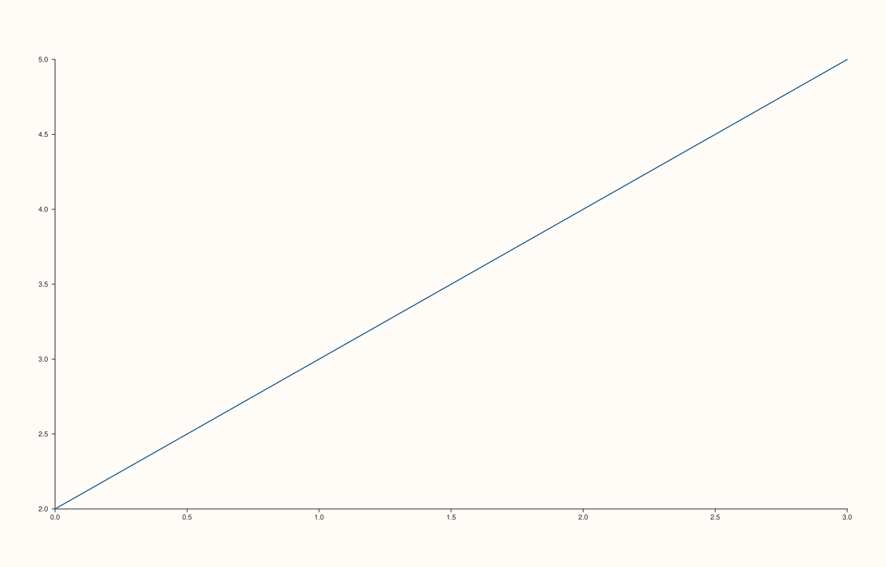
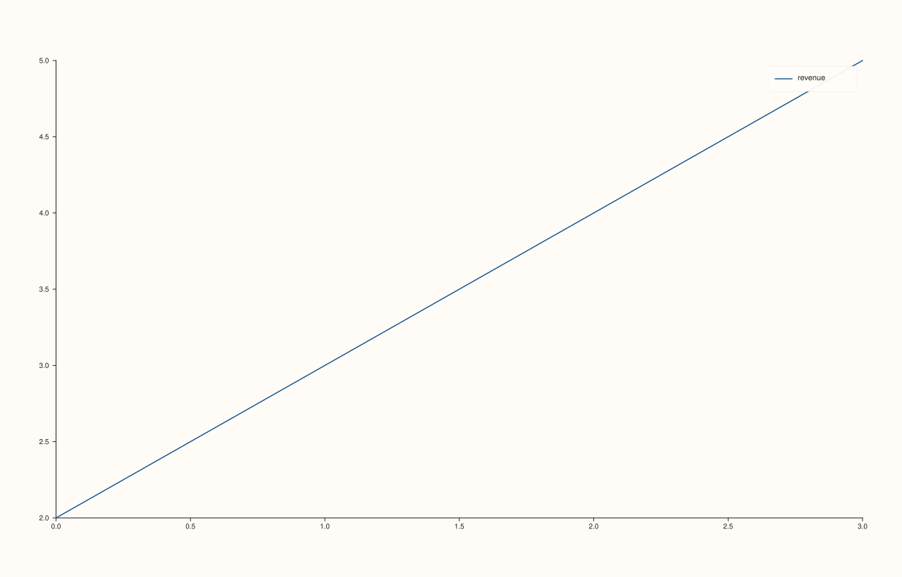

<!-- pluss-hand-authored -->

# Trace::label / Trace::label_text

[Back to Trace API Reference](../../trace_api_reference)

## Signatures

```cpp
const std::string& Trace::label_text() const noexcept

Trace& Trace::label(std::string label)
```

## What It Does

Gets/sets the trace's legend entry text. Unlike several `Pane` name pairs earlier in this
reference, the getter and setter here have genuinely **different names**
(`label_text()` vs. `label()`) — there is no C++ overload-resolution ambiguity possible,
unlike [`Pane::visible`](../pane/visible.md)'s notorious same-name getter/setter hazard.

An empty (default-constructed) label produces no legend entry for that trace even when the
pane's [`legend()`](../pane/legend.md) is enabled at a real `KeyPlace`.

## Parameters

**label** (`std::string`, setter only)
    The legend text for this trace. Pass an empty string to omit this trace from the
    legend.

## Returns

`const std::string&` (getter)
    The current label text, `""` by default.

`Trace&` (setter)
    A reference to `*this`, for chaining.

## Examples

Example 1. The default (empty) label — no legend entry appears even with the legend
enabled.

```cpp
using namespace pluss::pl;

// A formula-generated x/y pair -- `point_count` is the single source of truth for how
// many points the line has, rather than a hand-typed literal vector.
constexpr std::int64_t point_count = 4;
auto x = pluss::series::linspace(0.0, point_count - 1.0, point_count, pluss::ScalarType::Float64);
auto y = pluss::series::linspace(2.0, 5.0, point_count, pluss::ScalarType::Float64);

auto fig = studio("trace_label_default");
auto& pane = fig.pane2();
pane.trend(x, y);
pane.legend(KeyPlace::NorthEast);
fig.show();
```



Example 2. Setting a label — verified via direct SVG diff to render genuinely different
from Example 1 (a legend entry now appears).

```cpp
using namespace pluss::pl;

constexpr std::int64_t point_count = 4;
auto x = pluss::series::linspace(0.0, point_count - 1.0, point_count, pluss::ScalarType::Float64);
auto y = pluss::series::linspace(2.0, 5.0, point_count, pluss::ScalarType::Float64);

auto fig = studio("trace_label_set");
auto& pane = fig.pane2();
pane.trend(x, y).label("revenue");
pane.legend(KeyPlace::NorthEast);
fig.show();
```



## Notes

- The setter is not `noexcept` (constructs/moves a `std::string`, which may allocate); the
  getter **is** `noexcept`.
- No length or content validation — any string, including one containing newlines or
  unusual characters, is accepted as-is.
- Distinct getter/setter names (`label_text()`/`label()`) sidestep the overload-resolution
  hazard documented for several `Pane` methods of this shape — see
  [`Pane::visible`](../pane/visible.md) for the contrasting case where the getter and
  setter *do* share a name.

## See Also

- [`Pane::legend`](../pane/legend.md): must be enabled at a real `KeyPlace` (not
  `KeyPlace::None`) for any trace's `label()` to actually appear.

<div class="pluss-inline-prev-next">
  <a class="prev-link" href="payload.html">
    <span class="label">Previous</span>
    <span class="title">payload</span>
  </a>
  <a class="next-link" href="width.html">
    <span class="label">Next</span>
    <span class="title">width</span>
  </a>
</div>
