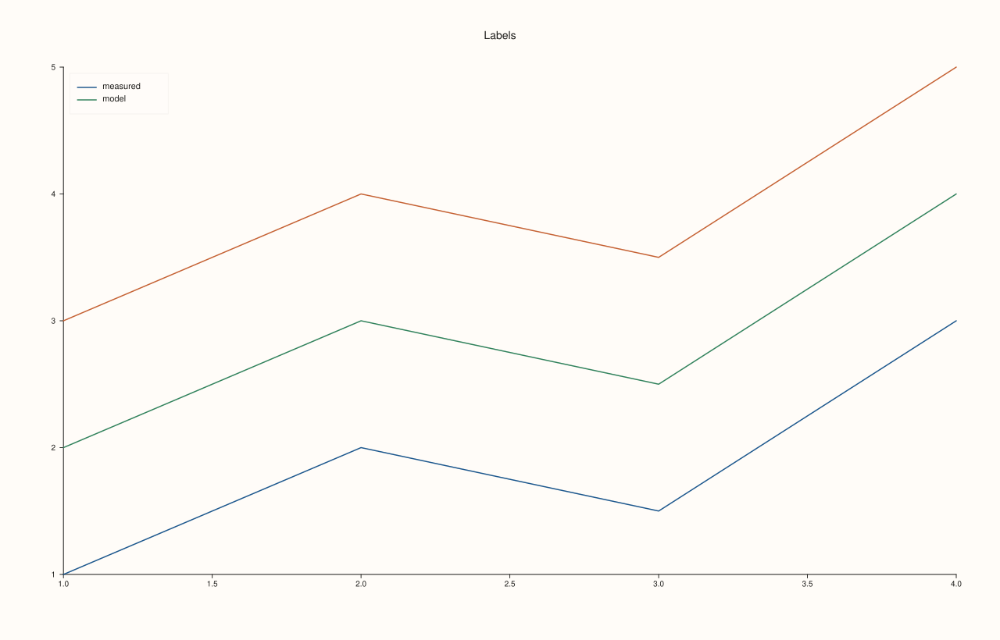
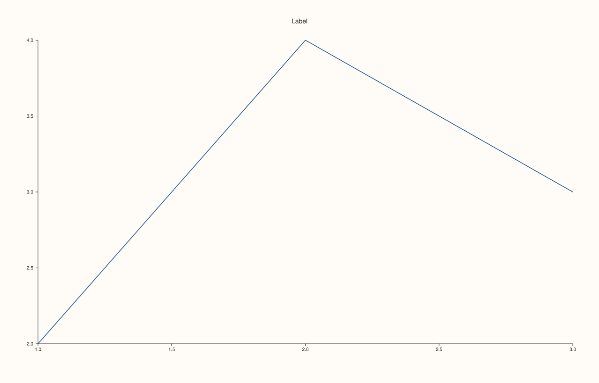
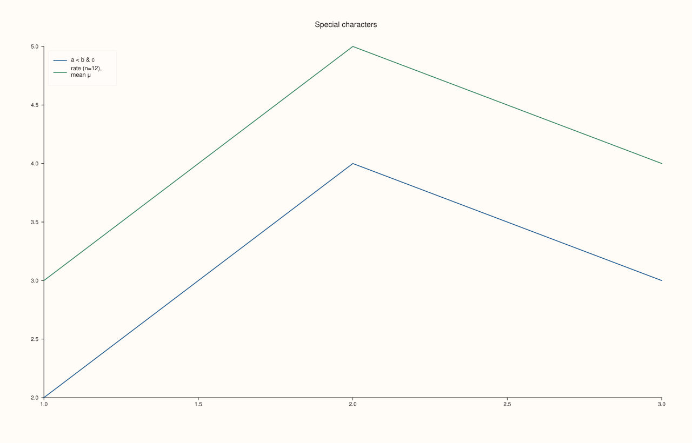
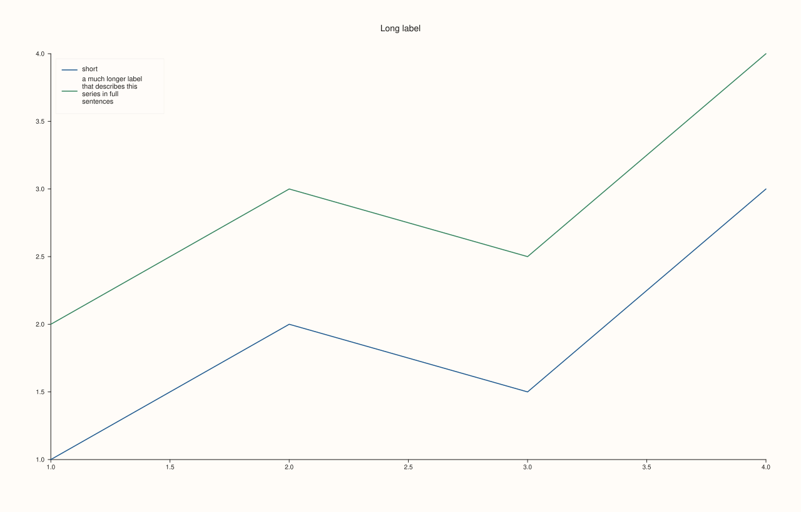
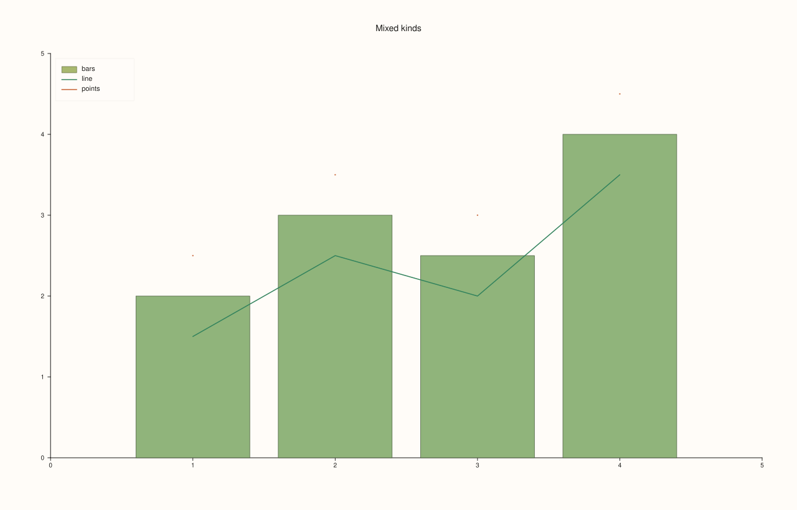
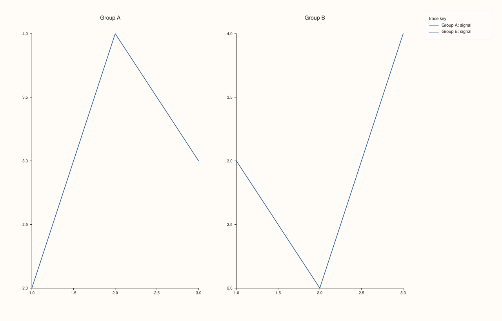

<!-- pluss-hand-authored -->

# Trace::label

[Back to Trace API Reference](../../trace_api_reference)

## Signature

```cpp
const std::string& Trace::label_text() const noexcept

Trace& Trace::label(std::string label)
```

## What It Does

Names a trace in the legend. `label(text)` sets the name and `label_text()` reads it back; the two have different names, so there is no overload ambiguity. A trace with no label, the default, never appears in any legend, whatever the legend's placement ([`KeyPlace`](../types/KeyPlace.md), [`KeyDock`](../types/KeyDock.md)): a legend lists labelled traces only.

The label is plain text. Characters that mean something in SVG, `<`, `>`, `&` and quotes, are escaped when the figure is written, so they appear as typed. A long label wraps inside the legend box (how widely is set by [`KeyShape`](../types/KeyShape.md)) and is cut with an ellipsis after four lines. A label can be changed at any time before the figure is drawn, and an empty string removes the entry again.

The label is the only thing in a trace's styling that does not depend on its kind: every kind can be named, including the 3D ones.

## Parameters

**label** (`std::string`, setter only)
    The legend text. An empty string removes the trace from the legend.

## Returns

`const std::string&` (getter)
    The current label, `""` by default.

`Trace&` (setter)
    The same trace, for chaining.

## Examples

Example 1. The effect of a label. Three lines, two labelled: the legend lists exactly the two, and the unlabelled line is drawn but not named.

```cpp
auto fig = studio("label_legend");
auto& pane = fig.pane2("Labels");
pane.trend(std::vector<double>{1, 2, 3, 4}, std::vector<double>{1, 2, 1.5, 3}).label("measured");
pane.trend(std::vector<double>{1, 2, 3, 4}, std::vector<double>{2, 3, 2.5, 4}).label("model");
pane.trend(std::vector<double>{1, 2, 3, 4}, std::vector<double>{3, 4, 3.5, 5});
pane.legend(KeyPlace::NorthWest);
fig.save_svg("figure.svg");
```



Example 2. Reading and changing a label. The default is empty; `label` returns the trace, so it chains; setting an empty string takes the trace out of the legend again, which the comparison of the SVG text of the figure with a never-labelled trace shows.

```cpp
std::string svg[2];
for (int i = 0; i < 2; ++i) {
  auto fig = studio("label_readback");
  auto& pane = fig.pane2("Label");
  Trace& trace = pane.trend(std::vector<double>{1, 2, 3}, std::vector<double>{2, 4, 3});
  if (i == 0) {
    std::cout << "default: '" << trace.label_text() << "'\n";
    trace.label("temporary");
    std::cout << "after label(): '" << trace.label_text() << "'\n";
    trace.label("");
    std::cout << "after label(\"\"): '" << trace.label_text() << "'\n";
  }
  pane.legend(KeyPlace::NorthEast);
  svg[i] = fig.to_svg();
}
std::cout << "cleared label == never labelled: " << (svg[0] == svg[1]) << "\n";
auto fig = studio("label_readback_out");
fig.pane2("Label").trend(std::vector<double>{1, 2, 3}, std::vector<double>{2, 4, 3}).label("named");
fig.save_svg("figure.svg");
```

### Output

```text
default: ''
after label(): 'temporary'
after label(""): ''
cleared label == never labelled: 1
```



Example 3. What can go in a label. Mathematical symbols and characters that SVG treats specially are escaped, so the label shows what was typed: the printed check confirms that the SVG contains the escaped form `a &lt; b &amp; c` and not the raw one.

```cpp
auto fig = studio("label_text");
auto& pane = fig.pane2("Special characters");
pane.trend(std::vector<double>{1, 2, 3}, std::vector<double>{2, 4, 3}).label("a < b & c");
pane.trend(std::vector<double>{1, 2, 3}, std::vector<double>{3, 5, 4}).label("rate (n=12), mean \xCE\xBC");
pane.legend(KeyPlace::NorthWest);
const std::string svg = fig.to_svg();
std::cout << "escaped form present: " << (svg.find("a &lt; b &amp; c") != std::string::npos) << ", raw form present: " << (svg.find("a < b & c") != std::string::npos) << "\n";
fig.save_svg("figure.svg");
```

### Output

```text
escaped form present: 1, raw form present: 0
```



Example 4. Long labels wrap, and are cut. A label of eleven words wraps onto four lines inside the legend box, which grows taller to hold it, and the text that does not fit in four lines is replaced by an ellipsis (`describe...`); a short label sits on one line. Keep labels short enough to read whole.

```cpp
auto fig = studio("label_long");
auto& pane = fig.pane2("Long label");
pane.trend(std::vector<double>{1, 2, 3, 4}, std::vector<double>{1, 2, 1.5, 3}).label("short");
pane.trend(std::vector<double>{1, 2, 3, 4}, std::vector<double>{2, 3, 2.5, 4}).label("a much longer label that describes this series in full sentences");
pane.legend(KeyPlace::NorthWest);
fig.save_svg("figure.svg");
```



Example 5. Labels on every kind of trace. A column trace, a surface and a cloud are named in the same way; here two traces of different kinds share one pane and both appear in the legend.

```cpp
auto fig = studio("label_other_kinds");
auto& pane = fig.pane2("Mixed kinds");
pane.columns(std::vector<double>{1, 2, 3, 4}, std::vector<double>{2, 3, 2.5, 4}).label("bars");
pane.trend(std::vector<double>{1, 2, 3, 4}, std::vector<double>{1.5, 2.5, 2, 3.5}).label("line");
pane.cloud(std::vector<double>{1, 2, 3, 4}, std::vector<double>{2.5, 3.5, 3, 4.5}).label("points");
pane.legend(KeyPlace::NorthWest);
fig.save_svg("figure.svg");
```



Example 6. Labels in a docked legend. The two panes each have a labelled trace; the docked legend pools them, each entry prefixed with its pane's title, so the same label can be used in both panes and still be told apart.

```cpp
auto fig = studio("label_docked");
fig.mosaic(1, 2);
fig.pane2("Group A").trend(std::vector<double>{1, 2, 3}, std::vector<double>{2, 4, 3}).label("signal");
fig.pane2("Group B").trend(std::vector<double>{1, 2, 3}, std::vector<double>{3, 2, 4}).label("signal");
fig.legend(KeyDock::East);
fig.save_svg("figure.svg");
```



## Notes

- A label changes nothing about how the trace is drawn: its colour, width and everything else are set by the other `Trace` calls.
- The reference a creation method returns stays valid for the life of the pane, so a trace can be labelled at any time, not only in the statement that creates it.

## See Also

- [`Pane::legend`](../pane/legend.md): turns the legend on and places it.
- [`KeyPlace`](../types/KeyPlace.md), [`KeyDock`](../types/KeyDock.md), [`KeyShape`](../types/KeyShape.md): where the legend goes and how it is laid out.
- [`Trace::visible`](visible.md): a hidden trace is not in the legend.

<div class="pluss-inline-prev-next">
  <a class="prev-link" href="kind.html">
    <span class="label">Previous</span>
    <span class="title">kind</span>
  </a>
  <a class="next-link" href="lighting.html">
    <span class="label">Next</span>
    <span class="title">lighting</span>
  </a>
</div>
