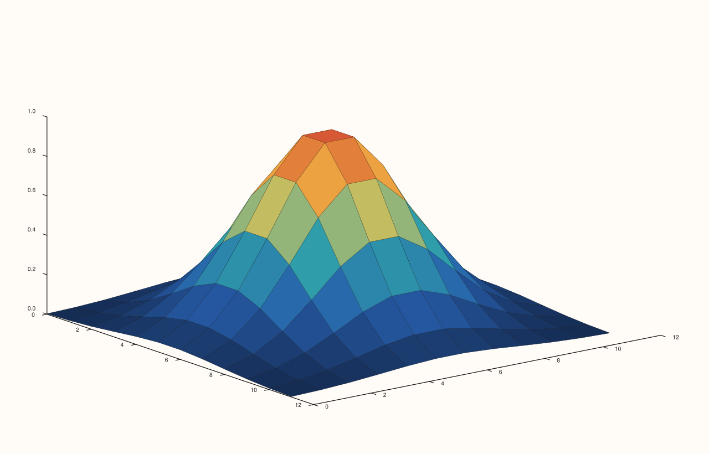
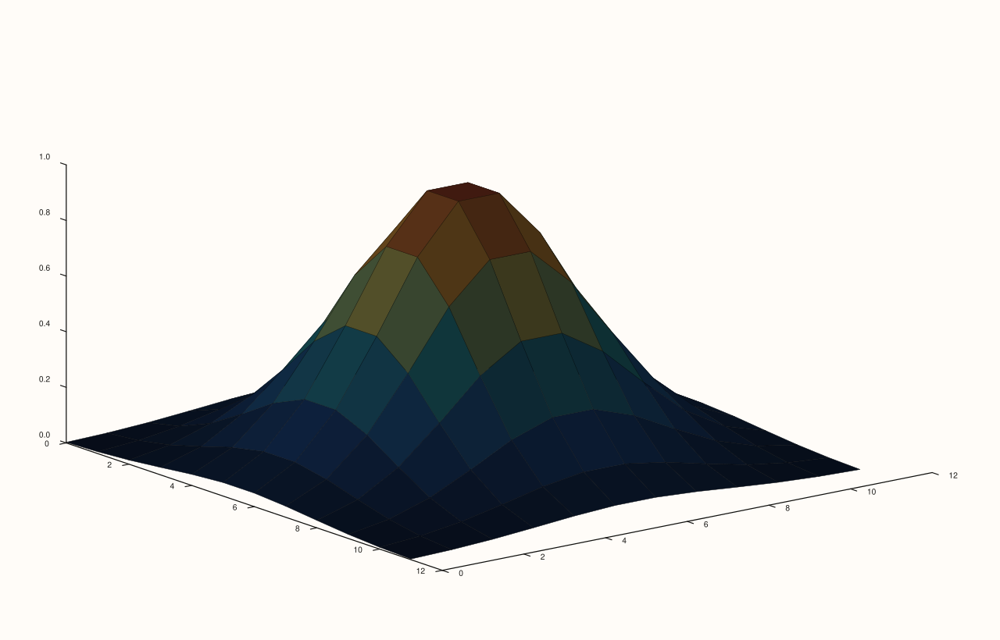

<!-- pluss-hand-authored -->

# Trace::lighting / Trace::lighting_mode

[Back to Trace API Reference](../../trace_api_reference)

## Signatures

```cpp
LightingMode Trace::lighting_mode() const noexcept

Trace& Trace::lighting(LightingMode mode) noexcept
```

## What It Does

Gets/sets a per-trace lighting-response mode: `LightingMode::None` (the constructor
default), `Flat`, or `Gouraud`.

```{important} Requires at least one light configured on the pane
lighting() only has an observed effect when the owning Pane has at least one
light added via Pane::lights() (headlight(), lamp_right(), lamp_left(),
sun_key(), or add()). A fresh Pane's LightRig starts empty (Pane::lights().empty()
is true), and the renderer's shading calculation short-circuits and returns the
trace's base color unchanged whenever there are no lights to shade with --
regardless of lighting_mode(). With no lights configured, None and Gouraud were
directly verified to render byte-for-byte identical output. Add a light first
(see Pane::lights) and the identical toggle produces a genuinely different
render, also directly verified below. This was initially miscategorized as
"no observed effect" earlier in this documentation effort, before the
Pane::lights() gating was traced through the renderer and confirmed by
compiled reproduction -- corrected here.
```

## Parameters

**mode** (`LightingMode`)
    `None`, `Flat`, or `Gouraud`.

## Returns

`LightingMode` (getter)
    The current lighting mode.

`Trace&` (setter)
    A reference to `*this`, for chaining.

## Examples

Example 1. **No lights configured** (the default `LightRig` state) — `LightingMode::None`
on a curved 3D surface.

```cpp
using namespace pluss::pl;

constexpr std::int64_t grid_n = 12;
auto coord = pluss::series::linspace(0.0, grid_n - 1.0, grid_n, pluss::ScalarType::Float64);
// A gently-peaked field (not a flat plane), so facet normals vary enough for lighting
// to have something to compute against, once a light exists to shade with.
std::vector<double> peak(static_cast<std::size_t>(grid_n * grid_n));
for (std::int64_t i = 0; i < grid_n; ++i) {
  for (std::int64_t j = 0; j < grid_n; ++j) {
    const double x = (i - (grid_n - 1) / 2.0) / ((grid_n - 1) / 2.0);
    const double y = (j - (grid_n - 1) / 2.0) / ((grid_n - 1) / 2.0);
    peak[static_cast<std::size_t>(i * grid_n + j)] = std::exp(-(x * x + y * y) * 3.0);
  }
}
auto z = pluss::make_series(peak, {grid_n, grid_n});

auto fig = studio("trace_lighting_no_lights_none");
auto& pane = fig.pane3();
pane.sheet(coord, coord, z).lighting(LightingMode::None);
fig.show();
```


Example 2. The same pane, still **no lights configured**, `LightingMode::Gouraud`.
Verified via direct SVG diff to render **byte-for-byte identically** to Example 1 —
confirming `lighting()` has no observed effect when there's nothing to light the surface
with.

```cpp
using namespace pluss::pl;

constexpr std::int64_t grid_n = 12;
auto coord = pluss::series::linspace(0.0, grid_n - 1.0, grid_n, pluss::ScalarType::Float64);
std::vector<double> peak(static_cast<std::size_t>(grid_n * grid_n));
for (std::int64_t i = 0; i < grid_n; ++i) {
  for (std::int64_t j = 0; j < grid_n; ++j) {
    const double x = (i - (grid_n - 1) / 2.0) / ((grid_n - 1) / 2.0);
    const double y = (j - (grid_n - 1) / 2.0) / ((grid_n - 1) / 2.0);
    peak[static_cast<std::size_t>(i * grid_n + j)] = std::exp(-(x * x + y * y) * 3.0);
  }
}
auto z = pluss::make_series(peak, {grid_n, grid_n});

auto fig = studio("trace_lighting_no_lights_gouraud");
auto& pane = fig.pane3();
pane.sheet(coord, coord, z).lighting(LightingMode::Gouraud);
fig.show();
```



Example 3. **With `pane.lights().headlight()` configured**, `LightingMode::None` — the
baseline for comparison against Example 4.

```cpp
using namespace pluss::pl;

constexpr std::int64_t grid_n = 12;
auto coord = pluss::series::linspace(0.0, grid_n - 1.0, grid_n, pluss::ScalarType::Float64);
std::vector<double> peak(static_cast<std::size_t>(grid_n * grid_n));
for (std::int64_t i = 0; i < grid_n; ++i) {
  for (std::int64_t j = 0; j < grid_n; ++j) {
    const double x = (i - (grid_n - 1) / 2.0) / ((grid_n - 1) / 2.0);
    const double y = (j - (grid_n - 1) / 2.0) / ((grid_n - 1) / 2.0);
    peak[static_cast<std::size_t>(i * grid_n + j)] = std::exp(-(x * x + y * y) * 3.0);
  }
}
auto z = pluss::make_series(peak, {grid_n, grid_n});

auto fig = studio("trace_lighting_with_lights_none");
auto& pane = fig.pane3();
pane.lights().headlight();
pane.sheet(coord, coord, z).lighting(LightingMode::None);
fig.show();
```


Example 4. The identical scene as Example 3, `pane.lights().headlight()` still
configured, now `LightingMode::Gouraud`. Verified via direct SVG diff to render
**genuinely different** output from Example 3 — confirming `lighting()` does have a real,
correctly-wired effect once a light exists.

```cpp
using namespace pluss::pl;

constexpr std::int64_t grid_n = 12;
auto coord = pluss::series::linspace(0.0, grid_n - 1.0, grid_n, pluss::ScalarType::Float64);
std::vector<double> peak(static_cast<std::size_t>(grid_n * grid_n));
for (std::int64_t i = 0; i < grid_n; ++i) {
  for (std::int64_t j = 0; j < grid_n; ++j) {
    const double x = (i - (grid_n - 1) / 2.0) / ((grid_n - 1) / 2.0);
    const double y = (j - (grid_n - 1) / 2.0) / ((grid_n - 1) / 2.0);
    peak[static_cast<std::size_t>(i * grid_n + j)] = std::exp(-(x * x + y * y) * 3.0);
  }
}
auto z = pluss::make_series(peak, {grid_n, grid_n});

auto fig = studio("trace_lighting_with_lights_gouraud");
auto& pane = fig.pane3();
pane.lights().headlight();
pane.sheet(coord, coord, z).lighting(LightingMode::Gouraud);
fig.show();
```



## Notes

- Both getter and setter are `noexcept`.
- The gating dependency on [`Pane::lights()`](../pane/lights.md) is the single most
  important fact about this setting — see the important callout above.
- `LightingMode::Flat`'s distinction from `Gouraud` (both with lights configured) was not
  separately isolated in this documentation pass — treat it as a real, declared third
  option rather than assuming its specific visual difference from `Gouraud` without
  checking further.
- Meaningfully affects only 3D surface-family trace kinds
  ([`sheet`](../pane/sheet.md), [`lattice`](../pane/lattice.md), and other
  `Volumetric`-only kinds); expected to have no visible effect on 2D trace kinds.

## See Also

- [`Pane::lights`](../pane/lights.md): must have at least one light added for this setting
  to have any observed effect — read this page first if `lighting()` appears to do
  nothing.
- [`Trace::material`](material.md): the other 3D-surface-appearance control on `Trace`,
  sharing the identical `Pane::lights()` gating dependency.
- [`Trace::shade`](shade.md): a related 3D-surface-appearance control that has an observed
  effect **regardless** of whether any lights are configured, for contrast.

<div class="pluss-inline-prev-next">
  <a class="prev-link" href="shade.html">
    <span class="label">Previous</span>
    <span class="title">shade</span>
  </a>
  <a class="next-link" href="material.html">
    <span class="label">Next</span>
    <span class="title">material</span>
  </a>
</div>
